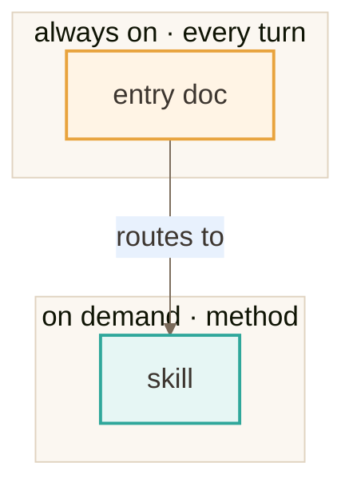

# Output Formatting Rules

**Full reference with examples:** `docs/formatting/readability-guide.md`

## Core rules

- **Structure:** Use clear header hierarchies (`##`, `###`) to separate sections.
- **Scannability:** Bold the first 2–3 words of bullet points to enable quick scanning.
- **Icons:** Use visual emojis (✅, ⚠️, ❌, 💡, 🚀) as section badges or status indicators.
- **Tables:** Structure comparisons, settings, or structured data into Markdown tables.
- **Diagrams:** Whenever explaining workflows, architecture, or sequence flows, include a `mermaid` diagram block.
- **Code Snippets:** Always specify language identifiers on code blocks for syntax highlighting.

## Thinking & structure rules

- **Reason before acting:** Structure analysis as a dependency tree — start with a one-sentence **Core Objective**, then **Analyzed Constraints**, then a **Component Breakdown Tree** of sub-systems → files → required changes. Show this plan before executing.
- **Tree syntax:** Render file systems, multi-step plans, and component hierarchies with ASCII tree characters (`├──`, `└──`, `│`), never flat comma lists; indent sub-elements to show parent-child ownership.
- **Nested plans:** Use indented checklists (`- [ ]`) for multi-phase work, with sub-items under their parent phase.
- **Data flow:** Prefer visual branching trees over prose for logical ownership/flow relationships.

## Diagram style (C4 + light palette)

- **C4 framing:** state the level on line 2 as a `%%` comment — *context* (systems and actors),
  *container* (what loads / executes where), *component* (the parts inside one container) — so the
  reader knows what is deliberately absent. Keep one level per diagram; nest rather than mix.
- **Boundaries are subgraphs:** every layer, container or trust boundary is a labelled `subgraph`
  (`always on · every turn`, `on demand · wiring`); nothing floats loose.
- **Label every edge with intent** — a verb phrase (`routes the task family`), never a bare arrow.
  Weight carries meaning: `==>` strong / hard dependency, `-->` normal, `-.->` weak or
  reference-only. Show a defect as `-.->` with a ✗ in the label.
- **Light palette, never the default grey/black.** One `classDef` per boundary role, attached with
  `:::` — reuse this scale: `#FFF4E5`/`#E8A33D` always-on · `#E6F6F4`/`#2FA79B` method ·
  `#E8F1FD`/`#3B82C4` wiring · `#F0EBFB`/`#7C5CD1` reference · `#E9F7EC`/`#3FA65A` runtime ·
  `#FDEAEC`/`#D9536B` broken. Text `#3D3630` throughout — a *warm* charcoal; never neutral grey.
- **Pin the theme on line 1 of every diagram *and* give every node an explicit `classDef` + `:::` —
  the theme line alone is not enough.** A node with **no `:::class`** is drawn with the viewer's own
  dark fill while the dark text colour still applies: **black text on a black box, invisible**, and the
  diagram reads as a row of empty rectangles (observed in the IntelliJ Cline plugin). `theme:'base'`
  sets the palette and `fontSize` the default text size; only a `classDef` carrying an explicit `fill`
  *and* `color` reliably survives the renderer. Copy this line verbatim as the first line inside the
  fence (before any `%%` comment):
  ```text
  %%{init: {'theme':'base','themeVariables':{'fontSize':'18px','primaryColor':'#FFF4E5','primaryTextColor':'#3D3630','primaryBorderColor':'#E8A33D','lineColor':'#7A6A5A','secondaryColor':'#E8F1FD','tertiaryColor':'#F0EBFB','clusterBkg':'#FBF7F1','clusterBorder':'#E0D3C0','background':'#FFFFFF'}}}%%
  ```
  **Enforced:** `python3 scripts/check-mermaid.py`, run as step **5/10** of `bash scripts/check.sh`
  (and of `--quick`, so the pre-commit hook gets it), fails on a node with no `:::class`, a block
  whose first line is not the `%%{init` pin, or a `flowchart` with no `classDef` at all. It checks
  each node **individually**, so a partly styled line (`A["x"]:::ok --> B["y"]`) still fails — that
  was a false negative of the first version, found by negative-testing the checker itself.
  **Two more facts, verified 2026-11:** the diagram's canvas is **the chat's own background** — the
  SVG is transparent and the `background` themeVariable does not paint it — so a node's *fill* is the
  only thing that makes a diagram visible at all; and `sequenceDiagram` / `classDiagram` accept **no**
  `classDef`, so their boxes are entirely at the renderer's mercy (the checker warns about them;
  prefer `flowchart` where legibility matters).

- **Prefer a narrow diagram, and stack rather than fan out.** In the Mermaid *reference* renderer the
  diagram is drawn at its *natural* size and shrunk to the column when wider, text and all, with no
  floor and no scrollbar: a five-band fan-out measured **1956px** and landed at **4px** (unreadable),
  while the same content stacked in one column measured **402–409px** at the full 18px. The chat
  column is ~400–430px. ⚠️ **That shrink-to-fit is measured in headless Chromium, NOT in the
  IntelliJ plugin** — a **1239px** `LR` diagram (`docker/fuseki/README.md`) was confirmed legible in
  the plugin (2026-11), so ≤420px is a *cheap conservative default, not a plugin limit*. The cost of
  a wide diagram is paid in *legibility*, and it is invisible in the source. So:
  - **one column, top to bottom** — layers as stacked bands (`L0` → `L3`), each holding one or two
    nodes; do **not** put a node in every band and fan five bands side by side;
  - **the width driver is text, not boxes** — a long node label *or a long edge label* widens the
    whole graph, because every other node must clear it. Keep labels short (`pass 1 · driver, SQL`,
    not a sentence) and wrap with `<br/>`; **an edge label on a long skip-edge (`SK -.-> R2`) is
    the most expensive thing you can add** — it pushed a 402px graph to 496px. Prefer an unlabelled
    skip edge and let the chain edge carry the meaning;
  - **budget the bands, not the nodes** — moving four reference nodes into one `REF` node, and
    describing the runtime in the prose under the diagram, is what got the pipeline map from 1956px
    to 409px. Fold lists into a single node and let the prose carry the detail;
  - **a diagram *shown as source* is exempt** — a block nested inside a 4-backtick `markdown` fence
    renders as monospaced text, not as a diagram, so its width does not matter (the three worked
    examples in `docs/formatting/readability-guide.md` are written that way). Every diagram that *is*
    rendered is in scope, including one you ship as an example;
  - **measure rather than guess** — `scale = svg.getBoundingClientRect().width / svg.viewBox.baseVal.width`,
    and `scale × 18px` is the effective font size of the smallest label. The full recipe and the
    measurement table are in `docs/formatting/readability-guide.md`.

