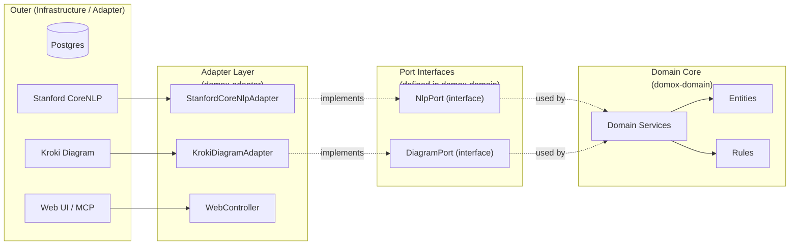
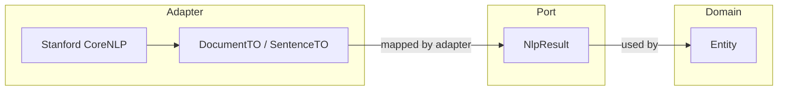

# Hexagonal Architecture (Ports & Adapters) — Best Practices

## Core Principles



### 1. Dependency Rule — THE cardinal rule

> **Dependencies point INWARD.** The domain never knows about the adapter.

```
✅ Correct:  adapter → port (interface) ← domain
❌ Wrong:   domain → adapter (inverts the architecture)
```

| Direction | Allowed? | Reason |
|---|---|---|
| `domox-adapter` → `domox-domain` | ✅ Yes | Adapter imports & implements domain-defined interfaces |
| `domox-domain` → `domox-adapter` | ❌ **No** | Domain must NOT depend on infrastructure |
| `domox-webapp` → `domox-domain` | ✅ Yes | Web layer orchestrates domain services |
| `domox-webapp` → `domox-adapter` | ✅ Yes | Web wires adapters into domain ports |

### 2. What Goes Where

| Layer | Module | Contents | Depends on |
|---|---|---|---|
| **Domain** | `domox-domain` | Entities, Value Objects, Domain Services, **Port interfaces**, Repository interfaces, Business Rules | Nothing (or only SDK/framework APIs) |
| **Adapter** | `domox-adapter` | Port implementations (NLP, Diagram, Persistence, HTTP clients), DTOs for external APIs | `domox-domain` |
| **Web/App** | `domox-webapp` | Spring Boot config, MVC controllers, MCP tools, security | `domox-domain`, `domox-adapter` |

### 3. Port Interface Naming

Define **port interfaces inside `domox-domain`** — these are what the domain needs from the outside world:

```
domox-domain/src/main/java/domox/port/
├── NlpPort.java              # parse text → domain-usable NLP results
├── DiagramPort.java          # render DOT/PlantUML → PDF/SVG
└── NlpResult.java            # domain-safe transfer object (not from adapter!)
```

**Convention:**
- **Port interfaces** — `*Port` suffix (or `*Service` if already established). Declared in the domain.
- **Adapter classes** — `*Adapter` suffix (or `*Impl`). Live in `domox-adapter`, implement the port.

### 4. Adapter Naming & Package Layout

```
domox-adapter/src/main/java/domox/adapter/
├── nlp/
│   ├── StanfordCoreNlpAdapter.java   # implements NlpPort
│   └── DocumentTO.java               # external DTO (stays in adapter)
├── diagram/
│   └── KrokiDiagramAdapter.java      # implements DiagramPort
└── ruleengine/
    └── RuleBookConfig.java           # Spring config
```

**Rules:**
- **Adapter classes** use `domox.adapter.*` package — NOT bare `domox.*` (avoids namespace collision with domain)
- **DTOs that mirror external API shapes** stay in the adapter — never leak into the domain
- The adapter may define its own **nested interfaces** for internal use, but the **primary port** is always in the domain

### 5. Transfer Objects (TOs / DTOs)



**Best Practice:**
- External DTOs (`DocumentTO`, `SentenceTO`, `TokenTO`) **live in the adapter** — they mirror the external API's JSON shape
- The **port returns domain-safe objects** (or a simple domain type) — never raw external DTOs
- The adapter is responsible for **mapping** between external DTOs and domain-safe port return types

### 6. Dependency Injection Wiring

The webapp module (or a Spring `@Configuration` in the adapter) **wires implementations to ports**:

```java
// domox-webapp or adapter SpringConfig
@Configuration
public class AdapterWiring {
    @Bean
    public NlpPort nlpPort() {
        return new StanfordCoreNlpAdapter(host, port);
    }
}
```

The domain service receives the port via constructor injection and knows **only the interface**:

```java
// In domox-domain — does NOT import any adapter class
@DomainService
public class Corpora {
    private final NlpPort nlpPort;

    @Inject
    public Corpora(..., NlpPort nlpPort) {
        this.nlpPort = nlpPort;
    }
}
```

## DoMoX Conformance Checklist

When reviewing code in this repo, check:

- [ ] `domox-domain` does **not** import any class from `domox.adapter.*`, `domox.nlp.*`, `domox.diagram.*`, `domox.ruleengine.*`, or bare `domox.Constants`
- [ ] Every cross-boundary interface is defined **in the domain** as a port
- [ ] Every adapter class has an `*Adapter` or `*Impl` suffix
- [ ] Adapter classes live under `domox.adapter.*` package — not bare `domox.*`
- [ ] `domox-domain/pom.xml` does **not** declare a dependency on `domox-adapter`
- [ ] External DTOs (NLP results, Kroki responses) stay in `domox-adapter` — not in `domox-domain`
- [ ] The `domox.svc` package does not exist in `domox-domain` (services that wrap infrastructure belong in the adapter)
