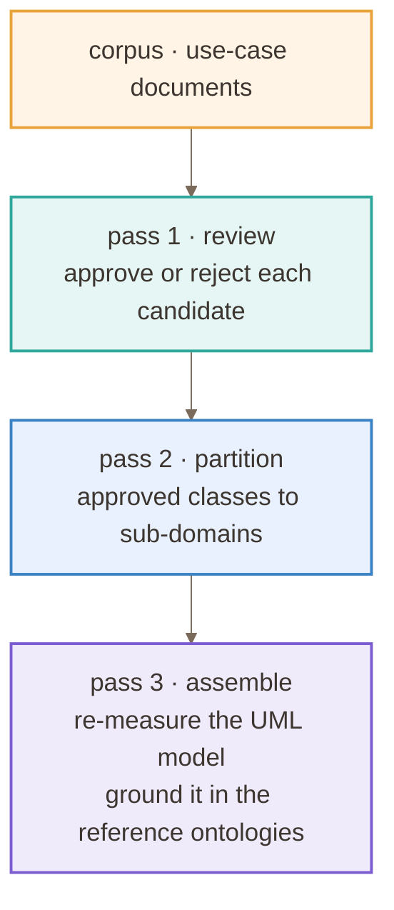
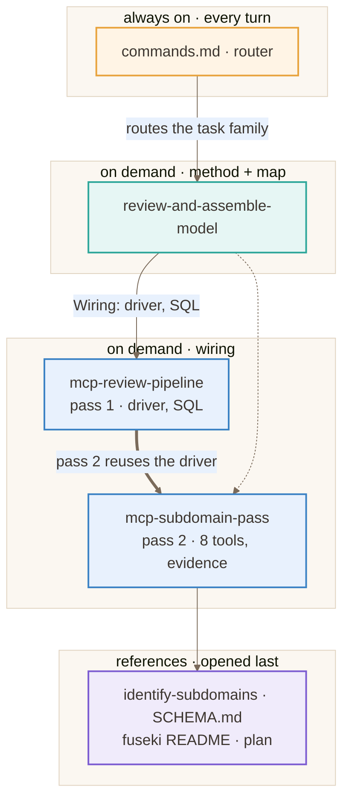

One pipeline turns a use-case corpus into a reviewed domain model. It runs as **three passes**, each
consuming the one before it. A **pass** is the unit of work: one candidate type, one kind of
decision, verified in the database before the next pass starts.

Run the passes in order, and **verify each pass in the database before starting the next**: every
later pass reads the earlier one's *approved* set, so an unverified pass propagates silently.

## The method (applies to every pass)

1. **Read the queue from the tools.** Ask the tooling what is left for this pass; enumerate
   candidates from the database only to *verify*, never to drive — the tools own the queue and the
   approval filters.
2. **Judge on evidence.** The candidate's rule-match chain for review, its use-case profile for
   partitioning, the reference ontologies for grounding. An approval is a claim about the business,
   so it needs a reason that outlives the run.
3. **Send one call at a time.** Sequential MCP calls converge; concurrent writes to one object race
   (see *Pitfalls*).
4. **Verify against the database, not the client output.** The client reports `ok` for calls that
   changed nothing.

Completion criterion: the pass's own verification query returns the expected counts with nothing
skipped — not "the driver printed `ok`".

## Pass 1 — review

Decides *which candidates are real*. Every candidate of the pass's type is approved or rejected; a
rejection carries a rationale from the fixed set `ReviewRationale` — `DUPLICATE`,
`WRONG_CANDIDATE_TYPE`, `NOT_RELEVANT`, `INSUFFICIENT_INFORMATION`, `OTHER`. The
`WRONG_CANDIDATE_TYPE` / `NOT_RELEVANT` boundary is fixed (`MODEL_REVIEW_PLAN.md` §4, §12.3): **wrong
slot → `WRONG_CANDIDATE_TYPE`, not a domain concept → `NOT_RELEVANT`** — apply it identically in
every pass.

| Tool | Role |
|---|---|
| `nextCandidateForReview()` | the next unprocessed candidate |
| `approveCandidate(candidateId, reason)` | approve, with a reason |
| `rejectCandidate(candidateId, rationale, reason)` | reject, with a category **and** a reason |

Every decision is recorded as the agent reviewer and is **idempotent**, so a re-run is safe and a
straggler is fixed by calling the tool for that one id.

**A reason is required on every write.** `rationale` is the *category*; `reason` is the free text
behind it — the evidence relied on, not a restatement of the category. It is stored on the candidate
(`Candidate.rationale`, `varchar(2000)`), so a decision can be read back together with its
justification, and a blank reason is refused rather than defaulted. The same rule holds for the
sub-domain writes — `createSubDomain`, `assignCandidatesToSubDomain` and `clearCandidateSubDomain`
record it on the sub-domain and on every assigned candidate (`mcp-subdomain-pass.md` §3).

The evidence behind a decision is the rule-match chain
`candidate → RuleMatch → TypedDependency → Sentence → Document`. Read it through
`UseCases#provenanceFor` — *which use cases the rules actually fired on* — not
`ContextEvidence#sentencesFor`, which answers where the word appears. Different question.

## Pass 2 — partition

Decides *which business area each real class belongs to*. Only **approved** classes are material:
the tools filter on approval for exactly that reason, so this pass is empty until pass 1 lands.

| Tool | Role |
|---|---|
| `listUseCases()` | the corpus, and how much of the class model each use case evidences |
| `listSubDomains()` | existing sub-domains and their owned-candidate counts |
| `listUnassignedClassCandidates()` | approved classes with no sub-domain — the input |
| `subDomainEvidenceForCandidate(candidateId)` | one candidate's use-case profile |
| `suggestSubDomains()` | a proposed partition; 🧠 advisory, **writes nothing** |
| `createSubDomain(name, classification)` | create, or re-classify an existing one (idempotent) |
| `assignCandidatesToSubDomain(candidateIds, subDomainName, classification)` | one cluster per call |
| `clearCandidateSubDomain(candidateId)` | undo one assignment |

The **sub-domain name is the identity**: the look-up is case-insensitive, nothing constrains
uniqueness, and re-running with a *renamed* sub-domain creates a second one.

Classification is `CORE` / `SUPPORTING` / `GENERIC` / `UNCLASSIFIED`. The corpus records **what** the
business does, never **why it matters**, so core-vs-supporting is not derivable from it: leave
`UNCLASSIFIED` and name the business input that would settle it, rather than let a plausible-sounding
cluster name imply a classification.

The generic method — cohesion cues, the clustering pass, boundary tests, classification signals —
lives in the `identify-subdomains` skill.

## Pass 3 — assemble and ground

Decides *what the model now says*. Assembly is a **re-measurement, not a creation**: the
`DomainModel` already exists (the analysis made it), and passes 1–2 have decided which of its
candidates are real and which area each belongs to. Read the assembled model back:

- `DomainModels#listAll()` finds the model; `DomainModels#showUmlDiagrams(domainModel)` is the page to
  *read* the model on — one tab per sub-domain, labelled with the sub-domain name, plus the overview and
  the whole model (each tab's diagram is assembled when that tab is shown, so the page opens on the
  overview).  Each tab is a `UmlClassDiagram` view model whose `d3Graph` property is the diagram — the
  payload the D3 panel draws in the browser — and the whole model is also readable directly as
  `UmlDiagramSet#wholeModelGraph`.  The single-diagram actions that used to open one of these on its own
  page (`generateUmlDiagram`, `generateSubDomainUmlDiagram`, `generateSubDomainOverviewDiagram`) have been
  removed: the tabs cover reading, and `DomainModels#downloadPlantUml(domainModel, kind, subDomainName)` —
  a `.puml` download — is the text form and **that is what the re-measure counts**. The D3 model diagram
  seeds from the **approved** candidates only, so a model with zero approvals diagrams as empty and
  says so in the log instead of failing.
- Record the numbers (classes, attribute lines, operation lines, edges, cardinalities) against the
  readiness review's table, so the next pass measures a **delta** and not a fresh opinion.

**Grounding** is the second half of the pass: check a candidate name against the reference
vocabularies served by the local Fuseki image, so an approve/reject does not rest on the reviewer's
priors alone.

| Tool | Role |
|---|---|
| `ontologySearch(term)` | what the vocabularies know about a term — source, IRI, label, Class/Property/Individual, super-class, definition, synonyms |
| `ontologyEvidenceForCandidate(candidateId)` | that lookup for one candidate, plus its agreement and duplicates |
| `suggestReview(candidateId)` | a suggested decision derived **only** from ontology evidence and duplicates |

Two rules govern grounding:

- **The vocabularies are generic, so "no match" is not "not a term".** Most nouns of a use-case
  corpus will not appear in Schema.org / BFO / gist / BBO / sBPMN. A miss yields `UNCERTAIN`, never a
  rejection.
- **Grounding is one input, not the decision.** `suggestReview` sees neither the rule-match evidence
  nor the review policy, and `ontologySearch` over the ~15 core classes is a sanity check, not
  evidence of completeness.

The graphs are served as **named graphs**, so the dataset's default graph is empty and every query
must be scoped to the configured graph list. An unscoped query returns nothing and is
indistinguishable from "no match".

## Pitfalls

- **Verify in the database.** A full run printed `ok` for every candidate while one got zero reviews:
  a corrupted rationale threw, and the error did not match the client's fail pattern.
- **One MCP call at a time.** Concurrent calls race: an assignment can look a name up before the
  create that preceded it has committed, and create a duplicate sub-domain.
- **A decisions file must end with a newline.** An append that swallows it merges two records onto
  one line and silently drops a decision.
- **`/mcp` returning 404 is the protocol key.** The transport is chosen by
  `spring.ai.mcp.server.protocol`; a misspelled key is ignored silently and the router is never
  registered.
- **Candidate rows live in the per-type tables** (`classcdd`, `propertycdd`, `actioncdd`,
  `associationcdd`), not the base `candidate` table — `Candidate` uses `TABLE_PER_CLASS`.
- **`suggestSubDomains()` coming back empty is not a failure** — it lists unassigned *approved*
  classes only.

## Wiring — read these, do not restate them

This skill is the method and the map. Truth flows one way, downward through the layers below:

Read the diagram as **one column of layers**, top to bottom: `commands.md` routes the task family
to this skill; the skill drives **pass 1** (`mcp-review-pipeline` — the session driver and the
verification SQL) and **pass 2** (`mcp-subdomain-pass` — the eight sub-domain tools and the evidence
chain). Pass 2 is the *prerequisite* and reuses pass 1's driver **verbatim** (the thick edge);
`commands.md` also routes straight to a runbook when the task signature names one, without this
skill. Both runbooks end at the same references below, and both drive the runtime — the MCP endpoint
at `POST /mcp` and `domox-db`. Each runbook opens with a `pass N of 3` banner, so the reader can
always tell which pass they are in.

- `.clinerules/memory-bank/workflows/mcp-review-pipeline.md` — the MCP session driver, the
  decisions-file pre-flight, the 404 fix, the per-pass verification SQL.
- `.clinerules/memory-bank/workflows/mcp-subdomain-pass.md` — the evidence chain, the eight
  sub-domain tools in full, the sub-domain verification SQL.
- `.clinerules/memory-bank/technical/SCHEMA.md` — a new JPA field (such as `classification`) needs an
  `ALTER TABLE`; EclipseLink `create-tables` never ALTERs.
- `docs/scratch_pad/MODEL_REVIEW_PLAN.md` — the live pass plan: scope, ordering, the per-pass policy
  questions, and the current counts.
- `docker/fuseki/README.md` — the reference-ontology image, its five named graphs and their IRIs.
