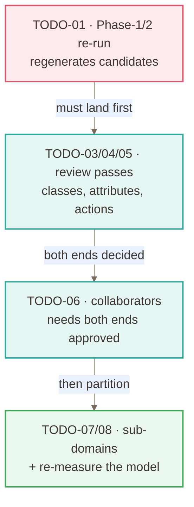
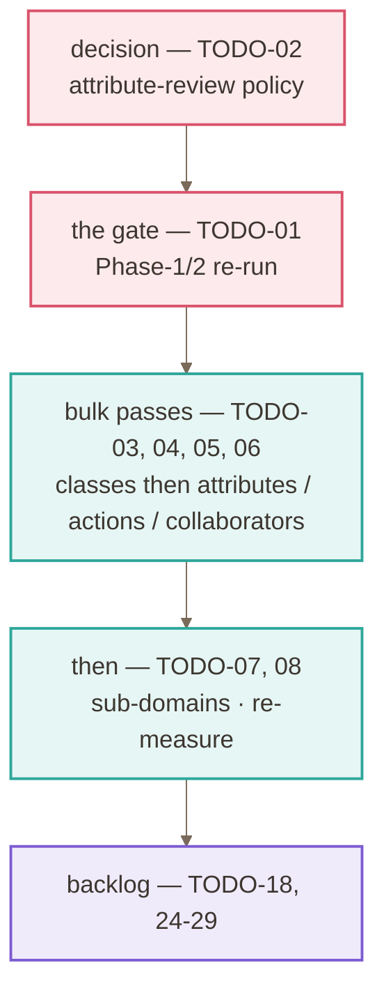

# TODO — open issues collected from the DoMoX docs

**Purpose.** One place where the *open* work scattered across the plan / review / retrospective
documents can be seen, ranked and picked up. It is a **derived index**, not a new source of truth:
every item names the document that owns it, and that document wins if the two disagree.

**Compiled.** 2026-11-19. Re-derive it by reading the sources, not by trusting this file's counts.

**Sources swept.** `docs/scratch_pad/MODEL_REVIEW_PLAN.md`, `MODEL_UML_READINESS_REVIEW.md`,
`UML_GAP_FIX_PLAN.md`, `CRC_VOCABULARY_RENAME_SUMMARY.md`, `D3_DIAGRAM.md`, `UML_LAYOUT_GEOMETRY.md`,
the three `retro-*.md`, `rules/RULES_REGISTRY.md`, `events/EVENTS.md`, `docs/domain-modeling/pattern-repositories.md`,
`docs/association-type-categorization.md`, `ORPHAN_CASCADE_DELETION.md`, `CODING_STANDARDS.md`,
`.clinerules/memory-bank/technical/SCHEMA.md`, `.clinerules/memory-bank/workflows/*.md`,
`.clinerules/skills/review-and-assemble-model.md`, `scripts/check.sh`, `.github/workflows/ci.yml`.

**Already closed — do not re-open.** The eight `FIX-1…FIX-8` waves; the eight candidates of
`retro-uml-gap-fixes-2026-11-18.md`; all nine of `retro-d3-hover-reveal-2026-10-31.md`; the
`schema-projection` staleness guard; the orphan `domox.packagecdd` tables (gone from the live DB and
from `create-tables.sql`); `SeedService.java` (deleted).

**Closed 2026-11-19** — the six XS/Low items of the first sweep, each verified before closing:
TODO-10 (the rationale convention is now stated once in `MODEL_REVIEW_PLAN.md` §4/§12.3, and the
runbook + skill point at it); TODO-16 (the stale `packagecdd` references are gone);
TODO-17 (`persistence.xml` moved to `src/main/resources/META-INF/`); TODO-23 ("five instant steps");
TODO-30 (the retro carries its implemented table); TODO-31 (`scripts/measure-mermaid.sh` committed,
reproducing the guide's widths).

**Closed 2026-11-19 (second sweep)** — the three extraction-rule items, each a *rule-set* change
verified by domain tests and recorded in `UML_GAP_FIX_PLAN.md` §13, which is the owning document:
TODO-13 (`CandidateFactory` de-duplicates only a *pure* class match — an association is no longer
swallowed by its source class, §13.7); TODO-12 (TDR10/TDR11 create a `PropertyCdd` only for an
attribute noun — the same scope-guard shape FIX-5 gave TDR25/TDR26, §13.6); TODO-11 (the verb→return
type mapping — receive verb → the received class, output/notify verb → `String`, else no return type,
§13.2). All three take effect on the next Phase-1/2 run (TODO-01); no migration is needed.

**Closed 2026-11-20 (third sweep)** — the four CI-guardrail items, each proved by a **negative test**
(the failure the rule exists for was reproduced and observed to fail) and recorded in
`retro-boot4-upgrade-2026-10-14.md`, which is the owning document: TODO-19 (`check-mermaid.py` is now a
step of the CI `test` job, so a PR from a clone without the pre-commit hook cannot ship an invisible
diagram); TODO-20 (the root pom's enforcer bans `junit-jupiter-api`/`-engine` `[5.0.0,6.0.0)` —
re-pinning `junit-jupiter.version=5.11.0` now fails the *build* instead of the test run);
TODO-21 (`check.sh` step 6/10 runs the enforcer **by execution id**, `@enforce-constraints`, because a
bare `mvn enforcer:enforce` ignores the execution's configuration and would check nothing);
TODO-22 (`ConfigPlaceholderSmokeTest` resolves every no-default `causeway.*` placeholder it scrapes
from the classpath against `application.yml`). The last three are Maven/test work, so `check.sh` now
has **ten** steps.

**Closed 2026-11-20 (fourth sweep)** — TODO-14 (operation owner correctness), the last open
extraction-rule item, recorded in `UML_GAP_FIX_PLAN.md` §13.8. It was the one item explicitly
**gated** on a review pass, so the gate was re-expressed as a measurement: the owner-correctness tally
is computable from data the model already holds, and it came out **systematic** — of the 191
`ActionCdd` candidates, 149 have an owner and *all 149 are owned by their object noun*, none by their
actor (every one from `TDR3`, which fires on the object dependency). So the owner is now the sentence's
`nsubj` actor, with the object kept only as the fallback owner when the sentence names no usable actor
(62 operations — 19 name an unusable actor such as `System`, 43 name none) and as the receive-verb
return type. 87 owners corrected, 21 owner-less operations gain an owner, 0 lost. Pass 3 (TODO-05) now
only *confirms* it — it still records the owner-correctness column (`MODEL_REVIEW_PLAN.md` §6). A
rule-set change, so it takes effect on the next Phase-1/2 run (TODO-01); no migration.

**Closed 2026-11-20 (fifth sweep)** — TODO-09 (optional ontology grounding), the last open item owned by
`MODEL_UML_READINESS_REVIEW.md`, recorded there as §3.6.1. It was run as written: `ontologySearch`,
`ontologyEvidenceForCandidate` and `suggestReview` (`OntologyReviewMcpTools`) over the ~15 core commerce
classes §3.6 names as genuine matches, against the live Fuseki graphs. All 15 agree (`typeAgreement =
AGREES`, `suggestReview` → `APPROVE`), so the grounding *confirms* the approved core set rather than
changing it — but the run's real deliverable is the **false homonyms** it documents: `Claim` is the
corpus's *insurance* claim, not schema.org's fact-checking assertion, and `Class` is a *training* class,
not `rdfs:Class`. It also exposed the trap in the tool itself: `suggestReview` advises
`REJECT`/`WRONG_CANDIDATE_TYPE` on four **approved** classes whose names collide with a schema.org
PROPERTY/INDIVIDUAL (`Pet` → `schema.org/PET`, a medical-imaging individual; `Owner`, `Customer`,
`Provider` → schema.org properties) and `REJECT`/`DUPLICATE` on the class `Review` because an approved
*action* `review` shares its name. No decision follows from it — the advisor is advisory, and a name
collision is not evidence.

**Closed 2026-11-20 (sixth sweep)** — TODO-15 (deferred persisted-name migration), the last item owned
by `.clinerules/memory-bank/technical/SCHEMA.md`. It was the *persistence* half of the 2026-10 CRC
rename: the Java classes had been renamed while `@Table`, `@Entity(name=…)`, `@Named` and the
`candidateType` literals were pinned to the historical values, so class name and object type differed
and every reader had to re-derive it. The migration is applied — eight tables (four per-type + their
four `_rulematch` join tables) renamed, the derived columns (`responsibilitycdd_id` etc.) and every
constraint/index name moved with them, and the persisted `candidatetype` values rewritten
(`rulematch` 507 + 105 rows, the per-type rows 191 + 109 + 237) — by the committed one-shot script
`scripts/migrate-crc-persisted-names.sql`, after a `db-backup.sh` backup. Counts are unchanged
(971 classes / 302 reviews / 2 476 rule matches), `scripts/check-schema-drift.sh` is clean, and the
regenerated `create-tables.sql` carries only the new names, so a fresh DB and the migrated dev DB
agree. Recorded in `SCHEMA.md` ("Persisted-name migration") and `CRC_VOCABULARY_RENAME_SUMMARY.md`.

**Closed 2026-11-20 (seventh sweep)** — TODO-18 (the flat `domox.dom.rules` package), the last item owned
by `CRC_VOCABULARY_RENAME_SUMMARY.md`. The 61-file package was split exactly as that document's item 5
prescribed: the 41 rules plus `TypedDependencyRule` into `domox.dom.rules.tdr`, the five config-backed
vocabularies into `domox.dom.rules.catalog`, and the linguistic knowledge + its derivations
(`NounType`, `NounTypeLexicon`, `UseCaseBlockedNouns`, `AssociationLabel`, `MultiplicityEvidence`,
`MultiplicityNotation`, `ResponsibilityOwnerExtraction`, `ResponsibilityParameterExtraction`) into
`domox.dom.rules.lexicon`. What remains in `domox.dom.rules` is the engine itself — `RuleMatch`,
`RuleMatches`, `RuleMatchRepository`, `RuleMatchSignature`, `CandidateFactory`, `CandidateResolver`,
`NlpProperties` — **7 files**. No configuration change was needed: `RuleBookRunner` matches every
sub-package with `startsWith(pkg)` and `@ComponentScan` / `@EntityScan` / `@EnableJpaRepositories` are all
rooted at `domox`, which the 46 `TypedDependencyRulesTest` cases (Spring context + `RuleBook`) confirm by
still firing all 41 rules. The only visibility change is `UseCaseBlockedNouns` (and its two predicates),
package-private while it sat beside its callers, now `public`. Tests mirror the new packages, and the
misfiled `DependencyVocabularyPredicatesTest` (it tests a `domox.dom.nlp` class) moved to its class's
package. Verified: `mvn -o -pl domox-domain test` → **1 057 tests, 0 failures**; `scripts/check.sh` →
**10/10**.

---

## 1. Scales

| Priority | Meaning |
|---|---|
| **P0** | Do now — it blocks everything downstream |
| **P1** | This iteration — small, self-contained, high leverage |
| **P2** | Next — needs a decision, a measurement or a re-run first |
| **P3** | Backlog — hygiene or a proposal; do it when touching the same area |

| Effort | Rough size |
|---|---|
| **XS** | a line or two; under 15 min |
| **S** | one file, one focused change; under an hour |
| **M** | several files / a new collaborator + tests; half a day |
| **L** | a rule-set change or a bulk pass; a day or more |
| **XL** | a new subsystem; multi-session |

**Risk** is the cost of doing it *wrong or not at all* (the failure it lets through), not the
difficulty of the change. **Contribution** is what the item unlocks once it lands.

## 2. Critical path

Read it as one column: the **re-run gates the review passes**, and the **collaborator pass gates the
sub-domain pass and the re-measurement**. The three independent rule gaps (TODO-11/12/13) landed
2026-11-19, so they no longer branch off this path — the re-run above simply carries them. The four
CI-guardrail items (TODO-19…22) landed 2026-11-20 and were never on this path either, and neither was
TODO-14 (operation-owner correctness, landed 2026-11-20): it waited on Pass 3's owner tally, which
turned out to be derivable from the candidates themselves, so the decision was made ahead of the pass.
TODO-09 (ontology grounding, landed 2026-11-20) never needed a pass either — it is a spot-check over the
already-approved core set. No open item now sits off this path.

---
## 3. Summary — every open item

| ID | Area | Issue (one line) | Pri | Effort | Risk |
|---|---|---|---|---|---|
| **TODO-01** | Review pipeline | Phase-1/2 re-run on the whole corpus — the gate for every review pass | **P0** | M | **High** |
| **TODO-02** | Review pipeline | Attribute-review policy (`MODEL_REVIEW_PLAN.md` §5) not signed off | **P1** | S | Medium |
| **TODO-03** | Review pipeline | Pass 1 — review **769** `ClassCdd` candidates | **P1** | L | High |
| **TODO-04** | Review pipeline | Pass 2 — review **100** `PropertyCdd` + record the vocabulary (feeds FIX-6c) | P2 | M | Medium |
| **TODO-05** | Review pipeline | Pass 3 — review **100** `ActionCdd` + confirm the owner-correctness column | P2 | M | Medium |
| **TODO-06** | Review pipeline | Pass 4 — review **237** `AssociationCdd` (last: needs both ends approved) | P2 | M | Medium |
| **TODO-07** | Review pipeline | Sub-domain pass for the newly approved classes | P2 | S | Low |
| **TODO-08** | Review pipeline | Re-measure the UML diagram and update the readiness review | P2 | S | Medium |
| **TODO-24** | Build hygiene | Nexus snapshot-metadata timeout noise on every build | P3 | S | Low |
| **TODO-25** | Capability | gist into Fuseki + MCP-exposed pattern repositories | P3 | L | Low |
| **TODO-26** | Capability | "Suggest missing model elements" (DoMoX only reviews what exists) | P3 | XL | Low |
| **TODO-27** | Capability | Event-detection rules (`EVENTS.md`) not implemented | P3 | L | Low |
| **TODO-28** | Capability | The "(future)" association patterns in `association-type-categorization.md` | P3 | M | Low |
| **TODO-29** | Capability | Generalization literature gaps + the stale "not yet implemented" Group-6 header | P3 | M | Low |

**Counts.** 14 open items — 1 × P0, 2 × P1, 5 × P2, 6 × P3. (Seventeen further items — TODO-09, 10, 11,
12, 13, 14, 15, 16, 17, 18, 19, 20, 21, 22, 23, 30, 31 — were closed 2026-11-19/20; see the header.)

---

## 4. Details

Each entry names the document that owns it, what is still open, the failure it lets through, the
concrete improvement, and the condition that closes it.

### A. Model-review pipeline — `docs/scratch_pad/MODEL_REVIEW_PLAN.md`

#### TODO-01 — Phase-1/2 re-run on the whole corpus · **P0** · M · Risk **High**

- **Source:** `MODEL_REVIEW_PLAN.md` §3 (Phase 0) and §12.1; `UML_GAP_FIX_PLAN.md` §14.
- **Open:** the re-analysis has not run since FIX-5/FIX-6 changed *what is extracted*; the
  multiplicity matches still carry the stale `09` / `N` / `02` notation the plan calls out.
- **Risk if skipped:** the 1 206 pending judgements would be recorded against candidates the re-run
  replaces — orphaned decisions and a pass done twice. It also gates TODO-03…TODO-06.
- **Area of improvement:** re-analyse into the **existing** `DomainModel:653` (never delete it — that
  is what keeps the 302 decisions alive), then re-run the `§9` verification SQL.
- **Done when:** multiplicity matches carry UML notation (`1`, `*`, `1..*`) and the per-type counts
  match the re-measured table.

#### TODO-02 — Attribute-review policy not signed off · **P1** · S · Risk Medium

- **Source:** `MODEL_REVIEW_PLAN.md` §5 and §12.2.
- **Open:** §5 is still a *proposal* — the approve/reject table for `PropertyCdd` candidates is not
  signed off. The measured input now exists (`UML_GAP_FIX_PLAN.md` §13.6: 42 attributes from TDR12, 26
  from TDR10, 18 from TDR11 — the TDR10/TDR11 share shrinks on the next re-run), and the rule-side
  question "may the possessive rules keep producing attributes for class nouns?" is **answered: no**
  (§13.6, applied 2026-11-19; TODO-12 closed). What remains is ratifying the policy itself.
- **Risk if skipped:** TODO-04 is executed against an unratified policy, so its decisions are not
  reproducible; the attribute vocabulary it harvests then feeds FIX-6c on a shaky basis.
- **Area of improvement:** ratify §5 before Pass 2 starts; record the outcome in §12.2.
- **Done when:** §12.2 reads *decided*, and the decision records the §13.6 rule outcome as its premise.

#### TODO-03 — Pass 1: review 769 `ClassCdd` candidates · **P1** · L · Risk High

- **Source:** `MODEL_REVIEW_PLAN.md` §4; runbook `.clinerules/memory-bank/workflows/mcp-review-pipeline.md`.
- **Open:** 769 of 971 classes are unreviewed. The 302 existing decisions (190 approve / 112 reject)
  are the calibration set.
- **Risk if skipped:** a class approved here decides **171** generalization edges in TODO-06; the
  sub-domain pass is empty until this lands; and rejecting a generalization because an endpoint is
  merely *unreviewed* records a wrong decision as a real one.
- **Area of improvement:** run the pass in batches (fatigue is the named risk), one MCP call at a
  time, and verify in the database per batch — never on the driver's `ok` lines.
- **Done when:** every `ClassCdd` has exactly one review and `§9` query 2 returns 0.

#### TODO-04 — Pass 2: review 100 `PropertyCdd` + record the vocabulary · P2 · M · Risk Medium

- **Source:** `MODEL_REVIEW_PLAN.md` §5, §11; `UML_GAP_FIX_PLAN.md` §9 (F6b/F6c).
- **Open:** 100 attributes unreviewed, only 2 approved today, and the pass has no policy until TODO-02.
- **Risk if skipped:** the **real deliverable** is lost — the approved names are exactly the
  vocabulary `basic-attributes` is missing, and reject decisions tell FIX-6e whether the extraction
  is emitting associations where attributes were expected.
- **Area of improvement:** keep a running approved-attribute list per owner *during* the pass; feed
  it to F6c, and the rejects to F6e.
- **Done when:** all 100 reviewed **and** the vocabulary list is attached to `UML_GAP_FIX_PLAN.md` §9.

#### TODO-05 — Pass 3: review 100 `ActionCdd` + confirm the owner-correctness column · P2 · M · Risk Medium

- **Source:** `MODEL_REVIEW_PLAN.md` §6 and §11; `UML_GAP_FIX_PLAN.md` §8 (F3d), §13.8.
- **Open:** 100 responsibilities unreviewed. The owner-correctness observation is **no longer a
  blocker** — it was measured over the candidates themselves and FIX-3d was applied 2026-11-20
  (TODO-14, closed): all 149 owned operations were owned by their object noun and none by their actor.
  This pass now only *confirms* the actor-derived owners.
- **Risk if skipped:** the responsibility vocabulary stays unratified and the owner correction goes
  unconfirmed — but no decision hangs on it any more.
- **Area of improvement:** for every approved responsibility, record whether its owner is the right
  class, as a second column of the pass output.
- **Done when:** all 100 reviewed **and** the owner-correctness tally is written into §6.

#### TODO-06 — Pass 4: review 237 `AssociationCdd` · P2 · M · Risk Medium

- **Source:** `MODEL_REVIEW_PLAN.md` §7.
- **Open:** 0 of 237 reviewed; 171 are `GENERALIZATION`, 52 `SYNONYM`, 14 plain `ASSOCIATION`.
  Today **0/171** generalizations have both ends approved.
- **Risk if skipped:** the diagram keeps claiming 237 edges of which only 23 connect two approved
  classes — the model looks richer than it is.
- **Area of improvement:** run it **after** TODO-03; approve a generalization only when both endpoints
  are approved classes and the is-a reading is true; map "one endpoint is not a class" to
  `WRONG_CANDIDATE_TYPE` (the §4 rationale convention) so counts stay comparable.
- **Done when:** every `AssociationCdd` has one review and `§9` query 4 reports the approved subset.

#### TODO-07 — Sub-domain pass for the newly approved classes · P2 · S · Risk Low

- **Source:** `MODEL_REVIEW_PLAN.md` §10; runbook `.clinerules/memory-bank/workflows/mcp-subdomain-pass.md`.
- **Open:** the 131 currently approved classes are all assigned, but every class approved in TODO-03
  is not. `suggestSubDomains()` is empty until Pass 1 lands.
- **Risk if skipped:** the partition silently stops matching the approved set, and the re-measured
  diagram's per-area view is wrong.
- **Area of improvement:** run the eight `SubDomainMcpTools` sequentially (concurrent writes create
  duplicate sub-domains), leave `UNCLASSIFIED` where the corpus cannot justify core-vs-supporting.
- **Done when:** §7's SQL reports 0 approved classes without a sub-domain and no duplicate names.

#### TODO-08 — Re-measure the diagram and update the readiness review · P2 · S · Risk Medium

- **Source:** `MODEL_REVIEW_PLAN.md` §10; `MODEL_UML_READINESS_REVIEW.md` §2.
- **Open:** the readiness review's §1/§2 numbers are the **pre-fix** baseline; the post-pass
  measurements have not been taken.
- **Risk if skipped:** the next session measures a fresh opinion instead of a delta, and closed gaps
  are re-litigated.
- **Area of improvement:** `python3 scripts/ro.py invoke domox.DomainModels generateUmlDiagram
  domainModel=DomainModel:653`, compare against the §2 table, and write the delta back.
- **Done when:** the readiness review carries the post-pass table and the answered gaps are closed.

---

### B. Schema / DDL hygiene — `SCHEMA.md`, `CRC_VOCABULARY_RENAME_SUMMARY.md`

**TODO-15 (deferred persisted-name migration) used to head this section** and was closed 2026-11-20 —
the persisted names now carry the CRC vocabulary. See the header, `SCHEMA.md` → "Persisted-name
migration", and `scripts/migrate-crc-persisted-names.sql`.

#### TODO-18 — `domox.dom.rules` was a flat package of 61 files · **closed 2026-11-20**

**Closed** — the package now holds **7** files (the engine); the rules are in `domox.dom.rules.tdr`,
the vocabularies in `domox.dom.rules.catalog`, the language knowledge in `domox.dom.rules.lexicon`.
See the header and `CRC_VOCABULARY_RENAME_SUMMARY.md` item 5.

---

### C. Build hygiene — `retro-boot4-upgrade-2026-10-14.md`

The four CI-guardrail items that used to live here — TODO-19 (mermaid check not wired into CI),
TODO-20 (no JUnit 5.x `bannedDependencies` rule), TODO-21 (`check.sh` never ran the enforcer) and
TODO-22 (no config-property placeholder smoke test) — were **closed 2026-11-20**. Each fix and the
negative test that proves it is recorded in the retro's *Candidates implemented* table; the one
build-hygiene item is what remains here.

#### TODO-24 — Nexus snapshot-metadata timeout noise · P3 · S · Risk Low

- **Source:** `retro-boot4-upgrade-2026-10-14.md` candidate 5.
- **Open:** every `mvn` invocation emits 35+ `Could not transfer metadata … apache nexus snapshots`
  warnings for the unreachable Causeway snapshot repository.
- **Risk if skipped:** low — it is noise, but it buries real warnings in a build log and costs a
  reader's attention on every failure diagnosis.
- **Area of improvement:** the repository is declared by `causeway-app-starter-parent`, so disabling
  its snapshots means re-declaring the repository in this pom with
  `<snapshots><enabled>false</enabled></snapshots>` (this pom already does that for its own three
  repositories) — or accept the noise deliberately and note it.
- **Done when:** a build no longer prints the metadata-transfer warnings.

---

### D. Capability proposals (not yet implemented)

#### TODO-25 — gist into Fuseki + MCP-exposed pattern repositories · P3 · L · Risk Low

- **Source:** `docs/domain-modeling/pattern-repositories.md` (status: analysis / proposal).
- **Open:** the highest-ROI suggestion — load **gist** into the Fuseki instance DoMoX already runs —
  has not been done; nor has exposing pattern repositories over MCP. (GoodRelations is already inside
  Schema.org, which is already loaded.)
- **Risk if skipped:** none functional; DoMoX keeps working with Schema.org/BFO/gist/BBO/sBPMN as-is.
  The cost is that the core-commerce classes stay ungrounded against the vocabulary that describes
  them best.
- **Area of improvement:** add the gist graph to `docker/fuseki` and to `domox.rdf.default-graphs`,
  mirroring the existing `OntologyTerms` / `OntologyReviewMcpTools` pattern rather than building a new
  subsystem.
- **Done when:** a gist term (e.g. `Contract`) resolves through `ontologySearch`.

#### TODO-26 — "Suggest missing model elements" · P3 · XL · Risk Low

- **Source:** `docs/domain-modeling/pattern-repositories.md` §"Key insight".
- **Open:** DoMoX can only *review* elements it already extracted; it has no capability to suggest an
  element the corpus implies but the rules missed.
- **Risk if skipped:** none — it is an enhancement, not a defect. The model's completeness stays a
  function of the rule set.
- **Area of improvement:** a new advisory service (MCP tool) that proposes additions from the
  ontology + the use-case corpus, kept strictly advisory like `suggestReview`.
- **Done when:** a proposal for a missing class is produced for a corpus known to lack one.

#### TODO-27 — Event-detection rules not implemented · P3 · L · Risk Low

- **Source:** `docs/scratch_pad/events/EVENTS.md`.
- **Open:** the document designs event detection from `nsubj`/`dobj`/`advcl`/`xcomp`/`neg`/`obl` and
  gives example rules, but no TDR rule implements any of it.
- **Risk if skipped:** none — events are outside the current CRC element set (class / attribute /
  responsibility / collaborator).
- **Area of improvement:** if events are wanted, add them as a candidate type with their own rules and
  registry entries — a design decision first, code second.
- **Done when:** a scoped decision is recorded (implement, or explicitly out of scope).

#### TODO-28 — The "(future)" association patterns · P3 · M · Risk Low

- **Source:** `docs/association-type-categorization.md` (rows marked *(future)*).
- **Open:** `nmod:from(VB, E2)`, `dobj + nmod:to` with send/forward/route, and `nmod:on(E1, E2)` are
  documented as intended `DEPENDENCY` / `AGGREGATION` signals but are not implemented.
- **Risk if skipped:** some genuine relationships (a customer *receives from* a system) are never
  extracted, so those edges are missing from the model.
- **Area of improvement:** implement the three patterns as TDR rules with tests, updating the
  categorization table's status column.
- **Done when:** the *(future)* marker is replaced by the rule id.

#### TODO-29 — Generalization literature gaps + the stale Group-6 header · P3 · M · Risk Low

- **Source:** `docs/scratch_pad/rules/RULES_REGISTRY.md` §Group 6; `docs/scratch_pad/scratch_pad.md`.
- **Open:** the Group 6 header still says the patterns are "**not yet implemented** in any TDR rule"
  while TDR38/TDR39/TDR40/TDR41 are implemented below it — a stale claim. Separately, Arora's
  `"may be"` / `conj:or` generalization ("X may be A or B") is described but not implemented.
- **Risk if skipped:** the registry misleads a reader about what exists (the stale header), and one
  literature pattern stays unavailable (the `conj:or` case).
- **Area of improvement:** rewrite the Group-6 header to describe the implemented rules, and either
  implement the `conj:or` pattern or mark it as deliberately out of scope.
- **Done when:** the header matches the table and the `conj:or` case has an explicit status.

---

## 5. Suggested sequencing

