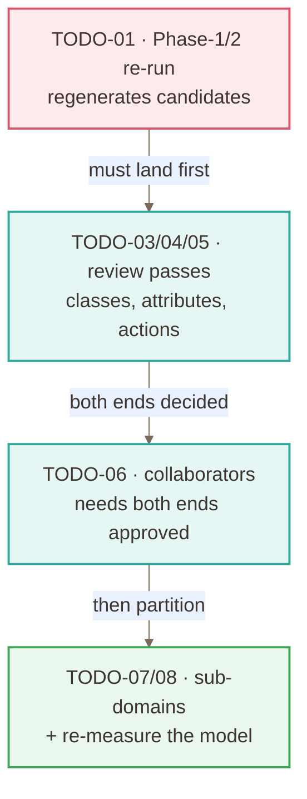
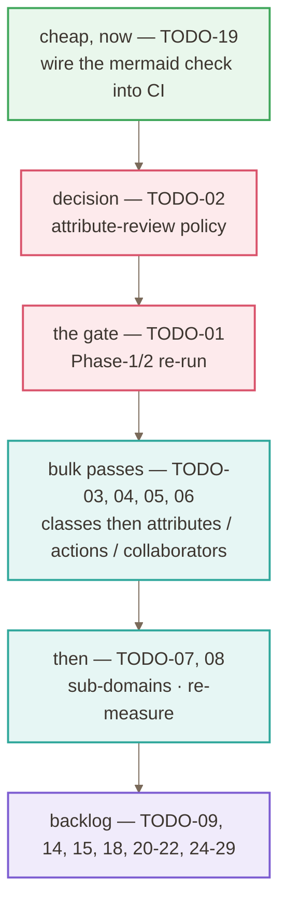

# TODO — open issues collected from the DoMoX docs

**Purpose.** One place where the *open* work scattered across the plan / review / retrospective
documents can be seen, ranked and picked up. It is a **derived index**, not a new source of truth:
every item names the document that owns it, and that document wins if the two disagree.

**Compiled.** 2026-11-19. Re-derive it by reading the sources, not by trusting this file's counts.

**Sources swept.** `docs/scratch_pad/MODEL_REVIEW_PLAN.md`, `MODEL_UML_READINESS_REVIEW.md`,
`UML_GAP_FIX_PLAN.md`, `CRC_VOCABULARY_RENAME_SUMMARY.md`, `D3_DIAGRAM.md`, `UML_LAYOUT_GEOMETRY.md`,
the three `retro-*.md`, `rules/RULES_REGISTRY.md`, `events/EVENTS.md`, `docs/domain-modeling/pattern-repositories.md`,
`docs/association-type-categorization.md`, `ORPHAN_CASCADE_DELETION.md`, `CODING_STANDARDS.md`,
`.clinerules/memory-bank/technical/SCHEMA.md`, `.clinerules/memory-bank/workflows/*.md`,
`.clinerules/skills/review-and-assemble-model.md`, `scripts/check.sh`, `.github/workflows/ci.yml`.

**Already closed — do not re-open.** The eight `FIX-1…FIX-8` waves; the eight candidates of
`retro-uml-gap-fixes-2026-11-18.md`; all nine of `retro-d3-hover-reveal-2026-10-31.md`; the
`schema-projection` staleness guard; the orphan `domox.packagecdd` tables (gone from the live DB and
from `create-tables.sql`); `SeedService.java` (deleted).

**Closed 2026-11-19** — the six XS/Low items of the first sweep, each verified before closing:
TODO-10 (the rationale convention is now stated once in `MODEL_REVIEW_PLAN.md` §4/§12.3, and the
runbook + skill point at it); TODO-16 (the stale `packagecdd` references are gone);
TODO-17 (`persistence.xml` moved to `src/main/resources/META-INF/`); TODO-23 ("five instant steps");
TODO-30 (the retro carries its implemented table); TODO-31 (`scripts/measure-mermaid.sh` committed,
reproducing the guide's widths).

**Closed 2026-11-19 (second sweep)** — the three extraction-rule items, each a *rule-set* change
verified by domain tests and recorded in `UML_GAP_FIX_PLAN.md` §13, which is the owning document:
TODO-13 (`CandidateFactory` de-duplicates only a *pure* class match — an association is no longer
swallowed by its source class, §13.7); TODO-12 (TDR10/TDR11 create a `PropertyCdd` only for an
attribute noun — the same scope-guard shape FIX-5 gave TDR25/TDR26, §13.6); TODO-11 (the verb→return
type mapping — receive verb → the received class, output/notify verb → `String`, else no return type,
§13.2). All three take effect on the next Phase-1/2 run (TODO-01); no migration is needed.
**TODO-14 stays open** — it is gated on TODO-05's owner tally, which needs Pass 3 to run.

---

## 1. Scales

| Priority | Meaning |
|---|---|
| **P0** | Do now — it blocks everything downstream |
| **P1** | This iteration — small, self-contained, high leverage |
| **P2** | Next — needs a decision, a measurement or a re-run first |
| **P3** | Backlog — hygiene or a proposal; do it when touching the same area |

| Effort | Rough size |
|---|---|
| **XS** | a line or two; under 15 min |
| **S** | one file, one focused change; under an hour |
| **M** | several files / a new collaborator + tests; half a day |
| **L** | a rule-set change or a bulk pass; a day or more |
| **XL** | a new subsystem; multi-session |

**Risk** is the cost of doing it *wrong or not at all* (the failure it lets through), not the
difficulty of the change. **Contribution** is what the item unlocks once it lands.

## 2. Critical path

Read it as one column: the **re-run gates the review passes**, and the **collaborator pass gates the
sub-domain pass and the re-measurement**. The three independent rule gaps (TODO-11/12/13) landed
2026-11-19, so they no longer branch off this path — the re-run above simply carries them. The one
remaining rule item, TODO-14 (operation-owner correctness), is *not* independent: it waits on Pass 3's
owner tally, so it has no place on this diagram until TODO-05 has run.

---
## 3. Summary — every open item

| ID | Area | Issue (one line) | Pri | Effort | Risk |
|---|---|---|---|---|---|
| **TODO-01** | Review pipeline | Phase-1/2 re-run on the whole corpus — the gate for every review pass | **P0** | M | **High** |
| **TODO-02** | Review pipeline | Attribute-review policy (`MODEL_REVIEW_PLAN.md` §5) not signed off | **P1** | S | Medium |
| **TODO-03** | Review pipeline | Pass 1 — review **769** `ClassCdd` candidates | **P1** | L | High |
| **TODO-04** | Review pipeline | Pass 2 — review **100** `PropertyCdd` + record the vocabulary (feeds FIX-6c) | P2 | M | Medium |
| **TODO-05** | Review pipeline | Pass 3 — review **100** `ActionCdd` + capture owner correctness (feeds FIX-3d) | P2 | M | Medium |
| **TODO-06** | Review pipeline | Pass 4 — review **237** `AssociationCdd` (last: needs both ends approved) | P2 | M | Medium |
| **TODO-07** | Review pipeline | Sub-domain pass for the newly approved classes | P2 | S | Low |
| **TODO-08** | Review pipeline | Re-measure the UML diagram and update the readiness review | P2 | S | Medium |
| **TODO-09** | Ontology grounding | Optional grounding of the ~15 core commerce classes | P3 | S | Low |
| **TODO-14** | Extraction rules | Operation owner correctness (`supervise → Day`) — gated on TODO-05's owner tally | P3 | M | Medium |
| **TODO-15** | Schema / DDL | Deferred persisted-name migration (`@Table`/`@Named`/`candidateType`) | P3 | L | Medium |
| **TODO-18** | Architecture | `domox.dom.rules` is a flat package of 61 files | P3 | M | Low |
| **TODO-19** | CI guardrails | `check-mermaid.py` is not wired into CI | **P1** | XS | Medium |
| **TODO-20** | CI guardrails | No enforcer `bannedDependencies` rule for JUnit 5.x | P2 | S | Medium |
| **TODO-21** | CI guardrails | `check.sh` never runs `mvn enforcer:enforce` | P2 | XS | Medium |
| **TODO-22** | CI guardrails | No config-property placeholder smoke test | P2 | M | Medium |
| **TODO-24** | Build hygiene | Nexus snapshot-metadata timeout noise on every build | P3 | S | Low |
| **TODO-25** | Capability | gist into Fuseki + MCP-exposed pattern repositories | P3 | L | Low |
| **TODO-26** | Capability | "Suggest missing model elements" (DoMoX only reviews what exists) | P3 | XL | Low |
| **TODO-27** | Capability | Event-detection rules (`EVENTS.md`) not implemented | P3 | L | Low |
| **TODO-28** | Capability | The "(future)" association patterns in `association-type-categorization.md` | P3 | M | Low |
| **TODO-29** | Capability | Generalization literature gaps + the stale "not yet implemented" Group-6 header | P3 | M | Low |

**Counts.** 22 open items — 1 × P0, 3 × P1, 8 × P2, 10 × P3. (Nine further items — TODO-10, 11, 12,
13, 16, 17, 23, 30, 31 — were closed 2026-11-19; see the header.)

---

## 4. Details

Each entry names the document that owns it, what is still open, the failure it lets through, the
concrete improvement, and the condition that closes it.

### A. Model-review pipeline — `docs/scratch_pad/MODEL_REVIEW_PLAN.md`

#### TODO-01 — Phase-1/2 re-run on the whole corpus · **P0** · M · Risk **High**

- **Source:** `MODEL_REVIEW_PLAN.md` §3 (Phase 0) and §12.1; `UML_GAP_FIX_PLAN.md` §14.
- **Open:** the re-analysis has not run since FIX-5/FIX-6 changed *what is extracted*; the
  multiplicity matches still carry the stale `09` / `N` / `02` notation the plan calls out.
- **Risk if skipped:** the 1 206 pending judgements would be recorded against candidates the re-run
  replaces — orphaned decisions and a pass done twice. It also gates TODO-03…TODO-06.
- **Area of improvement:** re-analyse into the **existing** `DomainModel:653` (never delete it — that
  is what keeps the 302 decisions alive), then re-run the `§9` verification SQL.
- **Done when:** multiplicity matches carry UML notation (`1`, `*`, `1..*`) and the per-type counts
  match the re-measured table.

#### TODO-02 — Attribute-review policy not signed off · **P1** · S · Risk Medium

- **Source:** `MODEL_REVIEW_PLAN.md` §5 and §12.2.
- **Open:** §5 is still a *proposal* — the approve/reject table for `PropertyCdd` candidates is not
  signed off. The measured input now exists (`UML_GAP_FIX_PLAN.md` §13.6: 42 attributes from TDR12, 26
  from TDR10, 18 from TDR11 — the TDR10/TDR11 share shrinks on the next re-run), and the rule-side
  question "may the possessive rules keep producing attributes for class nouns?" is **answered: no**
  (§13.6, applied 2026-11-19; TODO-12 closed). What remains is ratifying the policy itself.
- **Risk if skipped:** TODO-04 is executed against an unratified policy, so its decisions are not
  reproducible; the attribute vocabulary it harvests then feeds FIX-6c on a shaky basis.
- **Area of improvement:** ratify §5 before Pass 2 starts; record the outcome in §12.2.
- **Done when:** §12.2 reads *decided*, and the decision records the §13.6 rule outcome as its premise.

#### TODO-03 — Pass 1: review 769 `ClassCdd` candidates · **P1** · L · Risk High

- **Source:** `MODEL_REVIEW_PLAN.md` §4; runbook `.clinerules/memory-bank/workflows/mcp-review-pipeline.md`.
- **Open:** 769 of 971 classes are unreviewed. The 302 existing decisions (190 approve / 112 reject)
  are the calibration set.
- **Risk if skipped:** a class approved here decides **171** generalization edges in TODO-06; the
  sub-domain pass is empty until this lands; and rejecting a generalization because an endpoint is
  merely *unreviewed* records a wrong decision as a real one.
- **Area of improvement:** run the pass in batches (fatigue is the named risk), one MCP call at a
  time, and verify in the database per batch — never on the driver's `ok` lines.
- **Done when:** every `ClassCdd` has exactly one review and `§9` query 2 returns 0.

#### TODO-04 — Pass 2: review 100 `PropertyCdd` + record the vocabulary · P2 · M · Risk Medium

- **Source:** `MODEL_REVIEW_PLAN.md` §5, §11; `UML_GAP_FIX_PLAN.md` §9 (F6b/F6c).
- **Open:** 100 attributes unreviewed, only 2 approved today, and the pass has no policy until TODO-02.
- **Risk if skipped:** the **real deliverable** is lost — the approved names are exactly the
  vocabulary `basic-attributes` is missing, and reject decisions tell FIX-6e whether the extraction
  is emitting associations where attributes were expected.
- **Area of improvement:** keep a running approved-attribute list per owner *during* the pass; feed
  it to F6c, and the rejects to F6e.
- **Done when:** all 100 reviewed **and** the vocabulary list is attached to `UML_GAP_FIX_PLAN.md` §9.

#### TODO-05 — Pass 3: review 100 `ActionCdd` + capture owner correctness · P2 · M · Risk Medium

- **Source:** `MODEL_REVIEW_PLAN.md` §6 and §11; `UML_GAP_FIX_PLAN.md` §8 (F3d).
- **Open:** 100 responsibilities unreviewed; and the owner-correctness observation (the review
  measured `supervise → Day`, `capture → Delivery` — the owner is the sentence *object*) **cannot be
  recovered later**.
- **Risk if skipped:** FIX-3d is decided blind — systematic vs sporadic owner errors lead to opposite
  conclusions, and the evidence is gone after the pass.
- **Area of improvement:** for every approved responsibility, record whether its owner is the right
  class, as a second column of the pass output.
- **Done when:** all 100 reviewed **and** the owner-correctness tally is written into §6.

#### TODO-06 — Pass 4: review 237 `AssociationCdd` · P2 · M · Risk Medium

- **Source:** `MODEL_REVIEW_PLAN.md` §7.
- **Open:** 0 of 237 reviewed; 171 are `GENERALIZATION`, 52 `SYNONYM`, 14 plain `ASSOCIATION`.
  Today **0/171** generalizations have both ends approved.
- **Risk if skipped:** the diagram keeps claiming 237 edges of which only 23 connect two approved
  classes — the model looks richer than it is.
- **Area of improvement:** run it **after** TODO-03; approve a generalization only when both endpoints
  are approved classes and the is-a reading is true; map "one endpoint is not a class" to
  `WRONG_CANDIDATE_TYPE` (the §4 rationale convention) so counts stay comparable.
- **Done when:** every `AssociationCdd` has one review and `§9` query 4 reports the approved subset.

#### TODO-07 — Sub-domain pass for the newly approved classes · P2 · S · Risk Low

- **Source:** `MODEL_REVIEW_PLAN.md` §10; runbook `.clinerules/memory-bank/workflows/mcp-subdomain-pass.md`.
- **Open:** the 131 currently approved classes are all assigned, but every class approved in TODO-03
  is not. `suggestSubDomains()` is empty until Pass 1 lands.
- **Risk if skipped:** the partition silently stops matching the approved set, and the re-measured
  diagram's per-area view is wrong.
- **Area of improvement:** run the eight `SubDomainMcpTools` sequentially (concurrent writes create
  duplicate sub-domains), leave `UNCLASSIFIED` where the corpus cannot justify core-vs-supporting.
- **Done when:** §7's SQL reports 0 approved classes without a sub-domain and no duplicate names.

#### TODO-08 — Re-measure the diagram and update the readiness review · P2 · S · Risk Medium

- **Source:** `MODEL_REVIEW_PLAN.md` §10; `MODEL_UML_READINESS_REVIEW.md` §2.
- **Open:** the readiness review's §1/§2 numbers are the **pre-fix** baseline; the post-pass
  measurements have not been taken.
- **Risk if skipped:** the next session measures a fresh opinion instead of a delta, and closed gaps
  are re-litigated.
- **Area of improvement:** `python3 scripts/ro.py invoke domox.DomainModels generateUmlDiagram
  domainModel=DomainModel:653`, compare against the §2 table, and write the delta back.
- **Done when:** the readiness review carries the post-pass table and the answered gaps are closed.

#### TODO-09 — Optional ontology grounding of the core classes · P3 · S · Risk Low

- **Source:** `MODEL_REVIEW_PLAN.md` §4 (Optional grounding), §10; `MODEL_UML_READINESS_REVIEW.md` §3.6.
- **Open:** never run over the approved set.
- **Risk if skipped:** none material — it is a sanity check, not evidence of completeness.
- **Area of improvement:** `ontologySearch` / `suggestReview` on the ~15 core commerce classes only,
  remembering that a *miss* is not evidence against and that `Pet` matches `schema.org/PET` (medical
  imaging), not a pet.
- **Done when:** the ~15 core names have been spot-checked and any false homonym is documented.

---

### B. Extraction-rule gaps — `docs/scratch_pad/UML_GAP_FIX_PLAN.md` §13

#### TODO-14 — Operation owner correctness (FIX-3d) · P3 · M · Risk Medium

- **Source:** `UML_GAP_FIX_PLAN.md` §8 (F3d); `MODEL_REVIEW_PLAN.md` §6.
- **Open:** deliberately not bundled with FIX-3 — fix only if TODO-05's owner tally shows it matters
  for the approved set. Its three sibling extraction-rule items (TODO-11/12/13) were closed
  2026-11-19; this one is **gated**: it needs a Pass-3 tally that does not exist yet, so it is the
  only item left in this section.
- **Risk if skipped:** if the owner is systematically the sentence object, operations sit on the wrong
  classes and the class diagram's behaviour is misattributed.
- **Area of improvement:** use TODO-05's tally to decide; if systematic, resolve the owner from the
  `nsubj` actor rather than the object. Note that the FIX-3b return type (closed 2026-11-19) maps a
  receive verb to "the received class", i.e. the operation's **owner** — so if this item moves the
  owner to the `nsubj` actor, the receive-verb return type moves with it
  (`ResponsibilityCandidates#outputTypeFor`).
- **Done when:** the tally exists and a keep/fix decision is recorded.

---

### C. Schema / DDL hygiene — `SCHEMA.md`, `CRC_VOCABULARY_RENAME_SUMMARY.md`

#### TODO-15 — Deferred persisted-name migration · P3 · L · Risk Medium

- **Source:** `.clinerules/memory-bank/technical/SCHEMA.md` → "Remaining work";
  `CRC_VOCABULARY_RENAME_SUMMARY.md` item 1.
- **Open:** the 2026-10 CRC rename changed **Java class names only** — `@Table`, `@Named`,
  `@Entity(name=…)` and the `candidateType` literals are still the historical values
  (`actioncdd`, `propertycdd`, `associationcdd`, `parametercdd`), so class name and object type
  differ (`Candidate.getObjectType()` exists for exactly that reason).
- **Risk if skipped:** every new reader of the code (or of `domox.rulematch.candidatetype`) meets the
  mismatch and must re-derive it; the divergence is permanent and grows with each rename.
- **Area of improvement:** follow the recipe in `SCHEMA.md` — `ALTER TABLE … RENAME TO` for each
  per-type table plus its join table and FK columns, `UPDATE domox.rulematch SET candidatetype=…`,
  then flip the annotations together (Causeway object types are persisted in `bookmark`/`command`).
- **Done when:** class name and object type agree and `check-schema-drift.sh` is clean.

#### TODO-18 — `domox.dom.rules` is a flat package of 61 files · P3 · M · Risk Low

- **Source:** `CRC_VOCABULARY_RENAME_SUMMARY.md` item 5.
- **Open:** 41 `TDR*.java` rules plus ~20 catalogs / factories / collaborators share one package.
- **Risk if skipped:** low — but navigation and the "which file owns this?" question get slower with
  every extracted collaborator.
- **Area of improvement:** split into `rules/tdr`, `rules/catalog`, `rules/lexicon` (the package move
  also makes the new path untracked — diff it with `git status --short`, see `commands.md`).
- **Done when:** the rules package holds no more than ~10 files.

---

### D. Build / CI guardrails — `retro-boot4-upgrade-2026-10-14.md`, this session

#### TODO-19 — `check-mermaid.py` is not wired into CI · **P1** · XS · Risk Medium

- **Source:** `scripts/check.sh` step 5/9; `.github/workflows/ci.yml` (no mermaid step).
- **Open:** the guardrail runs locally (and in `--quick`, so the pre-commit hook gets it) but CI never
  invokes it — so a PR pushed from a clone without the hook can ship an invisible diagram.
- **Risk if skipped:** the exact defect the guardrail exists for (an unstyled node → black-on-black in
  the plugin) reaches `main`, and only a human reading the rendered chat notices.
- **Area of improvement:** add one `- name: Mermaid diagram guardrail` step running
  `python3 scripts/check-mermaid.py` to the `test` job, next to the layout-XML step.
- **Done when:** CI fails on a deliberately unstyled node (negative-test the step).

#### TODO-20 — No enforcer `bannedDependencies` rule for JUnit 5.x · P2 · S · Risk Medium

- **Source:** `retro-boot4-upgrade-2026-10-14.md` candidate 1.
- **Open:** the root pom pins `junit-jupiter.version` while the Boot BOM manages a newer major; the
  mismatch surfaced as a runtime `NoSuchMethodError`, and the build cache masked it.
- **Risk if skipped:** a mixed-version JUnit lands again and fails *at test runtime*, in a way the
  cache can hide on a workstation.
- **Area of improvement:** add a `bannedDependencies` rule banning
  `org.junit.jupiter:junit-jupiter-api:[5.0.0,6.0.0)` and `…-engine:[5.0.0,6.0.0)`.
- **Done when:** `mvn enforcer:enforce` fails on a re-pinned 5.x JUnit.

#### TODO-21 — `check.sh` never runs `mvn enforcer:enforce` · P2 · XS · Risk Medium

- **Source:** `retro-boot4-upgrade-2026-10-14.md` candidate 2.
- **Open:** the bundle runs drift → layout → syntax → alignment → mermaid → tests → render → webjar →
  metamodel, but no enforcer step, so a rule added per TODO-20 would not run locally.
- **Risk if skipped:** TODO-20 is a guardrail that only CI runs — the "a guardrail that never runs is
  not a guardrail" failure `CODING_STANDARDS.md` §4 names.
- **Area of improvement:** add the enforcer step to `check.sh` (keep `--quick` Maven-free, so it goes
  in the full bundle only).
- **Done when:** `check.sh` reports the enforcer step and fails on a deliberate violation.

#### TODO-22 — No config-property placeholder smoke test · P2 · M · Risk Medium

- **Source:** `retro-boot4-upgrade-2026-10-14.md` candidate 3.
- **Open:** a `@Value("${causeway.*}")` placeholder whose default lives only in a
  `@ConfigurationProperties` class is invisible to `Environment` and fails at bean creation; no test
  resolves the placeholders.
- **Risk if skipped:** a missing/renamed config key is found at boot, not at CI — the most expensive
  place to find it.
- **Area of improvement:** a smoke test (e.g. an `ApplicationContextRunner`) that asserts every
  `causeway.*` placeholder resolves.
- **Done when:** the test fails on a deliberately misspelled `causeway.*` key.

#### TODO-24 — Nexus snapshot-metadata timeout noise · P3 · S · Risk Low

- **Source:** `retro-boot4-upgrade-2026-10-14.md` candidate 5.
- **Open:** every `mvn` invocation emits 35+ `Could not transfer metadata … apache nexus snapshots`
  warnings for the unreachable Causeway snapshot repository.
- **Risk if skipped:** low — it is noise, but it buries real warnings in a build log and costs a
  reader's attention on every failure diagnosis.
- **Area of improvement:** the repository is declared by `causeway-app-starter-parent`, so disabling
  its snapshots means re-declaring the repository in this pom with
  `<snapshots><enabled>false</enabled></snapshots>` (this pom already does that for its own three
  repositories) — or accept the noise deliberately and note it.
- **Done when:** a build no longer prints the metadata-transfer warnings.

---

### E. Capability proposals (not yet implemented)

#### TODO-25 — gist into Fuseki + MCP-exposed pattern repositories · P3 · L · Risk Low

- **Source:** `docs/domain-modeling/pattern-repositories.md` (status: analysis / proposal).
- **Open:** the highest-ROI suggestion — load **gist** into the Fuseki instance DoMoX already runs —
  has not been done; nor has exposing pattern repositories over MCP. (GoodRelations is already inside
  Schema.org, which is already loaded.)
- **Risk if skipped:** none functional; DoMoX keeps working with Schema.org/BFO/gist/BBO/sBPMN as-is.
  The cost is that the core-commerce classes stay ungrounded against the vocabulary that describes
  them best.
- **Area of improvement:** add the gist graph to `docker/fuseki` and to `domox.rdf.default-graphs`,
  mirroring the existing `OntologyTerms` / `OntologyReviewMcpTools` pattern rather than building a new
  subsystem.
- **Done when:** a gist term (e.g. `Contract`) resolves through `ontologySearch`.

#### TODO-26 — "Suggest missing model elements" · P3 · XL · Risk Low

- **Source:** `docs/domain-modeling/pattern-repositories.md` §"Key insight".
- **Open:** DoMoX can only *review* elements it already extracted; it has no capability to suggest an
  element the corpus implies but the rules missed.
- **Risk if skipped:** none — it is an enhancement, not a defect. The model's completeness stays a
  function of the rule set.
- **Area of improvement:** a new advisory service (MCP tool) that proposes additions from the
  ontology + the use-case corpus, kept strictly advisory like `suggestReview`.
- **Done when:** a proposal for a missing class is produced for a corpus known to lack one.

#### TODO-27 — Event-detection rules not implemented · P3 · L · Risk Low

- **Source:** `docs/scratch_pad/events/EVENTS.md`.
- **Open:** the document designs event detection from `nsubj`/`dobj`/`advcl`/`xcomp`/`neg`/`obl` and
  gives example rules, but no TDR rule implements any of it.
- **Risk if skipped:** none — events are outside the current CRC element set (class / attribute /
  responsibility / collaborator).
- **Area of improvement:** if events are wanted, add them as a candidate type with their own rules and
  registry entries — a design decision first, code second.
- **Done when:** a scoped decision is recorded (implement, or explicitly out of scope).

#### TODO-28 — The "(future)" association patterns · P3 · M · Risk Low

- **Source:** `docs/association-type-categorization.md` (rows marked *(future)*).
- **Open:** `nmod:from(VB, E2)`, `dobj + nmod:to` with send/forward/route, and `nmod:on(E1, E2)` are
  documented as intended `DEPENDENCY` / `AGGREGATION` signals but are not implemented.
- **Risk if skipped:** some genuine relationships (a customer *receives from* a system) are never
  extracted, so those edges are missing from the model.
- **Area of improvement:** implement the three patterns as TDR rules with tests, updating the
  categorization table's status column.
- **Done when:** the *(future)* marker is replaced by the rule id.

#### TODO-29 — Generalization literature gaps + the stale Group-6 header · P3 · M · Risk Low

- **Source:** `docs/scratch_pad/rules/RULES_REGISTRY.md` §Group 6; `docs/scratch_pad/scratch_pad.md`.
- **Open:** the Group 6 header still says the patterns are "**not yet implemented** in any TDR rule"
  while TDR38/TDR39/TDR40/TDR41 are implemented below it — a stale claim. Separately, Arora's
  `"may be"` / `conj:or` generalization ("X may be A or B") is described but not implemented.
- **Risk if skipped:** the registry misleads a reader about what exists (the stale header), and one
  literature pattern stays unavailable (the `conj:or` case).
- **Area of improvement:** rewrite the Group-6 header to describe the implemented rules, and either
  implement the `conj:or` pattern or mark it as deliberately out of scope.
- **Done when:** the header matches the table and the `conj:or` case has an explicit status.

---

## 5. Suggested sequencing

