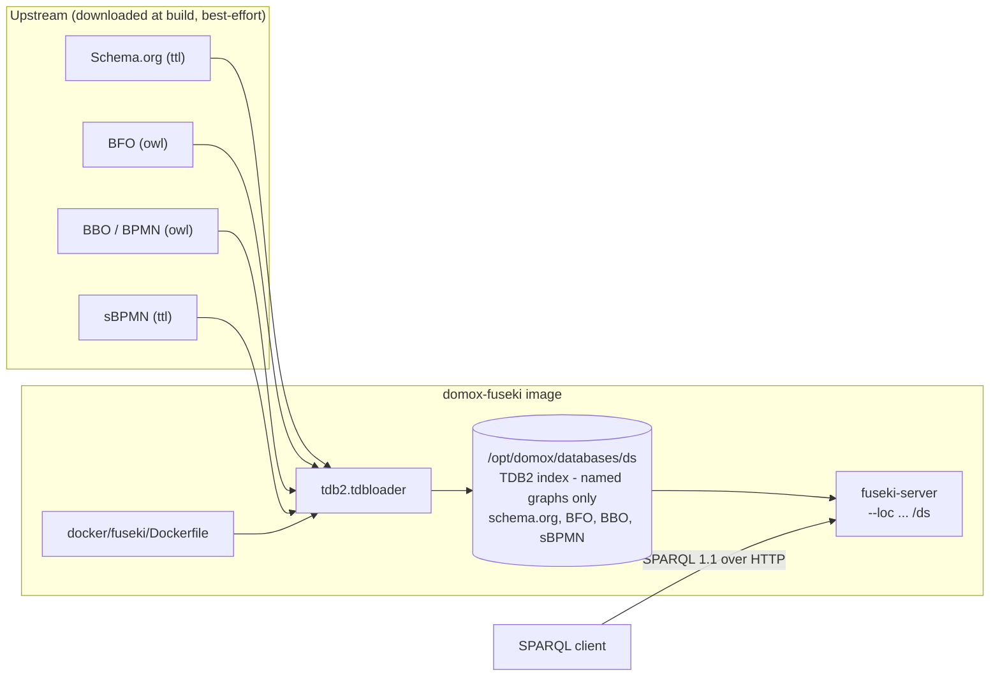

# Serving reference ontologies on Apache Jena Fuseki

A local [Apache Jena Fuseki](https://jena.apache.org/documentation/fuseki2/) server that
serves four reference RDF/OWL vocabularies over HTTP, so they can be queried with SPARQL
1.1 **without a rebuild**. Each vocabulary lives in its **own named graph**:

| Ontology | Graph IRI | Format |
| :--- | :--- | :--- |
| **Schema.org** | `https://schema.org/` | Turtle |
| **BFO** (ISO 21838-2) | `http://purl.obolibrary.org/obo/bfo.owl` | RDF/XML |
| **BBO** (BPMN 2.0 Based Ontology) | `http://BPMNbasedOntology` | RDF/XML |
| **sBPMN** (semantic BPMN 2.0) | `https://ntimes404.github.io/sBPMN/` | Turtle |

The DoMoX OntoUML model (`domox-domain/src/main/resources/ontology.ttl`) is **not** imported —
this image serves the reference vocabularies only.



## Step 1 - Build the image

`docker/fuseki/Dockerfile` extends the official community image `stain/jena-fuseki:5.1.0`
and pre-loads the four reference ontologies into a TDB2 index at build time. **Build from the
repository root**:

```bash
docker build -f docker/fuseki/Dockerfile -t domox-fuseki .
```

The four ontologies are **downloaded from upstream during the build** (best-effort — a flaky
URL is logged and skipped). To force a **fresh download + re-import**, bypass the layer cache
(Docker reuses the cached `RUN` layer whenever the Dockerfile is unchanged):

```bash
docker build --no-cache -f docker/fuseki/Dockerfile -t domox-fuseki .
```

The repository-root `.dockerignore` prunes `venv/`, `**/target`, … so only ~5 MB of context is
sent, not the ~850 MB a full working copy weighs.

## Step 2 - Run the container

```bash
docker run -d --name domox-fuseki -p 3030:3030 domox-fuseki
```

| Endpoint | URL |
| :--- | :--- |
| SPARQL query | `http://localhost:3030/ds/sparql` |
| Fuseki web UI | `http://localhost:3030/` - user `admin`, password from `docker logs domox-fuseki` |

## Step 3 - Verify

```bash
# every named graph with its triple count
curl -s -G http://localhost:3030/ds/sparql \
  -H 'Accept: application/sparql-results+json' \
  --data-urlencode 'query=SELECT ?g (COUNT(*) AS ?triples)
                     WHERE { GRAPH ?g { ?s ?p ?o } } GROUP BY ?g ORDER BY DESC(?triples)'

# a Schema.org class
curl -s -G http://localhost:3030/ds/sparql \
  -H 'Accept: application/sparql-results+json' \
  --data-urlencode 'query=PREFIX rdfs: <http://www.w3.org/2000/01/rdf-schema#>
                     SELECT ?label WHERE { GRAPH <https://schema.org/>
                       { <https://schema.org/Person> rdfs:label ?label } }'
```

The **default graph is empty** (the ontologies live in named graphs); query them with
`GRAPH <iri> { ... }`. The web UI works too: **http://localhost:3030** -> *Query* -> dataset `/ds`.

## Step 4 - Point DoMoX at it

The app's ontology search (`Corpora.searchOntologyAsD3Graph`) can query these graphs — but because
the data lives in **named graphs** (so the default graph is empty), the app must be told which
graphs to merge into each query. That is `domox.rdf.default-graphs`, which emits a SPARQL
`FROM <graph>` dataset clause per entry, and is already set in
`domox-webapp/src/main/resources/application.yml`:

```yaml
domox:
  rdf:
    endpoint-url: http://localhost:3030/ds/sparql
    default-graphs:
      - https://schema.org/
      - http://BPMNbasedOntology
      - http://purl.obolibrary.org/obo/bfo.owl
      - https://ntimes404.github.io/sBPMN/
```

List a single graph to search only that ontology. With `endpoint-url` blank the app uses the
bundled classpath ontology instead and `default-graphs` is ignored.

One line, no rebuild:

```bash
bash scripts/run-app.sh --domox.rdf.endpoint-url=http://localhost:3030/ds/sparql
```

The endpoint-only settings (`query-limit`, `query-timeout-seconds`, `user-agent`,
`label-language`, `default-graphs`) then apply; while the endpoint is blank the bundled classpath
graph is used and those settings are inert.

## Reference ontologies (Schema.org, BFO, BPMN)

The build imports four reference vocabularies into **named graphs** of the `/ds` dataset, so
each stays individually queryable via `GRAPH <iri> { ... }`. The DoMoX OntoUML model is
**not** imported:

| Ontology | Graph IRI | Format | Source (build arg) |
| :--- | :--- | :--- | :--- |
| **Schema.org** | `https://schema.org/` | Turtle | `SCHEMA_ORG_URL` — <https://schema.org/version/latest/schemaorg-current-https.ttl> |
| **BFO** (ISO 21838-2, 2019-08-26) | `http://purl.obolibrary.org/obo/bfo.owl` | RDF/XML | `BFO_URL` — <http://purl.obolibrary.org/obo/bfo.owl> |
| **BBO** (BPMN 2.0 Based Ontology) | `http://BPMNbasedOntology` | RDF/XML | `BBO_URL` — <https://github.com/AminaANNANE/BBO_BPMNbasedOntology> |
| **sBPMN** (semantic BPMN 2.0) | `https://ntimes404.github.io/sBPMN/` | Turtle | `SBPMN_URL` — <https://github.com/ntimes404/sBPMN> |

Each download is **best-effort**: `curl --retry 3` and, on failure, a `WARNING` is logged and
that vocabulary is simply skipped — a flaky third-party URL cannot break the image build.
Override any URL, or force a fresh re-import, at build time:

```bash
docker build --no-cache -f docker/fuseki/Dockerfile \
  --build-arg BFO_URL=http://example.org/bfo.owl -t domox-fuseki .
```

Query one of the named graphs, or list them all:

```bash
# triples in the Schema.org graph
curl -s -G http://localhost:3030/ds/sparql \
  -H 'Accept: application/sparql-results+json' \
  --data-urlencode 'query=SELECT (COUNT(*) AS ?triples)
                     WHERE { GRAPH <https://schema.org/> { ?s ?p ?o } }'

# every named graph with its triple count
curl -s -G http://localhost:3030/ds/sparql \
  -H 'Accept: application/sparql-results+json' \
  --data-urlencode 'query=SELECT ?g (COUNT(*) AS ?triples)
                     WHERE { GRAPH ?g { ?s ?p ?o } } GROUP BY ?g ORDER BY DESC(?triples)'
```

## Notes & variants

- **Why the index is built outside `/fuseki`.** `/fuseki` is a `VOLUME` in the base image and
  Docker discards build-time writes into a volume - hence `/opt/domox/databases/ds`.
- **Persistence / updates.** The server runs with `--update`; runtime edits live in the
  container's writable layer. Mount a volume on `/opt/domox/databases` to keep them.
- **Read-only endpoint.** Drop `--update` from the `CMD` in the Dockerfile.
- **Different ontologies.** Point the `SCHEMA_ORG_URL` / `BFO_URL` / `BBO_URL` / `SBPMN_URL`
  build args at other files, then rebuild. To force a fresh download + re-import, add
  `--no-cache` (otherwise Docker reuses the cached `RUN` layer).
- **Default graph instead of named graphs.** Drop `--graph="${graph}"` from the
  `tdb2.tdbloader` call to merge the four vocabularies into the default graph. You can then drop
  `domox.rdf.default-graphs` from the app config as well.
- **Searching from the app.** `Corpora#searchOntologyAsD3Graph` scopes each endpoint query with the
  `domox.rdf.default-graphs` list (one SPARQL `FROM <graph>` clause per entry). Without it the
  named-graph data is invisible and every search returns nothing.

## Appendix - building a TDB2 database by hand (no Docker)

Useful for large dumps where uploading through the web UI would time out:

```bash
# 1. install Apache Jena, then bulk-load a TTL dump into a TDB2 directory
tdb2.tdbloader --loc ./databases/ds ./rdf-data/mappingbased_objects_en.ttl

# 2. serve the pre-built directory, binding it as a volume
docker run -d --name fuseki-server -p 3030:3030 \
  --mount type=bind,src=$(pwd)/databases,dst=/fuseki/databases \
  stain/jena-fuseki:5.1.0 \
  /jena-fuseki/fuseki-server --tdb2 --update --loc=/fuseki/databases/ds /ds
```

(`/ds` publishes the dataset at `http://localhost:3030/ds`; `/jena-fuseki/fuseki-server` is
the full path of the binary inside the image.)
