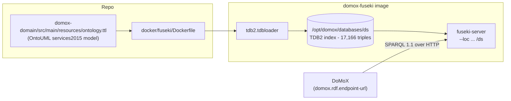

# Running the DoMoX ontology on Apache Jena Fuseki

The ontology diagram (`Corpora.searchOntologyAsD3Graph`) reads an RDF/OWL graph from one of
two sources:

| Source | Setting | What it reads |
| :--- | :--- | :--- |
| **Local (default)** | `domox.rdf.endpoint-url` blank | the bundled classpath graph `domox-domain/src/main/resources/ontology.ttl` |
| **Remote** | `domox.rdf.endpoint-url` set | a SPARQL endpoint, e.g. `http://localhost:3030/ds/sparql` |

This note covers the **remote** path: a local [Apache Jena Fuseki](https://jena.apache.org/documentation/fuseki2/)
server that serves the very same OntoUML `services2015` model over HTTP, so the app can be
pointed at it **without a rebuild**.



## Step 1 - Build the image

`docker/fuseki/Dockerfile` extends the official community image `stain/jena-fuseki:5.1.0`
and pre-loads the ontology into a TDB2 index at build time. **Build from the repository root**
so the bundled ontology is in the build context:

```bash
docker build -f docker/fuseki/Dockerfile -t domox-fuseki .
```

If the bundled `domox-domain/src/main/resources/ontology.ttl` is missing, the build downloads
it from upstream instead
(<https://github.com/OntoUML/ontouml-models/blob/master/models/services2015/ontology.ttl>).

The repository-root `.dockerignore` prunes `venv/`, `**/target`, … so only ~5 MB of context is
sent, not the ~850 MB a full working copy weighs.

## Step 2 - Run the container

```bash
docker run -d --name domox-fuseki -p 3030:3030 domox-fuseki
```

| Endpoint | URL |
| :--- | :--- |
| SPARQL query | `http://localhost:3030/ds/sparql` |
| Fuseki web UI | `http://localhost:3030/` - user `admin`, password from `docker logs domox-fuseki` |

## Step 3 - Verify

```bash
# triple count -> 17166
curl -s -G http://localhost:3030/ds/sparql \
  -H 'Accept: application/sparql-results+json' \
  --data-urlencode 'query=SELECT (COUNT(*) AS ?triples) WHERE { ?s ?p ?o }'

# a few OntoUML classes -> Pending, Claim, Belief, ...
curl -s -G http://localhost:3030/ds/sparql \
  -H 'Accept: application/sparql-results+json' \
  --data-urlencode 'query=PREFIX ontouml: <https://w3id.org/ontouml#>
                     SELECT ?name WHERE { ?c a ontouml:Class ; ontouml:name ?name } LIMIT 5'
```

The web UI works too: **http://localhost:3030** -> *Query* -> dataset `/ds`.

## Step 4 - Point DoMoX at it

One line, no rebuild:

```bash
bash scripts/run-app.sh --domox.rdf.endpoint-url=http://localhost:3030/ds/sparql
```

...or set it permanently in `domox-webapp/src/main/resources/application.yml`:

```yaml
domox:
  rdf:
    endpoint-url: http://localhost:3030/ds/sparql
```

The endpoint-only settings (`query-limit`, `query-timeout-seconds`, `user-agent`,
`label-language`) then apply; while the endpoint is blank the bundled classpath graph is used
and those settings are inert.

## Notes & variants

- **Why the index is built outside `/fuseki`.** `/fuseki` is a `VOLUME` in the base image and
  Docker discards build-time writes into a volume - hence `/opt/domox/databases/ds`.
- **Persistence / updates.** The server runs with `--update`; runtime edits live in the
  container's writable layer. Mount a volume on `/opt/domox/databases` to keep them.
- **Read-only endpoint.** Drop `--update` from the `CMD` in the Dockerfile.
- **Different ontology.** Replace `domox-domain/src/main/resources/ontology.ttl` (or rebuild
  with a different `ONTOLOGY_URL` build arg) and rebuild the image.

## Appendix - building a TDB2 database by hand (no Docker)

Useful for large dumps where uploading through the web UI would time out:

```bash
# 1. install Apache Jena, then bulk-load a TTL dump into a TDB2 directory
tdb2.tdbloader --loc ./databases/ds ./rdf-data/mappingbased_objects_en.ttl

# 2. serve the pre-built directory, binding it as a volume
docker run -d --name fuseki-server -p 3030:3030 \
  --mount type=bind,src=$(pwd)/databases,dst=/fuseki/databases \
  stain/jena-fuseki:5.1.0 \
  /jena-fuseki/fuseki-server --tdb2 --update --loc=/fuseki/databases/ds /ds
```

(`/ds` publishes the dataset at `http://localhost:3030/ds`; `/jena-fuseki/fuseki-server` is
the full path of the binary inside the image.)
