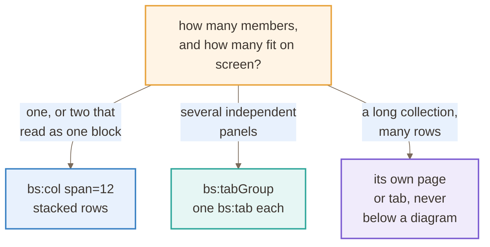

# Apache Causeway UI layout guidelines (DoMoX)

How to compose a Causeway object page in this repo. The *mechanics* of `*.layout.xml` (how the file
is found, which structural rule makes Causeway silently discard it, what the markers do, how
`@D3Graph` / `@PdfJsViewer` reach the page) live in
`.clinerules/memory-bank/technical/CAUSEWAY-LAYOUT.md`. **This** document is the opinion layer on
top: what a page should look like, and which shapes are rejected.

Full Causeway annotation reference: `docs/causeway/causeway-annotations.md`.

---

## The rule this document exists for

> **Nothing important may sit below the horizon.**
>
> A reader who has to scroll to discover that a panel exists has, in practice, been shown a page
> without that panel. A page is read from the top and abandoned early; the second screen is not
> "further down", it is *absent*.

This is not a stylistic preference, it is an observed failure: the UML class-diagram page stacked
its three renderings (PDF, D3, PlantUML source) as full-width rows and the reader — who does not
scroll by habit — reported the page as having only a diagram, and never saw the other two. The
content was correct, complete, and invisible.

**Corollary — a panel is not "extra" because it is second.** Two renderings of the same artifact, or
a source view next to its rendering, are *alternatives*, and alternatives belong side by side, not
one under the other.

---

## 1. Choose the container before choosing the column



**Read it as:** a page whose members fit on one screen stays a plain stack of `bs:col` rows — tabs
would hide something that costs nothing to show. As soon as a second member pushes the first out of
view, switch to a `bs:tabGroup`. A long collection is the one case that may legitimately scroll, and
even then it goes in its own tab rather than under a diagram.

---

## 2. The tab-group shape (copy this)

A tab group is a `bs:col` → `bs:tabGroup` → one `bs:tab name="…"` per panel → `bs:row` → `bs:col`
→ member. `bs:tab` **requires** a `bs:row`, and `bs:row` requires a `bs:col`, even when the tab holds
a single fieldset:

```xml
<bs:row>
    <bs:col span="12">
        <bs:tabGroup>
            <bs:tab name="First panel">
                <bs:row>
                    <bs:col span="12">
                        <cpt:fieldSet id="first" unreferencedProperties="true">
                            <cpt:property id="firstProperty"/>
                        </cpt:fieldSet>
                    </bs:col>
                </bs:row>
            </bs:tab>
            <bs:tab name="Second panel">
                <bs:row>
                    <bs:col span="12">
                        <cpt:fieldSet id="second">
                            <cpt:property id="secondProperty"/>
                        </cpt:fieldSet>
                    </bs:col>
                </bs:row>
            </bs:tab>
        </bs:tabGroup>
    </bs:col>
</bs:row>
```

Working examples in this repo: `Candidate.layout.xml` (5 tabs, the last four fed by
`unreferencedCollections`), `DomainModel.layout.xml` (4 collection tabs). `UmlClassDiagram.layout.xml`
is the one-panel case — it keeps a tab group of one so a reader still meets a panel, but a page with a
single member does not *need* tabs (see §1).

**One panel per tab, and a tab label cannot be dynamic.** A tab name comes from the XML and one layout
serves every instance of the type, so a tab cannot be named after the object it shows — the sub-domain a
UML class diagram belongs to is carried by the property's own label instead
(`UmlClassDiagram#namedD3Graph()`, a `namedXxx()` member-support method, which *is* re-read per
instance).

**Tab order is reading order, and the first tab is what the reader gets by default.** Put the
primary artifact first and the alternatives after it; do not reorder so that a cheap-to-render panel
comes first.

---

## 3. Width is the only thing that makes a diagram readable

A diagram panel (D3 graph, pdf.js viewer, Vega) fills its **container**, so the enclosing grid column
is the only width driver. Give it `span="12"`, or a `span` wide enough that the natural-size render
fits — the fallback grid's `span="4"` is how a diagram ends up unreadable in a third of the page.

Nothing else can widen it after the fact: `PdfJsViewerPanel.css` already sets `.pdfPanel { width:
100% }`, and the D3 extension sets `width: 100%` on `.d3GraphPanel`/`.d3GraphCanvas`.

---

## 4. Tab panels are loaded on demand — a panel never measures a hidden container

Verified live (2026-11, headless Chromium over CDP, on the UML class-diagram page **while it still had
three tabs**): the tab group (`AjaxBootstrapTabbedPanel`) puts **only the selected tab's panel in the
DOM** (`div.tab-content > div.tabPanel`); every other tab is an Ajax link that builds its panel when it
is clicked. Measured: exactly one `.pdfPanel` while the first tab was active, exactly one `.d3GraphPanel`
after clicking the second, exactly one `textarea` after the third — never two at once. That page now has
a single tab (the D3 picture), but the *rule* is Causeway's, not that page's, so it holds for any tab
group here.

So the "`clientWidth === 0`, because the pane is `display:none`" hazard **does not arise** here: a
panel's init script runs once its tab is visible. It is still worth knowing what each panel does with
a zero-width container, because some other container can produce one (a collapsed column, a
differently-composed page):

| Panel | If it ever does init with a zero-width container | Why |
|---|---|---|
| D3, `"layout":"uml"` payload | ✅ unaffected | `viewBox` comes from the payload's own canvas; only the *height* reads `clientWidth`, falling back to the payload width. No force simulation. |
| pdf.js viewer | ✅ unaffected | `PdfJsConfig.initialScale` defaults to `Scale._1_00` (a fixed 1.00), so the container-width auto-scale branch is never taken. |
| D3, force layout | ⚠️ degraded | Falls back to `config.initialWidth` (or 800) and lays the graph out in that box; it is scaled rather than broken, but the layout is not fitted to the real width. |

---

## 5. Keep the markers — the layout is discarded without them

Every layout XML needs `unreferencedCollections="true"` on exactly one `bs:col` **or** `bs:tabGroup`
(and the repo convention adds `unreferencedActions="true"` on the top column), plus
`unreferencedProperties="true"` on a `cpt:fieldSet`. Miss one and Causeway throws the **whole grid
away** and silently renders the span-4 fallback — the build stays green and the app boots.

Put the markers where the content is unconditional. `BSUtil.hasContent()` counts *any* property, so
a fieldset that is merely empty at runtime (e.g. a diagram that failed to render, leaving only its
`message`) still keeps its tab — but a tab with no members at all would disappear and shift every
tab index after it.

**Guardrail:** `scripts/check-layout-xml.sh` (step 2/10 of `bash scripts/check.sh`, and of
`--quick`, so the pre-commit hook runs it). It strips comments first — a layout's own comment names
the markers, so a naive grep passes a file that would be discarded.

---

## 6. Verify the layout, do not assume it

| Check | Command |
|---|---|
| Structure (offline, instant) | `bash scripts/check-layout-xml.sh` |
| The grid was actually accepted | grep the boot log for `Grid metadata errors` — **a green build proves nothing** |
| The columns/tabs really applied | `scripts/ro.py layout <objectRef>` — prints the top-level columns and their span |
| The rendering survived the tab | load the page, click each tab, confirm the panel has content (`verify-ui-render.sh` drives the table-cell case headlessly) |

`ro.py layout` is the fastest signal that a layout XML was applied rather than discarded: the
fallback grid prints `col span=4`, a working one prints your spans and `fieldSet[...]` groups.

