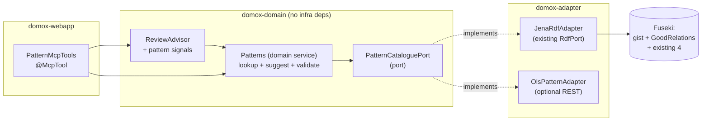

# Pattern Repositories for DoMoX — Feasibility & MCP Assessment

> **Status:** analysis / proposal (not yet implemented).
> **Question answered:** *Are there pattern repositories available that could be integrated with
> DoMoX and help with creating the domain model? Would it make sense to make them available via MCP?*
> **Short answer:** Yes to both. The highest-ROI addition is a machine-readable ontology that drops
> into the Fuseki instance DoMoX already runs (**gist**). Note that **GoodRelations is already
> integrated into Schema.org** (Nov 2012) — and DoMoX already loads Schema.org — so most of its
> e-commerce concepts are *already* queryable. MCP exposure should **mirror the existing
> `OntologyTerms` / `OntologyReviewMcpTools` pattern**, not become a new subsystem.

---

## 🎯 Core objective

Decide **which external "pattern repositories" could feed DoMoX's domain-model creation**, and
whether exposing them **via MCP** is a sensible design.

---

## 🧭 Analyzed constraints (from the actual codebase)

| Constraint | Evidence |
|---|---|
| DoMoX is **deterministic / rule-based**, "Vibe Coding *without* AI" | `README.md`, `docs/application/WHAT_IS_DOMOX.md` |
| Model creation = **requirements text → CoreNLP → TDR rules → candidates → human/agent review → DomainModel → UML/Causeway code** | `CorpusIngestion.java` (Phases 1 / 2 / 2b), `docs/scratch_pad/rules/RULES_REGISTRY.md` |
| Candidate types are the CRC vocabulary | `ClassCdd`, `AttributeCdd`, `ResponsibilityCdd`, `CollaboratorCdd` |
| There is **already one external knowledge source** wired in: reference ontologies over SPARQL | `OntologyTerms`, `RdfPort`, Fuseki image (Schema.org / BFO / gist / BBO / sBPMN) |
| There is **already a "pattern" classifier** — Coad's four archetypes, hard-coded | `ClassArchetypeClassifier` → `ClassType` (MOMENT_INTERVAL / ROLE / DESCRIPTION / PARTY_PLACE_THING) |
| There is **already an MCP server** with 6 tools | `ReviewMcpTools` (3), `OntologyReviewMcpTools` (3), `/mcp` via Spring AI |
| Hexagonal rule: **ports in `domox-domain`, adapters in `domox-adapter`** | `RdfPort` + `JenaRdfAdapter`; `.clinerules/hexagonal-architecture.md` |
| Advisory-vs-decision discipline is established | `ReviewAdvisor` returns `UNCERTAIN` on no-match; `suggestReview` is "advice, not a decision" |

> 💡 **Key insight:** DoMoX is *already* a pattern engine — TDR1–TDR41 are literally
> "NL dependency pattern → model element", `AssociationType` encodes 7 UML relationship patterns,
> and `ClassType` encodes Coad archetypes. The gap is **no *external, queryable* pattern repository**,
> and **no capability to *suggest missing model elements*** (only to review ones already extracted).

---

## 🌳 Where a pattern repository could plug in

```
Domain-model creation pipeline
├── 1. Candidate generation (TDR rules)              ← hard-coded; patterns could *add* rules
├── 2. Archetype classification (Coad)               ← hard-coded 4 archetypes; could be catalogue-driven
├── 3. Candidate review (approve/reject)             ← ✅ OntologyTerms grounding exists
├── 4. Model completion / gap-filling                ← ❌ NOTHING today  ← biggest opportunity
└── 5. Model validation (aggregates, invariants)     ← ❌ NOTHING today
```

A pattern repository adds value mostly at **3, 4 and 5** — and it serves two distinct jobs:

- **Grounding** — "is `Invoice` an established concept, and is it a Class or a Property?"
  *(same shape as today's ontology evidence)*
- **Completion / suggestion** — "a well-formed `Order` usually has an `OrderLine`, a `Quantity`,
  and a `Money` value" *(new capability)*

---

## 📚 The pattern-repository landscape (by fit)

### Tier 1 — already integrated (extend, don't rebuild)

| Source | Format | Licence | Notes |
|---|---|---|---|
| Schema.org, BFO, gist, BBO, sBPMN | RDF/OWL, named graphs in Fuseki | per-vocabulary | Already loaded and queried by `OntologyTerms` |

### Tier 2 — drop-in machine-readable ontologies (highest ROI)

| Source | Format | Licence | Why it fits |
|---|---|---|---|
| **gist** (Semantic Arts) | RDF/OWL, ~100 classes, `w3id.org/semanticarts/ontology/gistCore` | **CC-BY 4.0** | *Minimalist enterprise upper ontology*: `Person`, `Organization`, `Agreement`, `Event`, `Order`… deliberately "everyday names", domain-independent, with **gistBFO / gistUFO bridges** (ties into the BFO graph already loaded). **Best single addition.** |
| **GoodRelations** | RDF/XML + Turtle, `purl.org/goodrelations/v1` | CC-BY-SA 3.0 | **E-commerce ontology** — `gr:BusinessEntity`, `gr:Offering`, `gr:ProductOrService`, `gr:Location`, price specs, `gr:hasInventoryLevel`. ⚠️ **Largely already available:** GoodRelations was **integrated into Schema.org in November 2012**, and DoMoX already loads the Schema.org graph — so `Offer`, `Product`, `PriceSpecification`, `Organization`, `Place` are *already queryable*. Loading the GR namespace only adds the **finer-grained GR-only properties** (`gr:hasInventoryLevel`, `gr:hasEAN_UCC-13`, `gr:hasMPN`, `gr:hasStockKeepingUnit`, warranty / payment / delivery detail). |
| **FIBO** | OWL | MIT-ish | Financial Industry Business Ontology — only if the domain is finance |
| **CIDOC CRM** | OWL | CC-BY | Cultural heritage / events — good for `Event`/`Activity` patterns |
| **LOV (Linked Open Vocabularies)** | SPARQL endpoint + API | open | A **catalogue *of* vocabularies** — meta-repository to *discover* which vocabulary covers a term |
| **EBI OLS / BioPortal** | REST API | open | Ontology lookup services (biomedical) — the API pattern to copy if you build a catalogue |

### Tier 3 — analysis / DDD pattern catalogues (the "real" domain-model patterns, but **prose**)

| Source | Format | Licence | Fit |
|---|---|---|---|
| **Fowler, *Analysis Patterns*** | book / wiki prose | © copyrighted | The closest thing to "domain-model patterns": Quantity, Measurement, Money, Range, Accountability/Party, Inventory, Accounting. **Needs curation** into a structured form. |
| **Fowler, PoEAA catalogue** (`martinfowler.com/eaaCatalog`) | HTML | © | Architecture/ORM patterns — partly relevant (Unit of Work, Repository) |
| **Evans, *DDD Reference*** | PDF/markdown | free | Entity, Value Object, Aggregate, Repository, Domain Event, Bounded Context — ideal for **archetype + validation** |
| **Portland Pattern Repository** (`c2.com`) | wiki text | CC-ish | The original pattern wiki; messy, scrapeable |
| **microservices.io / Azure / AWS / GCP pattern catalogues** | HTML/JSON | vendor | Architecture patterns — low fit for *domain* modelling |
| **ddd-crew** GitHub (`ddd-starter-modelling-process`, `context-mapping`) | markdown | open | Machine-readable, process-oriented |

### Tier 4 — code/design-pattern repos (low fit)

`iluwatar/java-design-patterns`, `refactoring.guru`, `awesome-design-patterns` — these are
**GoF/code** patterns, not domain models. Useful only as a *name/definition* lookup for candidate
grounding, not for model completion.

### Tier 5 — DoMoX-native catalogue (curate what you already have)

Coad archetypes (`ClassType`) + **OntoUML stereotypes** (Kind, Subkind, Role, Phase, Relator, Mode,
Quality) — the OntoUML models are *already on the classpath* (`ontouml-models-latest.ttl`). Turning
the stereotype set into a queryable catalogue with *signals* is cheap and domain-aligned.

---

## 🔌 Does MCP make sense? — Yes, but split the roles

**Recommendation: yes, and it should mirror the existing `OntologyTerms` / `OntologyReviewMcpTools`
pattern exactly** — a domain port + domain service + a thin `*McpTools` façade. Not a new subsystem.



### Which tools to expose over MCP

| Tool | Purpose | Mirrors |
|---|---|---|
| `patternSearch(term)` | What does a pattern/ontology know about this term? | `ontologySearch` |
| `patternEvidenceForCandidate(id)` | Grounding + pattern-type agreement for a candidate | `ontologyEvidenceForCandidate` |
| `suggestMissingElements(className)` | **Gap-filling**: propose classes/attributes/relations a pattern implies | *(new capability)* |
| `validateModel()` / `validateClass(name)` | Aggregate / archetype / invariant checks | *(new capability)* |

### Architectural guardrails (must-do)

- ✅ **Port in `domox-domain`, adapter in `domox-adapter`** — never let Jena/HTTP types leak into the domain.
- ✅ **Advisory, never a decision** — reuse the `ReviewAdvisor` "advice ≠ verdict" discipline; extend the "no match ≠ invalid" rule to "not matching a pattern ≠ wrong".
- ✅ **Transaction discipline** — gather DB facts in a `TransactionTemplate`, do the network lookup *after* it closes (exactly as `OntologyReviewMcpTools` does).
- ✅ **Offline determinism** — pin `domox.rdf.endpoint-url` in integration tests (`ApplicationIntegTestBase`) so pattern lookups never hit the internet in CI.
- ⚠️ **Licence hygiene** — prefer CC-BY/open ontologies (gist, GoodRelations, FIBO, OntoUML). Fowler's books are **copyrighted prose**; curate *facts/structure*, don't embed the text.
- ⚠️ **Don't over-expose** — 6 tools already exist. Add 2–4, not 10. Too many "advisory" tools dilute decisions.

---

## 🚀 Suggested phasing

- [x] **Phase 1 — zero-code win (✅ implemented):** **gist** is loaded as a named graph by `docker/fuseki/Dockerfile` (build-arg `GIST_URL`, graph IRI `<https://w3id.org/semanticarts/ontology/gistCore>`) and listed in `domox.rdf.default-graphs`. `OntologyTerms` / `ontologySearch` / `ontologyEvidenceForCandidate` pick it up **immediately** — better grounding with *no Java changes*. (GoodRelations remains optional: the Schema.org graph already carries its core.)

  > **Phase 1b — ✅ implemented:** `RdfGraphDiagrams` (the *ontology diagram*) now also names nodes from `skos:prefLabel` (precedence: `rdfs:label` > `ontouml:name` > `skos:prefLabel`), so gist nodes render with their proper names ("Ordered Collection") instead of IRI local names. Pinned by `RdfGraphDiagramsTest.skosPrefLabelNamesANode` and `…rdfsLabelTakesPrecedenceOverASkosPrefLabel`.
- [ ] **Phase 2 — a curated pattern catalogue:** introduce `PatternCataloguePort` + a small curated RDF/JSON set of **analysis patterns** (Order/OrderLine, Party/Accountability, Quantity/Money/Range, Inventory) and let `ReviewAdvisor` consult it.
- [ ] **Phase 3 — completion tools:** add `suggestMissingElements` / `validateModel` MCP tools — this is the genuinely new "help *creating* the model" capability.
- [ ] **Phase 4 — discovery:** optionally point at **LOV / OLS** to *find* vocabularies, rather than hard-listing them.

---

## ✅ Bottom line

- **Yes, plenty of pattern repositories exist** — the best fit is a **machine-readable ontology you can load into the Fuseki instance you already run**: **gist** (CC-BY 4.0, enterprise upper ontology, BFO/UFO bridges). **GoodRelations** is *also* a strong e-commerce match, but it was **integrated into Schema.org in November 2012** — and DoMoX already loads Schema.org — so its core is already available; only the finer-grained GR-only properties would be new. Semi-structured DDD/analysis-pattern catalogues (Evans, Fowler, ddd-crew) are valuable but need **curation** first.
- **Yes, MCP exposure makes sense — as a mirror of the existing ontology tools**, not a new subsystem: a domain port + domain service + a thin `*McpTools` façade, keeping the advisory-not-decision discipline.
- **The highest-value, lowest-risk move is Phase 1** (load gist into Fuseki) — it improves grounding with no code. The *differentiating* move is **Phase 3** (pattern-driven **gap-filling / model completion**), which DoMoX has no equivalent of today.

---

### ⚠️ Things not fully verified

- ~~**GoodRelations licence**~~ — **resolved:** the Wikipedia infobox lists **CC-BY-SA 3.0** (not plain CC-BY). Note *share-alike*: check compatibility if you ever redistribute derived data.
- **LOV SPARQL endpoint URL** and **OntoUML model licences** — both fetches failed; confirm the current endpoints/licences before wiring them in. (OntoUML models are already referenced in `docs/scratch_pad/ontology/README.md`.)
