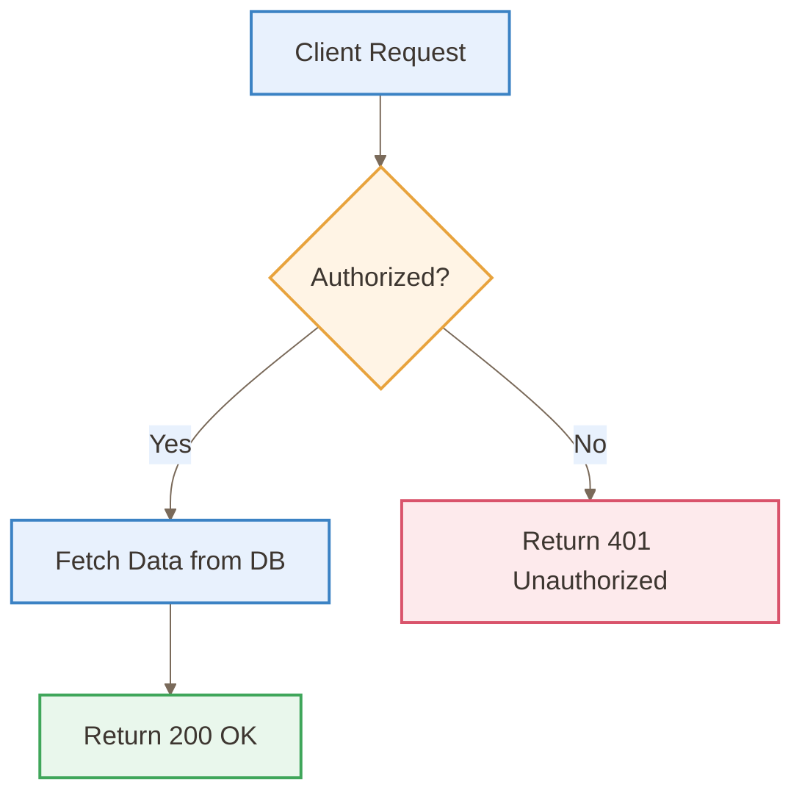
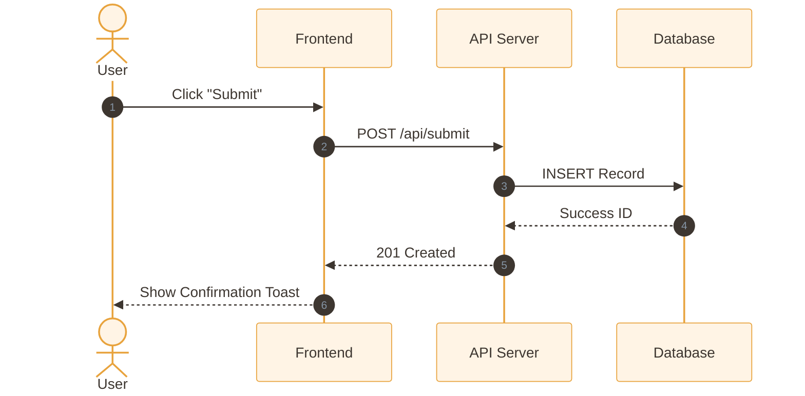
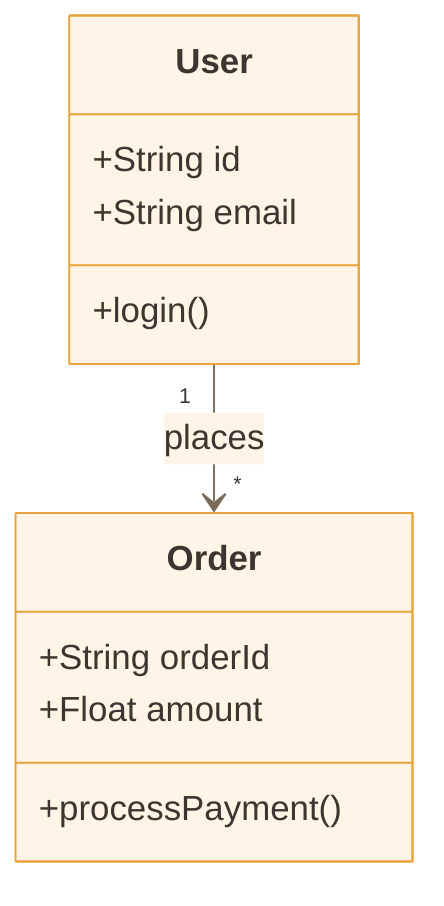

# Master Guide: Output Formatting & Readability in Cline

Improve the readability and structure of your outputs in **Cline** (Claude Dev) by applying standard GitHub Flavored Markdown (GFM), standard Unicode icons, and Mermaid diagrams.

---

## 1. Visual Cues & Icons

Use standard emojis and Unicode symbols as status indicators, warnings, and section markers to make content easy to scan.

### Recommended Status Icons
* ✅ **Success / Completed:** `✅` or `✔`
* ⚠️ **Warning / Caution:** `⚠️` or `⚡`
* ❌ **Error / Failed:** `❌` or `✖`
* 💡 **Tip / Insight:** `💡`
* 📌 **Key Takeaway / Note:** `📌`
* 🔍 **Inspection / Debugging:** `🔍`
* ⚙️ **Configuration / Settings:** `⚙️`
* 📦 **Package / Module:** `📦`
* 🚀 **Deployment / Execution:** `🚀`

### Example Usage
```markdown
### Deployment Checklist
- ✅ Environment variables configured
- ⚠️ Migration script requires review before running
- ❌ Redis connection failed
```

---

## 2. Structural Formatting Rules

### A. Use Scannable Lists (Lead Bold Formatting)
When writing lists, **bold the first 2–4 words**. This allows users to skim the document without reading full paragraphs.

**Bad (Hard to skim):**
> You need to make sure that you install all dependencies using npm install, and then after that you should set up your local .env file based on the template.

**Good (Fast to skim):**
> * **Install Dependencies:** Run `npm install` in the root directory.
> * **Configure Environment:** Copy `.env.example` to `.env` and fill in secrets.

---

### B. Use Structured Data Tables
Use markdown tables for key-value mappings, comparisons, and status summaries.

| Topic | Syntax Example | Use Case |
| :--- | :--- | :--- |
| **Headers** | `# Title`, `## Section` | Establishing visual hierarchy |
| **Callouts** | `> 💡 **Tip:** text` | Highlighting important warnings/tips |
| **Inline Code** | `` `variableName` `` | Referencing parameters, files, or paths |
| **Code Block** | ```` ```typescript ```` | Code snippets with syntax highlighting |

---

### C. Standardize Code Snippets
Always specify the explicit language tag for syntax highlighting.

````markdown
```typescript
interface UserConfig {
  id: string;
  enabled: boolean;
}

const config: UserConfig = {
  id: "usr_123",
  enabled: true
};
```
````

---

## 3. Embedding Diagrams (Mermaid.js)

Cline renders **Mermaid.js** diagrams natively inside markdown blocks using the `mermaid` language tag.

### Pinned theme & light palette (do this on every diagram)

Two things are needed, and **neither alone is enough**: a pinned theme, *and* an explicit `classDef`
on every node.

1. **Pin the theme** as the **first line inside the fence** — `fontSize` sets the diagram's default text
   size, and the palette keys set the light canvas and the warm-charcoal text:

```text
%%{init: {'theme':'base','themeVariables':{'fontSize':'18px','primaryColor':'#FFF4E5','primaryTextColor':'#3D3630','primaryBorderColor':'#E8A33D','lineColor':'#7A6A5A','secondaryColor':'#E8F1FD','tertiaryColor':'#F0EBFB','clusterBkg':'#FBF7F1','clusterBorder':'#E0D3C0','background':'#FFFFFF'}}}%%
```

2. **Give every node an explicit `classDef`, and attach it with `:::`.**

**Why both — observed in the IntelliJ Cline plugin:** with only the theme line, a node carrying **no
`:::class`** is drawn with the *viewer's* own dark fill, while `primaryTextColor` (`#3D3630`) still
applies — so the label is **black on black and invisible**, and the diagram looks like a row of empty
black rectangles. Only a `classDef` with an explicit `fill` *and* `color` survives the plugin's
renderer. Add a C4 framing comment and one `classDef` per boundary role:

| Role | Fill | Stroke |
|---|---|---|
| always-on | `#FFF4E5` | `#E8A33D` |
| method | `#E6F6F4` | `#2FA79B` |
| wiring | `#E8F1FD` | `#3B82C4` |
| reference | `#F0EBFB` | `#7C5CD1` |
| runtime | `#E9F7EC` | `#3FA65A` |
| broken | `#FDEAEC` | `#D9536B` |

Text is `#3D3630` throughout — a *warm* charcoal, never neutral grey. Label every edge with intent
(`-->` normal, `==>` hard dependency, `-.->` reference-only) and make each boundary a labelled `subgraph`.

⚠️ **`sequenceDiagram` and `classDiagram` accept no `classDef`** — the theme line is the only lever
available, so their boxes are at the renderer's mercy. For anything whose legibility matters, use
`flowchart`, where every node can be given an explicit `fill` *and* `color`.
**Enforced.** `python3 scripts/check-mermaid.py`, run as step **5/10** of `bash scripts/check.sh` (and
of `--quick`, so the pre-commit hook gets it), fails on a node with no `:::class`, a block whose first
line is not the `%%{init` pin, or a `flowchart` with no `classDef` at all — and it checks each node
**individually**, so a partly styled line (`A["x"]:::ok --> B["y"]`) still fails. (That was a false
negative of the checker's first version, found by negative-testing the checker itself.)

**A third fact, verified 2026-11:** the diagram's canvas is **the chat's own background**. The SVG is
transparent and the `background` themeVariable does *not* paint it, so a node's **fill** is the only
thing that makes a diagram visible at all — a block of unstyled nodes is not merely low-contrast, it
is invisible, because there is nothing behind it but the dark chat. This is why "the theme line sets
`background:'#FFFFFF'`" is not a defence: it has no effect on the canvas.


### Diagram size — in Chromium the viewer scales to fit, so a wide diagram is a small one

In the **Mermaid reference renderer** (headless Chromium) the diagram is drawn at its **natural** size
and then shrunk to the column width when it is wider, **text and all**, with no minimum font size and
no scrollbar. Nothing in the source says this is happening: the diagram looks correct and is simply
too small to read. ⚠️ **The IntelliJ Cline plugin does not appear to behave this way** — see *Scope*
below before acting on any of these numbers.

The Cline chat column is about **400–430px** wide. Measured with the same Mermaid build the viewer
uses (headless Chromium, 18px theme, identical `classDef`s), for one real diagram:

| Layout | Natural width | Rendered at 430px | Smallest label |
|---|---|---|---|
| Five bands fanned side by side | 1956px | scale 0.22 | **4.0px** — unreadable |
| Same content, four stacked bands | 542px | scale 0.79 | 14.3px |
| Stacked bands + short labels + unlabelled skip edge | **409px** | **scale 1.0** | **18px** — full size |
| Four *side-by-side* subgraphs, 3–4 nodes each | 1597px | scale 0.27 | **4.8px** — unreadable |
| The same four subgraphs stacked, one node each | **346px** | **scale 1.0** | **18px** — full size |
| `docker/fuseki/README.md` — five upstream nodes + a chain, `LR` | **1239px** | scale 0.35 | **6.2px** — unreadable *here* |

The last two rows are the same architecture drawn twice (`.clinerules/hexagonal-architecture.md`):
the fix was not to drop the `subgraph` boundaries — it was to **stack** them and move each band's
node list into a single node. A subgraph is a boundary, not a column.

**Prefer ≤ 420px, and stack rather than fan out.** In practice that means:

- **Stack the layers, never fan them out.** One column, `L0` → `L3` top to bottom; one or two nodes
  per band. Five side-by-side bands is the failure case above.
- **A `subgraph` is a boundary, not a column.** Keep the labelled boundary — that is what the diagram
  is *for* — but give it **one** node that carries the band's list (`Entities<br/>Domain Services ·
  Rules`) instead of three or four boxes in a row. Stacked, four boundaries cost 346px; side by side,
  1597px.
- **The width driver is text.** A long node label *or* a long edge label widens the whole graph,
  because every other node has to clear it. Keep labels to a few words, wrap with `<br/>`.
- **A labelled skip edge is the most expensive element.** `SK -.-> R2` with a label took a 402px
  graph to 496px; unlabelled, it costs nothing. Let the chain edge carry the meaning instead.
- **Fold lists into one node and let the prose carry the detail.** Four separate reference nodes
  became one `REF` node; the runtime, drawn as a fifth band, moved into a sentence under the
  diagram. That is what took the diagram from 1956px to 409px.

**To measure rather than guess** — render the block in headless Chromium and read the SVG's
`viewBox` width, comparing it with the container's width:

```js
const vb = svg.viewBox.baseVal;                  // natural size
const rect = svg.getBoundingClientRect();        // drawn size
const scale = rect.width / vb.width;             // < 1 means the text shrank by this much
```

`scale × 18px` is the effective font size of the smallest label. In **this renderer** a payload wider
than ~420px is worth restructuring — but read the *Scope* note immediately below first, because the
IntelliJ plugin does not shrink the way Chromium does.

**One command reproduces every figure below** — the harness is committed, so the numbers are
re-checkable rather than re-derived:

```shell
bash scripts/measure-mermaid.sh docs/formatting/readability-guide.md
bash scripts/measure-mermaid.sh .clinerules/hexagonal-architecture.md docker/fuseki/README.md --width 430
```

It renders each `mermaid` fenced block into a `<width>px` column in headless Chromium (default
430px — the chat column) and prints `natW=<natural px>  font=<effective px>` per block, flagging a
block the renderer had to shrink as `WIDE`. The Mermaid build is pinned to the version the viewer
uses (`11.4.1`), and the script skips cleanly when node, a Chromium binary, or the build is
unavailable. Run it *before* citing a width — it is what reports the 1239px for
`docker/fuseki/README.md` in the table below.

### ⚠️ Scope: this is the *Chromium* renderer, not the IntelliJ plugin

Every figure above was measured in **headless Chromium** at a 430px column, with the same Mermaid
build and identical `classDef`s. That describes *that* renderer faithfully — but the shrink-to-fit
does **not** carry over to the IntelliJ Cline plugin, and the difference is large:

| Diagram | Natural width | Chromium at 430px | IntelliJ plugin (observed) |
|---|---|---|---|
| `.clinerules/hexagonal-architecture.md` (stacked `TD`) | 346px | 18.0px — full size | legible ✅ |
| `docker/fuseki/README.md` (fanned `LR`) | **1239px** | **6.2px — unreadable** | **legible ✅** |

The 1239px diagram was confirmed legible **in the plugin** in 2026-11 — the same session that
established the `classDef` contrast rule (`A′`/`C′` readable, `B′` black-on-black). So the plugin is
**not** applying the aggressive shrink-to-fit Chromium does; whether it scrolls, zooms, or simply has
a wider column was not determined. Therefore:

- **`≤ 420px` is a *cheap conservative default*, not a measured plugin limit.** Meeting it costs
  nothing and keeps the diagram readable in *any* renderer, including the ones that do shrink.
- **Do not restructure a diagram *solely* because it exceeds 420px**, and do not cite this section as
  proof that a wide diagram is broken — cite it as proof that a wide diagram is *at risk*.
- **To settle it for a specific diagram, measure it in the plugin**, using the snippet above.

The `classDef` rules earlier in this guide are a *separate* matter and are **not** affected by this
scope caveat: those were verified in the plugin itself, and are enforced by `scripts/check-mermaid.py`.


### Flowchart Example

The three examples in this section are **shown as source** — each sits inside a 4-backtick fence, so it
renders as monospaced text, not as a diagram, and its width is not a concern. A diagram that *is*
rendered is always in scope.

````markdown

````

### Sequence Diagram Example
````markdown

````

### Architecture / Class Diagram Example
````markdown

````

---

## 4. Master Prompt Instructions for Cline

Paste the block below into your **System Prompt**, **Custom Instructions**, or `.clinerules` file to make Cline adopt these readability standards automatically:

```markdown
## Output Formatting Requirements
- **Structure:** Use clear header hierarchies (`##`, `###`) to separate sections.
- **Scannability:** Bold the first 2-3 words of bullet points to enable quick scanning.
- **Icons:** Use visual emojis (✅, ⚠️, ❌, 💡, 🚀) as section badges or status indicators.
- **Tables:** Structure comparisons, settings, or structured data into Markdown tables.
- **Diagrams:** Whenever explaining workflows, architecture, or sequence flows, include a `mermaid` diagram block.
- **Code Snippets:** Always specify language identifiers on code blocks for syntax highlighting.
```