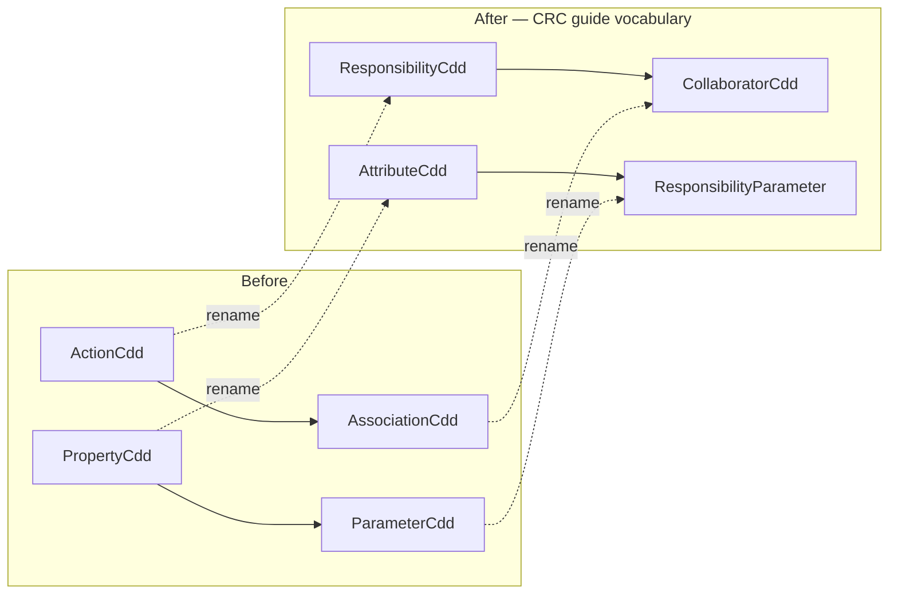

# CRC-Guide Alignment — Rename & Layout Change Summary

> **Date:** 2026-10-29 · **Module:** `domox-domain` (plus touch-ups in `domox-adapter`, `domox-webapp`)
> **Guide applied:** `docs/domain-modeling/crc-guide.md`
> **Decisions taken:** rename `ActionCdd`/`AssociationCdd`/`PropertyCdd`/`ParameterCdd`; **keep
> persisted names** (`@Table` / `@Named` / `candidateType`); include the optional layout items
> (`rqm`→`requirements`, `FileUtil`/`TextFilter`→`domox.util`).

---

## 🎯 What was done

Renamed the DoMoX metamodel's Java classes to the CRC guide's element vocabulary and re-laid-out
the `domox-domain` package tree — **while keeping every persisted name (tables, `@Named` object
types, `candidateType` strings) unchanged**.



---

## 📛 Part 1 — Class renames

| Before | After | Guide basis |
|---|---|---|
| `ActionCdd` | **`ResponsibilityCdd`** | guide element = *Responsibilities (Actions & Behaviors)* |
| `ActionCddRepository` | **`ResponsibilityCddRepository`** | follows |
| `ActionCandidates` | **`ResponsibilityCandidates`** | follows |
| `AssociationCdd` | **`CollaboratorCdd`** | *Collaborators & Relations* |
| `AssociationCddRepository` | **`CollaboratorCddRepository`** | follows |
| `AssociationCandidates` | **`CollaboratorCandidates`** | follows |
| `PropertyCdd` | **`AttributeCdd`** | *Attributes & Properties* |
| `PropertyCddRepository` | **`AttributeCddRepository`** | follows |
| `PropertyCandidates` | **`AttributeCandidates`** | follows |
| `ParameterCdd` | **`ResponsibilityParameter`** | not a CRC element — an *attribute of a Responsibility* |
| `PackageCdd` | **deleted** | not a CRC element; dead code (0 DB rows); superseded by `SubDomain` |
| `ClassCdd` | *unchanged* | guide's *Class* |

**Also renamed** (consistency, incl. Lombok-generated accessors):

`actionList`→`responsibilityList`, `propertyList`→`attributeList`,
`associationList`→`collaboratorList`, `actionCdd`→`responsibilityCdd`,
`addAction`→`addResponsibility`, `addAssociation`→`addCollaborator`,
`listAllActions`/`listAllAssociations`/`listAllProperties` →
`listAllResponsibilities`/`listAllCollaborators`/`listAllAttributes`,
`actionCandidates`/`propertyCandidates`/`associationCandidates` →
`responsibilityCandidates`/`attributeCandidates`/`collaboratorCandidates`.

**UI labels changed** to match: `List All Action Candidates` → `List All Responsibility Candidates`
(and Attribute / Collaborator), and the Causeway layout tabs in `DomainModel.layout.xml`
`Actions` → `Responsibilities`, `Properties` → `Attributes`, `Associations` → `Collaborators`.

---

## 🗂 Part 2 — Layout changes

```
domox-domain/src/main/
├── java/domox/
│   ├── DomainModule.java   SeedService.java          ← root utils moved out
│   ├── port/          (3)
│   ├── util/          (2)   ← L6: FileUtil, TextFilter  (was domox.*)
│   └── dom/
│       ├── AbstractEntity.java  UcResources.java
│       ├── crc/                                   ← L1: split by CRC role
│       │   ├── model/       (17)  entities + value objects + *.layout.xml
│       │   ├── repository/  (7)   Spring Data repos
│       │   ├── service/     (9)   domain services
│       │   └── diagram/     (4)   CandidateDiagrams / D3 / Vega
│       ├── requirements/    (10)  ← L5: was domox.dom.rqm
│       ├── nlp/             (11)
│       ├── rules/           (56)  untouched by design
│       └── fixtures/        (2)
└── kotlin/generate/         (4)   ← L3: was src/main/java/generate (Kotlin in a Java tree)
```

- **L1 — split `domox.dom.crc`** (36 flat classes) into `model` / `repository` / `service` /
  `diagram`; each sub-package stays flat, matching the existing `rqm`/`nlp`
  `Entity` + `EntityRepository` + `Entities` convention.
- **L2 — deleted the empty `domox/svc/` directory** — it violated
  `.clinerules/hexagonal-architecture.md`.
- **L3 — `generate/*.kt` moved** from `src/main/java` (a Maven *resource* root) to
  `src/main/kotlin/generate`, matching how `domox-adapter` stores Kotlin.
- **L5 — `domox.dom.rqm` → `domox.dom.requirements`.**
- **L6 — `domox.FileUtil` / `domox.TextFilter` → `domox.util`.**
- **Tests mirror the new packages** (required, not cosmetic — package-private members are
  same-package only): `crc/model` (3), `crc/service` (3), `crc/diagram` (3), `util` (1),
  `requirements` (2).
- **`.layout.xml` files moved with their entities** (`Candidate.layout.xml`,
  `DomainModel.layout.xml`) — Causeway resolves them from the entity's package directory, and
  they only reach the classpath because `src/main/java` is a Maven resource root
  (`domox-domain/pom.xml`).

---

## 🔒 Persisted names — pinned (no DB migration)

`@Table(name = …)`, `@Named(… + ".ActionCdd")` and every `candidateType` literal
(`"ActionCdd"`, `"PropertyCdd"`, `"AssociationCdd"`, `"ParameterCdd"`) were **deliberately left
at the historical values**, so the live database needed no migration.

Observable effect (MCP `nextCandidateForReview`):

```json
{"candidate": {"candidateName": "receive",
               "candidateType": "ActionCdd",          // persisted value — unchanged
               "className": "ResponsibilityCdd", ...}} // renamed Java class
```

---

## 🐞 Two real regressions found *and fixed* during verification

Both were invisible to the compiler; one was caught by `scripts/check-schema-drift.sh`, the other
by probing the running app.

| # | Symptom | Root cause | Fix |
|---|---|---|---|
| 1 | `ERROR: column "responsibilitycdd_id" does not exist` on the MCP `nextCandidateForReview` call | `@Table` pins the *table*, but EclipseLink derives the **M:N join-table column** (`ActionCdd_RuleMatch(ActionCdd_ID, …)`) from the **JPA entity name**, and a bare `@JoinColumn` derives its column from the **property name** (`actionCdd` → `actioncdd_id`) | `@Entity(name = "ActionCdd")` (etc.) on the 4 renamed entities **+** `@JoinColumn(name = "actioncdd_id", …)` on `ResponsibilityParameter.responsibilityCdd` |
| 2 | D3/Vega diagram click-through would silently break | the JSON emitted `objectType` from `getClass().getSimpleName()` → `domox.ResponsibilityCdd`, but the client builds `/wicket/object/<objectType>:<id>` and Causeway's object type is still `domox.ActionCdd` | new `Candidate.getObjectType()` reads the value back from `@Named` (superclass walk, `@Programmatic`); the 3 diagram services now call it |

**Regression guard added:** `CandidateTest.getObjectType_usesPinnedNamedValue_notTheRenamedClassName`.

> ⚠️ **Durable lesson (also recorded in `.clinerules/memory-bank/technical/SCHEMA.md`):** pinning
> `@Table` alone is *not* enough when renaming a `TABLE_PER_CLASS` entity — the derived join-table
> columns come from the **entity name** and bare `@JoinColumn`s from the **property name**. The
> Causeway object type is likewise not the class name.

---

## 🧪 Verification evidence

| Check | Result |
|---|---|
| `mvn test -pl domox-domain -am` | ✅ **189 tests, 0 failures** (188 existing + 1 new) |
| `ValidateDomainModelIntegTest` (metamodel guardrail) | ✅ pass |
| `DeleteCorpusIntegTest`, `CorpusCandidateDedupIntegTest` | ✅ pass |
| `scripts/check-schema-drift.sh` | ✅ `no missing columns` |
| App boot (`spring-boot:run`) | ✅ `Validation PASSED`, `Started in 4.03s`, `GET /` = 200 |
| MCP `initialize` + `tools/list` + `nextCandidateForReview` | ✅ returns `candidateType: "ActionCdd"`, `className: "ResponsibilityCdd"` |
| `GET /restful/objects/domox.DomainModel/653/properties/diagram` | ✅ emits pinned `domox.ActionCdd` (20), `domox.ClassCdd` (85), `domox.PropertyCdd` (4) |
| DB row counts vs baseline | ✅ identical: `classcdd` 971, `propertycdd` 109, `actioncdd` 191, `associationcdd` 235, `rulematch` 2476 |

---

## 📝 Docs updated

- `.clinerules/memory-bank/technical/SCHEMA.md` — entity↔table map, the two derived-name traps,
  and a **"Remaining work — deferred persisted-name migration"** section.
- `.clinerules/mcp-review-pipeline.md` — vocabulary note (classes renamed, candidate types not)
  and the orphaned `packagecdd` table.
- `.clinerules/d3-diagram.md`, `.clinerules/commands.md` — updated file paths.
- `docs/scratch_pad/D3_DIAGRAM.md`, `docs/scratch_pad/apache_causeway_vega_integration_guide.md`,
  `docs/application/WHAT_IS_DOMOX.md`, `docs/association-type-categorization.md`.

---

## 🚧 Remaining things (not done — deliberate)

| # | Item | Notes |
|---|---|---|
| 1 | **Deferred persisted-name migration** | `@Table` / `@Named` / `candidateType` still historical. Full `ALTER TABLE` + `UPDATE` recipe is written up in `.clinerules/memory-bank/technical/SCHEMA.md` → "Remaining work". |
| 2 | **Orphaned DB tables** | `domox.packagecdd` + `domox.packagecdd_rulematch` still exist (0 rows) after the `PackageCdd` entity was deleted → `DROP TABLE`; also drop `packagecdd` from the `check-schema-drift.sh` comment. |
| 3 | **`domox-webapp/create-tables.sql`** (tracked generated file) changed | `PackageCdd` tables removed + column ordering; regenerated by the boot. Commit it with the rest. |
| 4 | **L4 not done** — `META-INF/persistence.xml` still under `src/main/java` | Works only because `src/main/java` is a Maven resource root (`domox-domain/pom.xml`). Optional move to `src/main/resources/META-INF/`. |
| 5 | **`domox.dom.rules` still flat (56 files)** | Out of scope by design; would need `rules/tdr`, `rules/catalog`, `rules/lexicon`. |
| 6 | **`SeedService.java` still in the root `domox` package** (its `@Service` is commented out) | Dead-ish code; left untouched. |
| 7 | **Docs referencing candidate *types*** (`mcp-review-pipeline.md` §5 policy, `scratch_pad/rules/*.md`, `scratch_pad.md`) | Intentionally left — they describe persisted `candidateType` strings, not classes. |
| 8 | **Environment state** | Dev app **stopped**, port 8080 free; `domox-db` / `domox-nlp-1` / `domox-kroki-1` still up. `domox-domain` / `domox-adapter` were re-`install`ed into `~/.m2` (required because `-pl domox-webapp spring-boot:run` resolves them from the local repo, not the reactor). |

---

## 📦 Change footprint

- **105 tracked files changed** (+303 / −8471 lines) plus the relocated files.
- Files were moved with plain `mv` (not `git mv`), so `git status` currently shows 66 `D`
  (old paths), 39 `M`, and the new paths as untracked — **git will detect the renames on commit**.
- Run `bash scripts/check.sh` (or `--quick` for drift only) after touching entities — the same
  checks CI runs in `.github/workflows/ci.yml`.
