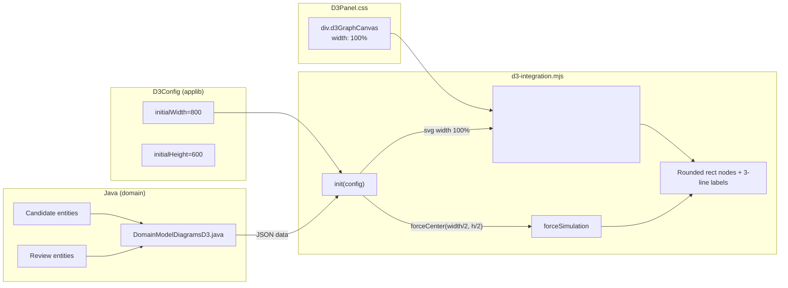

# D3 Domain-Model Diagram — Design & Sizing

## Overview

The domain-model diagram is an interactive **D3.js force-layout graph** that visualises
candidates extracted from a use-case corpus (PetShop in the current run). Each candidate
is rendered as a rounded rectangle; relationships between candidates are drawn as directed
edges with dependency-type labels (e.g. `nsubj`, `dobj`).

### Visual design

| Element | Rendering |
|---|---|
| **Node shape** | Rounded rectangle (`rx="9"`, `ry="9"`) |
| **Node fill** | Colour-coded by part-of-speech (POS) — nouns in blue, verbs in green, etc. |
| **First label line** | Subdomain — *italic*.  ClassCdd nodes show the reviewer-assigned `ClassCdd.subDomain` name (e.g. `Inventory`, `Checkout`); all other node types show blank |
| **Second label line** | Candidate name — **bold** |
| **Third label line** | POS tag inside `<< >>` — normal weight |
| **Border — approved** | `4px` solid `#333` (bold outline) |
| **Border — synonym** | `6px,4px` dashed |
| **Border — default** | `2px` solid `#333` |
| **Edge** | Grey line, opacity 0.6, width proportional to `value` |
| **Edge label** | Dependency type code (e.g. `nsubj`, `dobj`, `amod`) at midpoint |
| **Legend** | Bottom-left: POS colour swatch + label (e.g. Noun, Verb) |
| **Interactivity** | Drag nodes, zoom/pan (`0.1×–10×`), click nodes to invoke domain action |



### Data flow

1. **Domain layer (model-wide)** — `DomainModelDiagramsD3.renderDiagram(DomainModel)` queries
   all candidates, reviews, and rule matches, then assembles a JSON structure with `nodes`,
   `links`, and `legend` for the entire model.
2. **Domain layer (per candidate)** — `CandidateD3Graph.renderGraph(Candidate)` queries the
   same data but restricts the graph to the candidate's dependency neighbourhood via
   breadth-first expansion (up to `Candidate.hopDepth` hops), producing the same
   `{nodes, links, legend}` JSON format for a single candidate.
3. **Config** — The `@D3Graph` annotation on `DomainModel.getDiagram()` and
   `Candidate.getD3Graph()` triggers `D3Panel.buildConfig()` in the Wicket UI module,
   wrapping the JSON string into a `D3Config`.
4. **Page render** — `D3IntegrationReference.domReadyScript(config)` emits
   `WicketStuff.D3.init(configJSON)` as an `onDomReady` script.
5. **Client** — `init()` parses the JSON, creates an SVG, runs `d3.forceSimulation`,
   and renders nodes (rounded rectangles, coloured fills, 3-line labels) + links.

---

## Association-artifact filtering (lexical diagram)

### Problem

The lexical diagram was showing **synthetic association nodes** — e.g. `Coverage_Age`,
`OnlineStore_Store`, `RemainStock_Stock`, `Inventory_Product`, `BulkOrder_Order`,
`OnlineShop_Shop` — as orphan nodes with an empty `<<>>` POS label.  These nodes carry no
lexical information of their own: they are the *compound name* (`X_Y`) of an
`AssociationCdd` candidate derived from two real candidate lemmas, and the participants
plus their typed-dependency link are already drawn in the graph.

### Analysis (2026-10-16)

The candidate-extraction rules create such compounds from **three different rule families**,
which is why a rule-based filter kept missing cases:

| Rule family | Example | First fix | General fix |
|---|---|---|---|
| Synonym (TDR41) | `Coverage_Age` | ✅ caught | ✅ caught |
| Generalization | `OnlineStore_Store`, `RemainStock_Stock`, `BulkOrder_Order`, `OnlineShop_Shop` | ❌ missed | ✅ caught |
| Association rule | `Inventory_Product` | ❌ missed | ✅ caught |

A filter keyed on `SynonymCdd` rule matches (or any single rule type) is inherently
incomplete: every future rule family that emits `X_Y` compounds would need a new clause.

### Decision

**Filter by shape, not by origin.**  In `DomainModelDiagramsD3.associationArtifactLemmas(...)`:

1. Candidate type must label as `Association` (`typeLabel()` — any `*Cdd`-suffixed type).
2. The lowered lemma must contain a single `_` separator (`X_Y`).
3. Both halves (`X`, `Y`) must exist in the all-candidate lemma set (`candidateLemmas`).

If all three hold, the lemma is a synthetic compound → excluded from `nodeLemmas` and its
(fictional) endpoint TDs are stripped.  The **participant lemmas and their typed-dependency
link are kept** — only the compound node disappears.

| Candidate | Association-typed? | `X_Y` split | Both halves candidates? | Result |
|---|---|---|---|---|
| `Coverage_Age` | ✅ | `coverage` + `age` | ✅ | 🚫 excluded |
| `OnlineStore_Store` | ✅ | `onlinestore` + `store` | ✅ | 🚫 excluded |
| `RemainStock_Stock` | ✅ | `remainstock` + `stock` | ✅ | 🚫 excluded |
| `Inventory_Product` | ✅ | `inventory` + `product` | ✅ | 🚫 excluded |
| `BulkOrder_Order` | ✅ | `bulkorder` + `order` | ✅ | 🚫 excluded |
| `OnlineShop_Shop` | ✅ | `onlineshop` + `shop` | ✅ | 🚫 excluded |
| `PhysicalStore\|>Store` (genuine) | ✅ | no `_` → heuristic fails open | — | ✅ kept |
| `Inventory has Product` (genuine) | ✅ | no `_` → heuristic fails open | — | ✅ kept |

### Scope caveat — UML construction

**This filter is presentational only.**  It affects solely the D3 *lexical* rendering; the
`AssociationCdd` records themselves are **not** deleted or altered in the model.  The `X_Y`
compounds (and the `|>`-named generalizations) are required later for **UML class-diagram
construction**, where generalizations and associations are first-class citizens — do not
re-use this filter as a criterion for discarding association data anywhere else.

### Implementation reference

| Piece | Location |
|---|---|
| Artifact detection | `DomainModelDiagramsD3.associationArtifactLemmas(candidates, candidateLemmas)` |
| TD strip | `renderDiagram(...)` — `dependencies.removeIf(...)` on artifact endpoints |
| Node strip | `renderDiagram(...)` — `nodeLemmas.removeAll(artifactLemmas)` |
| Removed (superseded) | `synonymArtifactLemmas(...)` + `SYNONYM_CANDIDATE_TYPE` constant |

---

## Where the diagram size is set

The diagram's dimensions are controlled at **three layers**. Only two matter at runtime;
the third is a fallback.

### 1. Container (HTML + CSS) — `D3Panel.html` / `D3Panel.css`

```
.d3GraphPanel {
    width: 100%;
    min-height: 400px;
    overflow: hidden;
}
.d3GraphCanvas {
    width: 100%;
    min-height: 400px;
}
```

The `<div>` that holds the SVG is already `width: 100%` of its parent (the page's content
area).  **No change needed here.**

### 2. SVG element (JavaScript) — `d3-integration.mjs` lines 47–55

```js
var width = containerEl.clientWidth || config.initialWidth || 800;
var height = config.initialHeight || 600;

var svg = d3.select(containerEl)
    .append('svg')
    .attr('width', '100%')       // ← was numeric `width` (800); now fills the container
    .attr('height', height);
```

- `width` is derived from the container's `clientWidth` (the real rendered width of
  `div.d3GraphCanvas`). Falls back to `config.initialWidth` (800) if `clientWidth` is
  absent.
- `height` stays at the configured value (600) — the page's min-height triggers this.
- The SVG's `width` attribute is set to `'100%'` so the element stretches to its
  container.  Internal coordinates (used by `forceCenter()`) use the *measured* width,
  so the graph stays centred.
- On `resize`, a listener re-reads `clientWidth`, updates `forceCenter`, and gives the
  simulation a small kick (`alpha(0.5).restart()`) to re-centre.

### 3. Config default (Java) — `D3Config.java` (applib)

```java
@Builder.Default private int initialWidth = 800;
@Builder.Default private int initialHeight = 600;
```

These are never used in practice because `clientWidth` takes precedence. They remain as
fallbacks for test environments or headless rendering.

### Summary

| # | Layer | File | Effective value |
|---|---|---|---|
| 1 | Container CSS | `D3Panel.css` | `width: 100%; min-height: 400px` |
| 2 | SVG attribute | `d3-integration.mjs:55` | `width="100%"` |
| 2 | Layout width | `d3-integration.mjs:47` | `containerEl.clientWidth` (measured) |
| 2 | Layout height | `d3-integration.mjs:48` | `config.initialHeight \|\| 600` |
| 2 | Resize handler | `d3-integration.mjs:96–104` | Re-centres force layout on window resize |
| 3 | Java fallback | `D3Config.java` | `initialWidth = 800, initialHeight = 600` |

---

## Key files

| File | Role |
|---|---|
| `d3-integration.mjs` | Client-side D3 init — SVG creation, node/link rendering (first label line = `subdomain`), simulation, resize handling |
| `D3Panel.css` | Container layout — width 100%, min-height |
| `D3Panel.html` | Wicket panel markup — `div.d3GraphPanel > div.d3GraphCanvas` |
| `D3Panel.java` (ui) | Wicket panel — builds `D3Config` from `@D3Graph` facet |
| `D3Config.java` (applib) | `@Builder` config POJO — `initialWidth`, `initialHeight`, zoom/drag toggles |
| `D3IntegrationReference.java` | Wicket resource reference — wraps `d3-integration.mjs` and emits init script |
| `DomainModelDiagramsD3.java` | Domain service — assembles JSON graph data from all candidates + reviews (model-wide) |
| `CandidateD3Graph.java` | Domain service — assembles JSON graph data for a single candidate's neighbourhood (replaces `CandidateVegaGraph`) |
| `DomainModel.java` | Entity — holds `@D3Graph`-annotated `getDiagram()` property |
| `Candidate.java` | Entity — holds `@D3Graph`-annotated `getD3Graph()` property (replaces `getVegaGraph()`) |

---

## Quick reference (for agents)

- To change the **rendered size** — edit `d3-integration.mjs` width/height measurement
  (lines 47–48) and SVG attribute (line 55).
- To change the **container constraints** — edit `D3Panel.css` (`.d3GraphPanel`,
  `.d3GraphCanvas`).
- To change what data appears (model-wide) — edit `DomainModelDiagramsD3.java` (nodes, links, legend).
- To change what data appears (per candidate) — edit `CandidateD3Graph.java` (same format, single-candidate BFS).
- After editing `d3-integration.mjs`, **refresh the running app** by copying the file to
  `domox-webapp/target/classes/` under the same resource path, or run
  `mvn resources:resources -pl domox-webapp -q` for a full resource-cycle.
- To change the **underline link-affordance** (under the bold candidate name):
  - **Java side** (`DomainModelDiagramsD3.java` — `appendNodes()`) — emit the
    `isCandidateColumn` boolean flag per node.  `true` when the node has a real
    candidate entity (`candId != null`), `false` for synthetic/artifact nodes.
  - **JS side** (`d3-integration.mjs` — `node.each()`) — draws an explicit SVG `<line>`
    positioned by `tspan.d3-node-name.getBBox()` only when `d.isCandidateColumn` is
    `true`.  Avoids SVG `text-decoration: underline` on the tspan, whose baseline
    placement is unreliable with `dominant-baseline: central` when no subdomain line
    precedes it.

---

## Verification

After editing `d3-integration.mjs`, `DomainModelDiagramsD3.java`, or `CandidateD3Graph.java`:

1. **JS syntax** — `node --check domox-webapp/src/main/resources/org/apache/causeway/extensions/d3/wkt/integration/res/d3-integration.mjs`
2. **Refresh** — copy the `.mjs` to `target/classes` (see Quick reference above).
3. **Build + test** — `bash scripts/check.sh` (includes domain unit tests + metamodel guardrail).
4. **Manual visual check** — boot the app, open the Domain Model diagram page, verify:
   - ✅ Candidate-linked nodes (e.g. `Store`, `Customer`) have a white underline under the bold name.
   - ✅ Synthetic/artifact nodes (e.g. `Coverage_Age`, `ShopSystem`) have **no** underline.
   - ✅ The `<<POS>>` line is not overlapped by any underline.