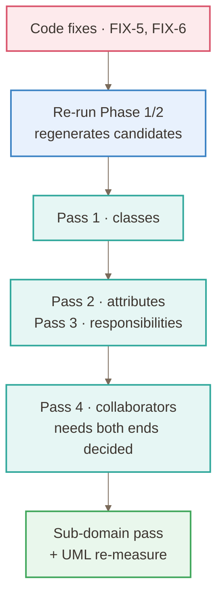

# Candidate review plan — what to review, in what order, and how

**Companion documents.** **Read first** — the three-pass overview and the map of which document
owns what: the `review-and-assemble-model` skill
(`.clinerules/skills/review-and-assemble-model.md`).
What the reviews are *for*: `MODEL_UML_READINESS_REVIEW.md`.
The code changes that must land first: `UML_GAP_FIX_PLAN.md`.
The mechanics of the pass (MCP driver, `/mcp` 404 trap, TSV pre-flight):
`.clinerules/memory-bank/workflows/mcp-review-pipeline.md`.
The pass that follows this one: `.clinerules/memory-bank/workflows/mcp-subdomain-pass.md`.
**Date.** 2026-11-18. All counts read from the live `domox-db`.

---

## 1. Scope — what is still unreviewed

| Type | Total | Reviewed | Approved | **Unreviewed** |
|---|---|---|---|---|
| `ClassCdd` | 971 | 202 | 131 | **769** |
| `PropertyCdd` (attributes) | 109 | 9 | 2 | **100** |
| `ActionCdd` (responsibilities) | 191 | 91 | 57 | **100** |
| `AssociationCdd` (collaborators) | 237 | 0 | 0 | **237** |
| **Total** | **1 508** | **302** | **190** | **1 206** |

Existing decisions (all `username='agent'`, idempotent): APPROVED 190, REJECTED
`NOT_RELEVANT` 80, `WRONG_CANDIDATE_TYPE` 18, `DUPLICATE` 14. Every one of the 131 approved
classes is already assigned to one of **10 sub-domains** (0 unassigned).

---

## 2. The ordering principle (read this before scheduling anything)



**Three rules, each of which avoids redoing work:**

1. **Fix the extraction before reviewing what it produces.** The review pass is 1 206 human
   judgements; a Phase-1/2 re-run replaces candidates and their ids. Reviewing first means the
   decisions are orphaned. FIX-5 (multiplicity scope) and FIX-6 (attribute vocabulary) change
   *what is extracted* → land them, re-run, then review.
2. **Classes before collaborators.** 171 of 237 collaborators are generalizations, and an
   association is only approvable when **both** ends are approved classes. Today **0/171** have
   both ends approved — because 769 classes are still unreviewed. Rejecting a generalization
   because an endpoint is *unreviewed* would be a wrong decision recorded as a real one.
3. **Attributes and responsibilities are independent of each other** and can be reviewed in
   parallel with the class pass — but they share the "owner is a real class" test, so reviewing
   them *after* the class pass gives a better owner signal.

---

## 3. Prerequisites (Phase 0)

- [ ] **Docker services up** — `docker ps` must show `domox-db`, `domox-nlp-1`, `domox-kroki-1`,
      `domox-fuseki-1` healthy (all four carry `restart: unless-stopped`; the Fuseki one matters
      for the optional ontology evidence).
- [ ] **App running** — `curl -s -o /dev/null -w '%{http_code}' http://localhost:8080/` → `200`.
- [ ] **MCP reachable** — `curl -s -o /dev/null -w '%{http_code}' -X POST http://localhost:8080/mcp`
      → `200`. A `404` is the `spring.ai.mcp.server.protocol` key trap
      (`mcp-review-pipeline.md` §3) — fix the config and **restart**, the auto-config does not
      pick it up on a live JVM.
- [ ] **Back up the database** — `bash scripts/db-backup.sh` before any bulk write.
- [ ] **Phase-1/2 re-run completed** (rule 1 above) — the rule matches must carry UML notation
      (`1`, `*`, `1..*`) rather than the stale `09` / `N` / `02` still in the table.

---

## 4. Pass 1 — classes (`ClassCdd`, 769 candidates)

**Why first.** Everything else references a class; the sub-domain pass, the association pass and
the attribute owner test all read the class decisions.

**Evidence.** `mcp-review-pipeline.md` §6.1 — candidate → `classcdd_rulematch` → `rulematch`
→ `typeddependency` → `sentence`.

**Policy** (from `mcp-review-pipeline.md` §5, unchanged):

| Decision | Applies to |
|---|---|
| `APPROVE` | a genuine domain entity the business talks about (`Pet, Groomer, Order, Policy, …`) |
| `REJECT / NOT_RELEVANT` | document scaffolding (`Sentence`, `MetadataField`, `OverviewField`, `SystemAction`, `BusinessRule`, `CaseUC`, `UseCase`…), combined artifacts (`SystemPayment`, `PetSystem`), generic/abstract nouns (`Information`, `Reason`, `Intent`) |
| `REJECT / WRONG_CANDIDATE_TYPE` | an attribute or unit in the entity slot (`Quantity`, `Cost`, `Age`, `Time`, `Online`), a bare verb (`Update`, `groom`, `have`) |
| `REJECT / DUPLICATE` | a capitalised `User_Action` duplicate of an accepted lowercase form |
| `REJECT / INSUFFICIENT_INFORMATION` | a name whose evidence is a single fragment |

**Rationale convention — the `NOT_RELEVANT` / `WRONG_CANDIDATE_TYPE` boundary** (decided
2026-11-19; §12.3). The two are not interchangeable, and the boundary is applied identically in all
four passes so the rationale counts stay comparable between them:

- **`WRONG_CANDIDATE_TYPE`** — the name *is* a domain concept, but it sits in the wrong slot: an
  attribute or unit in the entity slot (`Quantity`, `Cost`, `Availability`, `Age`, `Time`, `Online`),
  a bare verb where a class is expected (`Update`, `groom`, `have`), or a measure phrase
  (`WideRange`, `RealTime`, `TotalCost`). For a collaborator, an endpoint that is **not a class**
  (an attribute, a verb, a document artifact) is `WRONG_CANDIDATE_TYPE`.
- **`NOT_RELEVANT`** — the name is not a domain concept at all: document scaffolding (`Sentence`,
  `MetadataField`, `SystemAction`, `UC`, `**`), a combined artifact (`SystemPayment`, `PetSystem`),
  a generic/abstract noun (`Information`, `Reason`, `Intent`), or two names that merely co-occur.

Rule of thumb: **"right kind of thing, wrong place" → `WRONG_CANDIDATE_TYPE`; "not a thing we model"
→ `NOT_RELEVANT`.**

**Calibration.** The 302 existing decisions are the worked examples (190 approve / 112 reject;
`NOT_RELEVANT` dominates). Use them as the style guide; the PetShop baseline id list in
`mcp-review-pipeline.md` §5.1 is the reference for the already-reviewed portion.

**Optional grounding.** `ontologyEvidenceForCandidate(id)` / `suggestReview(id)` — advisory only.
Recall the two traps: the reference vocabularies are generic (no match is **not** evidence
against), and `Pet` matches `schema.org/PET` (a medical imaging technique).

**Exit criterion.** Every `ClassCdd` has exactly one review; the approved set is stable enough
that the association pass can rely on it.

---

## 5. Pass 2 — attributes (`PropertyCdd`, 100 candidates) — **new policy needed**

**Why a new policy.** `mcp-review-pipeline.md` §5 has no attribute table, and only 2 attributes are
approved today. This pass is also the **evidence source for FIX-6b**: the names you approve are
the vocabulary the `basic-attributes` list is missing.

| Decision | Applies to |
|---|---|
| `APPROVE` | a **value** that describes its owner — `Pet.breed`, `Order.total`, `Policy.expiryDate`; the name is a noun/measure, not a class |
| `REJECT / WRONG_CANDIDATE_TYPE` | the name is an entity (`pet`, `product`, `cart`, `role`) — it is a class or an association, not an attribute |
| `REJECT / NOT_RELEVANT` | the owner is the fabricated class `Unknown` (12 rows today; FIX-6a removes the cause, the re-run removes the rows) |
| `REJECT / DUPLICATE` | the same attribute twice on the same owner |
| `REJECT / INSUFFICIENT_INFORMATION` | phrase artifacts (`size color`, `description description`) with no resolvable single property |

**Record the vocabulary.** While reviewing, keep a running list of approved attribute names per
owner — it feeds FIX-6c directly. Reject decisions are equally informative: they tell FIX-6e
whether the extraction is producing associations where attributes were expected.

**The extraction side now applies the same rule (2026-11-19).** The TDR10/TDR11 possessive branches
create a `PropertyCdd` only when the possessed noun is in the `domox.nlp.basic-attributes` lexicon
(`UML_GAP_FIX_PLAN.md` §13.6), so an entity name no longer arrives here as an attribute. The measured
counts above (26 from TDR10, 18 from TDR11) therefore shrink on the next Phase-1/2 re-run, and the
`WRONG_CANDIDATE_TYPE` row should become rare: a `pet`/`cart`-style name turning up as an attribute is
now a **lexicon gap** to close in `basic-attributes` (this pass is what names the missing entry), not
a rule defect to re-open.

---

## 6. Pass 3 — responsibilities (`ActionCdd`, 100 candidates)

**Policy** (from `mcp-review-pipeline.md` §5, unchanged):

- **`APPROVE`** a genuine customer/system operation on a domain entity — `browse, purchase,
  select, add, proceed, validate, Calculate, confirm, Receive, notify, suggest, request, present,
  process, display, load`.
- **`REJECT / NOT_RELEVANT`** auxiliary or generic verbs — `have, use, allow, arrive, inform, ask,
  provide, prompt, decline, create`.
- **`REJECT / DUPLICATE`** for the capitalised `User_Action` duplicates of accepted lowercase
  dobj actions.

**Also record (for FIX-3).** For each approved responsibility, note whether its **owner** is the
right class. The review measured the owner to be the sentence *object* (`supervise → Day`,
`capture → Delivery`).

> **Resolved before the pass — FIX-3d applied 2026-11-20** (`UML_GAP_FIX_PLAN.md` §13.8). The
> observation no longer has to wait for this pass: it was re-expressed as a measurement over the
> candidates themselves, and it came out **systematic** — of the 191 `ActionCdd` candidates, 149 have
> an owner and **all 149 are owned by their object noun**, none by their actor (every one from `TDR3`,
> which fires on the object dependency). The owner is now the sentence's `nsubj` actor, with the object
> kept only as the fallback when the sentence names no usable actor. This pass therefore only
> **confirms** it: keep the second column, and read it as a check on the actor-derived owners rather
> than as the gate for a decision that has already been made.

---

## 7. Pass 4 — collaborators (`AssociationCdd`, 237 candidates) — **last, and new policy**

**Why last.** 171 are `GENERALIZATION`, 52 `SYNONYM`, 14 `ASSOCIATION`. A generalization is only
meaningful between two real classes, so this pass is worthless until Pass 1 is complete.

**Evidence.** The association **is** linked to its rule matches (`associationcdd_rulematch`, 237
rows) — the verb is in `rulematch.description`
(`relationship.add(inventory (has) product)`), which is also the natural edge label (FIX-7).

| Type | n | Decision rule |
|---|---|---|
| `GENERALIZATION` | 171 | `APPROVE` **only if both endpoints are approved classes** and the is-a reading is true; otherwise `REJECT / NOT_RELEVANT` (or `WRONG_CANDIDATE_TYPE` when an endpoint is not a class) |
| `SYNONYM` | 52 | `APPROVE` when the two names really denote one concept; `REJECT / NOT_RELEVANT` when they are merely co-occurring nouns |
| `ASSOCIATION` | 14 | `APPROVE` when the verb is a real domain relationship (`has`, `enroll in`, `register for`) and both ends are approved; else reject |

**Expected effect on the diagram.** This pass is where the diagram *shrinks*: 171 generalizations
built from unreviewed names will mostly go. That is the point — the export currently claims 237
edges, of which 23 connect two approved classes.

**Note on the rationale vocabulary.** The four values are fixed
(`DUPLICATE`, `WRONG_CANDIDATE_TYPE`, `NOT_RELEVANT`, `INSUFFICIENT_INFORMATION`, `OTHER`).
"one endpoint is not a class" maps most honestly to `WRONG_CANDIDATE_TYPE`; say so in the plan so
the counts stay comparable across passes.

---

## 8. How to run each pass (mechanics)

Reuse `mcp-review-pipeline.md` §7 verbatim — the MCP driver, the one-`initialize`-per-session
`Mcp-Session-Id`, and the `decisions.tsv` pre-flight. Three disciplines, each learned the hard way:

1. **One MCP call at a time.** Two calls in flight race (the sub-domain runbook saw duplicate
   sub-domains created by concurrent writes). Sequential calls converge.
2. **Validate the TSV before sending.** `id<TAB>APPROVE<TAB>` or `id<TAB>REJECT<TAB>RATIONALE`;
   every candidate id exactly once (`comm -23`); and **the file must end with a newline**
   (`tail -c1 /tmp/decisions.tsv | od -An -tx1` → `0a`) — an append that swallows the newline
   merged two records and silently produced one candidate with zero reviews.
3. **Never trust the driver's `ok` lines.** Cross-check the database (§9). In the first full run,
   148/148 printed `ok` while one candidate had no review, because its corrupted rationale threw
   and the error did not match the driver's fail pattern.

**Per-pass checkpoint.** After each pass, run the §9 verification for that type only, and only
then start the next pass. Do not batch all 1 206 decisions and verify at the end.

---

## 9. Verification (after every pass, and once at the end)

```sql
-- 1. per-type: total vs reviewed vs approved (unreviewed must reach 0 for the pass's type)
SELECT t.ctype, count(*) AS total, count(r.id) AS reviewed,
       count(*)-count(r.id) AS unreviewed,
       count(*) FILTER (WHERE r.status='APPROVED') AS approved
FROM ( SELECT id,'ClassCdd' AS ctype FROM domox.classcdd
       UNION ALL SELECT id,'PropertyCdd' FROM domox.propertycdd
       UNION ALL SELECT id,'ActionCdd'   FROM domox.actioncdd
       UNION ALL SELECT id,'AssociationCdd' FROM domox.associationcdd ) t
LEFT JOIN domox.review r ON r.candidate_id = t.id
GROUP BY 1 ORDER BY 1;

-- 2. candidates that escaped the pass entirely (must be 0)
SELECT count(*) FROM (
  SELECT id FROM domox.classcdd UNION ALL
  SELECT id FROM domox.propertycdd UNION ALL
  SELECT id FROM domox.actioncdd UNION ALL
  SELECT id FROM domox.associationcdd
) c WHERE c.id NOT IN (SELECT candidate_id FROM domox.review);

-- 3. every decision is the agent's, and the rationale breakdown is sane
SELECT username, status, rationale, count(*) FROM domox.review GROUP BY 1,2,3 ORDER BY 1,2,4 DESC;

-- 4. associations approvable in principle (both ends approved) — the Pass-4 health check
SELECT a.type, count(*) AS approved_associations
FROM domox.associationcdd a
WHERE EXISTS (SELECT 1 FROM domox.review r WHERE r.candidate_id=a.id AND r.status='APPROVED')
GROUP BY 1;
```

Shell: `docker exec domox-db psql -U postgres -d postgres -c "..."`.

---

## 10. Downstream — what the reviews unlock

- [ ] **Sub-domain pass.** Newly approved classes need a sub-domain; the existing 131 already have
      one (0 unassigned, 10 sub-domains, `Shared` classified `GENERIC`, the rest `UNCLASSIFIED`).
      Follow `.clinerules/memory-bank/workflows/mcp-subdomain-pass.md` — and remember **`suggestSubDomains()` lists only
      unassigned *approved* classes**, so it is empty until Pass 1 lands.
- [ ] **Re-measure the diagram.** `python3 scripts/ro.py invoke domox.DomainModels
      generateUmlDiagram domainModel=DomainModel:653`, then compare against the review's §2 table
      (971 classes / 842 empty bodies / 109 attribute lines / 149 operation lines / 237 edges /
      0 cardinalities). The approved subset is the number that matters.
- [ ] **Update `MODEL_UML_READINESS_REVIEW.md`** with the post-pass measurements, and close the
      gaps that the passes have answered (attribute vocabulary → FIX-6c).
- [ ] **Optional — ontology grounding.** `ontologySearch` / `suggestReview` on the approved set is a
      cheap sanity check for the ~15 core commerce classes; it is not evidence for completeness.

---

## 11. Work breakdown, effort and risk

| Pass | Candidates | Policy | Effort | Main risk |
|---|---|---|---|---|
| 0 — prerequisites + re-run | — | — | S | the re-run replaces candidate ids → review only **after** it |
| 1 — classes | 769 | existing, calibrated | L | review fatigue; a class approved here decides 171 associations |
| 2 — attributes | 100 | **new** | M | the vocabulary is the real deliverable — record it as you go |
| 3 — responsibilities | 100 | existing | M | the owner correction (FIX-3d, applied 2026-11-20) is only *confirmed* here — see §6 |
| 4 — collaborators | 237 | **new** | M | near-total rejection of 171 generalizations is expected, not a failure |
| 5 — sub-domains + re-measure | — | existing | S | `suggestSubDomains` is empty until Pass 1 completes |

---

## 12. Decisions — answered 2026-11-19

1. **Re-run scope** → **whole corpus**, and the 302 existing review decisions are **kept**: the review
   hangs off the candidate row, and a re-analysis *updates* candidates in place
   (`findOrCreate` by name + model) rather than deleting and re-creating them. The risk named in §11
   ("the re-run replaces candidate ids") therefore does not materialise **as long as the model is not
   dropped** — re-analyse into the existing `DomainModel` (`DomainModel:653`), do not delete it. If a
   fresh model is ever used, the decisions must be re-keyed by name + type first.
2. **Attribute policy sign-off** — open; §5 is still a proposal. The measured input for it is now
   available (`UML_GAP_FIX_PLAN.md` §13.6: 42 of the 109 attributes come from TDR12, 26 from TDR10,
   18 from TDR11), and the rule "an attribute is a built-in value; a reference to a class is an
   association" is settled — what is undecided is whether the *possessive* rules may keep producing
   attributes for class nouns.
3. **`WRONG_CANDIDATE_TYPE` vs `NOT_RELEVANT`** — **decided 2026-11-19** (a consistency call; it
   only affects the counts, not the decision). The boundary is stated once in §4 ("Rationale
   convention"): an element that *is* a domain concept but sits in the wrong slot — an attribute or
   unit in the entity slot, a bare verb, a measure phrase, or (for a collaborator) an endpoint that
   is not a class — is `WRONG_CANDIDATE_TYPE`; a name that is not a domain concept at all is
   `NOT_RELEVANT`. All four passes follow it.
4. **Whether to re-review** the 302 existing decisions → **no**: keep them (decision 1), and
   re-review only where the evidence changed (a candidate whose rule matches changed because of
   FIX-5/FIX-6).

### 12.5 what changed in the pipeline since this plan was written

The four gap-fix waves have landed (`UML_GAP_FIX_PLAN.md` §14). Three of them change what a reviewer
will see, so the passes below must be read against the **new** code:

| Fix | Effect on the review material |
|---|---|
| FIX-5 | TDR25/TDR26 no longer record a multiplicity (or a class) for a document-metadata noun — `Sentence`, `Second`, `Off`, `Day`, `Period`, `Time`, `UC` disappear on a re-run, and `UC` is now actually blocked (the lookup was case-sensitive) |
| FIX-6 | no class called `Unknown`; a compound attribute is named after the attribute word (`pet size` → `size`); `fee`, `cost`, `price`, `breed`, `duration`, `rating` are now extractable as attributes |
| FIX-3 | operations carry parameters (`browse(pet: Pet)`) and no longer render `: void` |
| FIX-2 / FIX-7 | edges carry a multiplicity and a verb label |
| FIX-4 | the RestfulObjects list endpoints work again, so the evidence can be read with `ro.py` |

