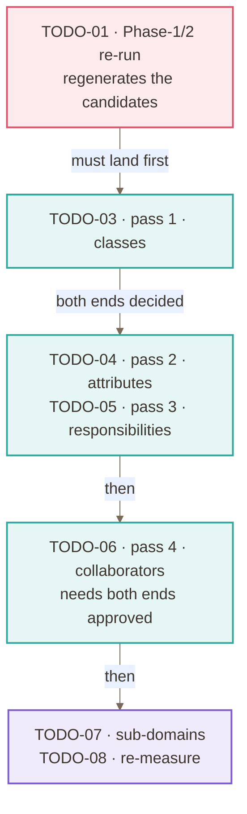

# Review Playbook — trigger a candidate-review run from one document

**Purpose.** Two things in one place, so a review run can be started by pointing the agent at this
file alone:

1. the **open Review-pipeline work** — the `TODO.md` items in the area *Review pipeline*; and
2. the **whole review method** joined from the review documents — prerequisites, the four review
   passes with their per-type policies, the sub-domain pass, the assembly/grounding pass, and the
   MCP mechanics (session driver, decisions file, the `/mcp` 404 fix, the verification SQL, the
   pitfalls).

**It is derived, not a source of truth.** Every section is joined from a document in the table below;
if this file and a source disagree, **the source wins**. Update the sources, then re-derive this file.

| Source | Owns |
|---|---|
| `TODO.md` §3–§4 | the open Review-pipeline items (TODO-01, 03–08) and their scales |
| `docs/scratch_pad/MODEL_REVIEW_PLAN.md` | the live pass plan: scope, ordering, per-pass policy, counts |
| `.clinerules/skills/review-and-assemble-model.md` | the umbrella method + the doc map |
| `.clinerules/memory-bank/workflows/mcp-review-pipeline.md` | pass 1 wiring: driver, SQL, `/mcp` 404 fix |
| `.clinerules/memory-bank/workflows/mcp-subdomain-pass.md` | pass 2 wiring: the 8 sub-domain tools, evidence |
| `docs/scratch_pad/MODEL_UML_READINESS_REVIEW.md` | what the reviews are *for*; the pre-fix baseline |
| `docs/scratch_pad/UML_GAP_FIX_PLAN.md` | the extraction fixes that gate the passes (§9, §13, §14) |

**Compiled.** 2026-11-21. All counts are the **pre-fix** baseline until TODO-01's re-run lands.

---

## 0. How to trigger a run

Say to the agent, for example:

> *"Run the candidate-review pipeline per `docs/scratch_pad/REVIEW_PLAYBOOK.md`."*

The agent then works **§4 → §5 → §6 → §7** in order, **one MCP call at a time**, and verifies each
pass in the database (§7.2) before starting the next. A **pass** is the unit of work: one candidate
type, one kind of decision, verified before the next pass starts.

Task signatures that route here (from the runbooks): *"review the N candidates / approve / reject"*,
*"run the candidate review pipeline / Phase 1..4"*, *"populate / fill the sub-domain table"*,
*"partition the domain"*, *"re-measure the UML model"*, *"generate the diagram(s) / one per sub-domain"*,
*"ground a term against the ontologies"*, and anything touching `ReviewMcpTools`,
`OntologyReviewMcpTools`, `SubDomainMcpTools`, `approveCandidate`, `rejectCandidate`,
`nextCandidateForReview`, `rejectEmptyClasses`, `suggestSubDomains`, `ontologySearch`.

---

## 1. The pipeline at a glance



**Three ordering rules** (`MODEL_REVIEW_PLAN.md` §2), each of which avoids redoing work:

1. **Fix the extraction before reviewing what it produces.** The code fixes have landed; the Phase-1/2
   re-run (**TODO-01**) is the only step left, and it is the gate for every pass.
2. **Classes before collaborators.** 171 of 237 collaborators are generalizations, approvable only when
   **both** ends are approved classes; today 0/171 qualify.
3. **Attributes and responsibilities are independent of each other** (parallel with the class pass) but
   share the *"owner is a real class"* test — run them after the class pass for a better owner signal.

---

## 2. Open Review-pipeline work (joined from `TODO.md`)

| ID | Issue | Pri | Effort | Risk | Blocked by |
|---|---|---|---|---|---|
| **TODO-01** | Phase-1/2 re-run on the whole corpus | P0 | M | High | — |
| **TODO-03** | Pass 1 — review **769** `ClassCdd` | P1 | L | High | TODO-01 |
| **TODO-04** | Pass 2 — review **100** `AttributeCdd` **+ record the vocabulary** | P2 | M | Medium | TODO-01 |
| **TODO-05** | Pass 3 — review **100** `ResponsibilityCdd` **+ owner-correctness column** | P2 | M | Medium | TODO-01 |
| **TODO-06** | Pass 4 — review **237** `CollaboratorCdd` | P2 | M | Medium | TODO-03 |
| **TODO-07** | Sub-domain pass for the newly approved classes | P2 | S | Low | TODO-03 |
| **TODO-08** | Re-measure the UML diagram + update the readiness review | P2 | S | Medium | TODO-03…06 |

**Details and done-criteria** (the *Risk if skipped* / *Area of improvement* / *Done when* fields from
`TODO.md`, condensed):

- **TODO-01 — Phase-1/2 re-run.** *Open:* the extraction fixes (FIX-6a/6b/6c/6e, TDR10/TDR11 lexicon
  guards, the re-expressed FIX-3d) have landed but the candidate tables still hold pre-fix output.
  *Risk if skipped:* every pass reviews a model that no longer exists — the counts below are the
  *pre-fix* shape. *Area:* re-run Phase 1 (NLP) + Phase 2 (rule match) over the 15 use cases, then
  re-measure the candidate counts and update `MODEL_REVIEW_PLAN.md`. *Done when:* the candidate tables
  are regenerated, `Unknown` no longer owns attributes, the TDR10/TDR11 possessive rows are lexicon-gated,
  and the per-type counts are re-measured.
- **TODO-03 — Pass 1 (classes).** *Risk if skipped:* nothing downstream can run — collaborators,
  sub-domains and the assembled diagram all read the approved class set. *Area:* apply the class policy
  (§4.1) to every `ClassCdd`. *Done when:* every `ClassCdd` has exactly one review and the approved set
  is stable enough for the collaborator pass to rely on.
- **TODO-04 — Pass 2 (attributes).** *Open:* 100 `AttributeCdd`, of which only a handful are approved.
  *Risk if skipped:* the `basic-attributes` lexicon (FIX-6c) is never completed, so entity names keep
  arriving in the attribute slot. *Area:* apply the attribute policy (§4.2) **and write the approved
  attribute-name vocabulary back into `UML_GAP_FIX_PLAN.md` §9** — that list *is* the deliverable.
  *Done when:* every `AttributeCdd` is reviewed and the vocabulary list is recorded.
- **TODO-05 — Pass 3 (responsibilities).** *Open:* 100 `ResponsibilityCdd`. *Risk if skipped:* the
  operation set of the assembled model is unverified. *Area:* apply the responsibility policy (§4.3) and
  keep the **owner-correctness column** — it now only *confirms* FIX-3d (already applied; owner = the
  sentence's `nsubj` actor). *Done when:* every `ResponsibilityCdd` is reviewed and the owner column is
  recorded.
- **TODO-06 — Pass 4 (collaborators).** *Open:* 237 `CollaboratorCdd` (171 `GENERALIZATION`, 52
  `SYNONYM`, 14 `ASSOCIATION`). *Risk if skipped:* the diagram keeps claiming 237 edges when only the
  ones between approved classes are real. *Area:* apply the collaborator policy (§4.4); this pass is
  where the diagram *shrinks*. *Done when:* every `CollaboratorCdd` is reviewed against the approved
  class set.
- **TODO-07 — Sub-domain pass.** *Open:* newly approved classes have no sub-domain. *Risk if skipped:*
  the assembled model has no business-area partition. *Area:* run §5. *Done when:* every approved class
  candidate has a sub-domain (or is a deliberate cross-cutting leftover).
- **TODO-08 — Re-measure.** *Open:* the readiness review's numbers are pre-fix. *Risk if skipped:* the
  model's stated size is an opinion, not a measurement. *Area:* re-measure classes / attribute lines /
  operation lines / edges / cardinalities and update `MODEL_UML_READINESS_REVIEW.md` §2 so the next run
  measures a **delta**. *Done when:* the readiness table is refreshed from the assembled model.

---

## 3. Phase 0 — prerequisites (before any pass)

- **App running with the MCP endpoint live.** `bash scripts/run-app.sh`, then confirm
  `curl -s -o /dev/null -w '%{http_code}' -X POST http://localhost:8080/mcp` → **200**. A **404** is the
  `spring.ai.mcp.server.protocol` key issue (§7.3), not a missing server.
- **Postgres reachable** — `docker exec domox-db psql -U postgres -d postgres -c '\dt domox.*'`. Never boot
  a second app instance against the same DB (the shared `domox.SEQ_GEN` sequence makes parallel boots fail
  with `seq_gen already exists`).
- **Schema drift clear** — `bash scripts/check-schema-drift.sh`. A missing column (e.g.
  `subdomain.classification`) fails the pass with *column "…" does not exist*; EclipseLink `create-tables`
  never ALTERs (`memory-bank/technical/SCHEMA.md`).
- **The queue is non-empty for the pass's type** — read it from the tools, never from SQL alone (§4.0).
- **For the re-run (TODO-01):** the Stanford CoreNLP service must be up (`docker start domox-nlp-1`;
  `curl -s -o /dev/null -w '%{http_code}' http://localhost:8999/` → 200, ~10 s after start).

---

## 4. Pass 1 — review (the four review passes)

Decides *which candidates are real*. Every candidate of the pass's type is **approved or rejected**, and
a rejection carries a rationale from the fixed set `ReviewRationale` — `DUPLICATE`,
`WRONG_CANDIDATE_TYPE`, `NOT_RELEVANT`, `INSUFFICIENT_INFORMATION`, `OTHER`.

### 4.0 The tools and the evidence

| Tool | Role |
|---|---|
| `nextCandidateForReview()` | the next unprocessed candidate — **the queue, from the tool** |
| `approveCandidate(candidateId, reason)` | approve, with a reason |
| `rejectCandidate(candidateId, rationale, reason)` | reject, with a **category** and a **reason** |
| `rejectEmptyClasses(reason)` | **the "no empty boxes" sweep** (§4.6): reject every approved class with no approved content |
| `ontologyEvidenceForCandidate(candidateId)` | *(optional)* grounding for the candidate's name + `typeAgreement` + same-name approved candidates |
| `suggestReview(candidateId)` | *(optional)* an **advisory** suggestion — never the decision |

- **A reason is required on every write.** `rationale` is the *category*; `reason` is the free text behind
  it — the evidence relied on, not a restatement of the category. Stored on `Candidate.rationale`
  (`varchar(2000)`); blank is refused.
- **Evidence is the rule-match chain** `candidate → RuleMatch → TypedDependency → Sentence → Document`.
  Read it through `UseCases#provenanceFor` — *which use cases the rules actually fired on* — not
  `ContextEvidence#sentencesFor` (where the word appears; a different question).
- **Every decision is idempotent**, so a re-run is safe and a straggler is fixed by calling the tool for
  that one id.
- **Optional grounding** (`OntologyReviewMcpTools`, §6) is advisory only: the reference vocabularies are
  generic, so **no match is not evidence against** (and `Pet` matches `schema.org/PET`, a medical imaging
  technique).

**The fixed `NOT_RELEVANT` / `WRONG_CANDIDATE_TYPE` boundary** (decided 2026-11-19; apply it *identically*
in every pass so the counts stay comparable):

- **wrong slot → `WRONG_CANDIDATE_TYPE`** — the name *is* a domain concept but sits in the wrong slot (an
  attribute/unit in the entity slot, a bare verb, a measure phrase; for a collaborator, an endpoint that is
  not a class);
- **not a domain concept → `NOT_RELEVANT`** — scaffolding (`Sentence`, `MetadataField`, `SystemAction`,
  `UC`, `**`), a combined artifact (`SystemPayment`), a generic/abstract noun (`Information`, `Reason`), or
  two merely co-occurring names.

Rule of thumb: **"right kind of thing, wrong place" → `WRONG_CANDIDATE_TYPE`; "not a thing we model" →
`NOT_RELEVANT`.**

### 4.1 Class policy (Pass 1 / TODO-03) — `ClassCdd`

| Decision | Applies to |
|---|---|
| `APPROVE` | a **thing with identity and a lifecycle** the business talks about — an entity/aggregate or a value object with identity: `Pet`, `Order`, `Payment`, `Vet` |
| `REJECT / WRONG_CANDIDATE_TYPE` | a name that *is* an attribute/unit/measure in the entity slot (`Quantity`, `Cost`, `Availability`, `Age`, `Range`, `Second`, `Time`, `Online`, `WideRange`, `RealTime`, `TotalCost`), or a verb used as a class (`Update`, `groom`, `have`, `reflect`, `require`, `restrict`) |
| `REJECT / DUPLICATE` | a capitalised `User_Action` duplicate of an accepted lowercase dobj action (`Select`/`select`, `Add`/`add`, `Process`/`process`, `Display`/`display`); a property that duplicates an entity (`cart` vs `Cart`) |
| `REJECT / NOT_RELEVANT` | document scaffolding, a combined artifact, a generic/abstract noun, or two merely co-occurring names |
| `REJECT / INSUFFICIENT_INFORMATION` · `OTHER` | rarely needed |

**Calibration.** The **202** existing *class* decisions are the worked examples (131 approve / 71 reject;
`NOT_RELEVANT` dominates) — *not* the corpus-wide 302, which counts all four candidate types. The PetShop
baseline id list (§4.5) is the reference for the already-reviewed portion.

**Exit criterion.** Every `ClassCdd` has exactly one review; the approved set is stable enough that the
collaborator pass can rely on it.

### 4.2 Attribute policy (Pass 2 / TODO-04) — `AttributeCdd` — ratified 2026-11-20

This pass is also the **evidence source for FIX-6b**: the names you approve are the vocabulary the
`basic-attributes` list is missing.

| Decision | Applies to |
|---|---|
| `APPROVE` | a **value** that describes its owner — `Pet.breed`, `Order.total`, `Policy.expiryDate`; the name is a noun/measure, not a class |
| `REJECT / WRONG_CANDIDATE_TYPE` | the name is **itself a class** (`pet`, `product`, `cart`, `role`, `status`, `type`) — the possessive rule mirrored a noun into the wrong slot; this is the association FIX-6e expects to see |
| `REJECT / WRONG_CANDIDATE_TYPE` | the name is a **verb** (`update`), not a value — the same boundary the class pass applies |
| `REJECT / DUPLICATE` | a **true mirror pair**: the same noun extracted in both directions, `X.y` *and* `y.x` (`Sign.illness` / `Illness.sign`) |
| `REJECT / NOT_RELEVANT` | the owner is the fabricated class `Unknown` (FIX-6a removes the cause, the re-run the rows) |
| `REJECT / INSUFFICIENT_INFORMATION` | phrase artifacts (`size color`, `description description`) with no resolvable single property |

**The entity-name vs mirror boundary (ratified 2026-11-20).** An attribute whose name is a class is
`WRONG_CANDIDATE_TYPE`, **not** `DUPLICATE`. Recorded as `DUPLICATE`, FIX-6e cannot tell *"the extraction
produced an association where an attribute was expected"* from *"the same attribute twice"*. `DUPLICATE`
is reserved for a mirror pair, where the **pair** is the finding.

**The measured pre-fix shape of the 100 candidates** (precedence as listed — decide for the *post-re-run*
shape, since the re-run shrinks the hard buckets):

| Bucket | Rows | Decision |
|---|---|---|
| owner = `Unknown` | 11 | `NOT_RELEVANT` |
| name has a space (phrase) | 47 | `INSUFFICIENT_INFORMATION` |
| **name is itself a class** | **37** | `WRONG_CANDIDATE_TYPE` (one live mirror pair → `DUPLICATE`) |
| plain value noun | 5 | `APPROVE` |

**Record the vocabulary — it *is* the deliverable.** Keep a running list of approved attribute names per
owner and write it back into `UML_GAP_FIX_PLAN.md` §9 beside F6b/F6c. Reject decisions are equally
informative: they tell FIX-6e whether the extraction is producing associations where attributes were
expected.

### 4.3 Responsibility policy (Pass 3 / TODO-05) — `ResponsibilityCdd`

| Decision | Applies to |
|---|---|
| `APPROVE` | a genuine customer/system **operation on a domain entity** — `browse`, `purchase`, `select`, `add`, `proceed`, `validate`, `Calculate`, `confirm`, `Receive`, `notify`, `suggest`, `request`, `present`, `process`, `display`, `load` |
| `REJECT / NOT_RELEVANT` | auxiliary or generic verbs — `have`, `use`, `allow`, `arrive`, `inform`, `ask`, `provide`, `prompt`, `decline`, `create`; and marked-as-missing artifacts |
| `REJECT / DUPLICATE` | the capitalised `User_Action` duplicates of accepted lowercase dobj actions |

**Also record (for FIX-3).** For each approved responsibility, note whether its **owner** is the right
class. *Resolved before the pass:* FIX-3d applied 2026-11-20 (`UML_GAP_FIX_PLAN.md` §13.8) — the
observation was re-expressed as a measurement and came out **systematic**: of the 191 `ResponsibilityCdd`
candidates, 149 have an owner and **all 149 are owned by their object noun**, none by their actor (every
one from `TDR3`). The owner is now the sentence's `nsubj` actor, with the object kept only as the fallback.
This pass therefore only **confirms** it: keep the second column, and read it as a check on the
actor-derived owners rather than as the gate for a decision already made.

### 4.4 Collaborator policy (Pass 4 / TODO-06) — `CollaboratorCdd` — last, new policy

**Why last.** 171 are `GENERALIZATION`, 52 `SYNONYM`, 14 `ASSOCIATION`. A generalization is only
meaningful between two real classes, so this pass is worthless until Pass 1 is complete.

**Evidence.** The association **is** linked to its rule matches (`collaboratorcdd_rulematch`, 237 rows) —
the verb is in `rulematch.description` (`relationship.add(inventory (has) product)`), which is also the
natural edge label (FIX-7).

| Type | n | Decision rule |
|---|---|---|
| `GENERALIZATION` | 171 | `APPROVE` **only if both endpoints are approved classes** and the is-a reading is true; otherwise `REJECT / NOT_RELEVANT` (or `WRONG_CANDIDATE_TYPE` when an endpoint is not a class) |
| `SYNONYM` | 52 | `APPROVE` when the two names really denote one concept; `REJECT / NOT_RELEVANT` when they are merely co-occurring nouns |
| `ASSOCIATION` | 14 | `APPROVE` when the verb is a real domain relationship (`has`, `enroll in`, `register for`) and both ends are approved; else reject |

**Expected effect on the diagram.** This pass is where the diagram *shrinks*: 171 generalizations built
from unreviewed names will mostly go. That is the point — the export currently claims 237 edges, of which
23 connect two approved classes.

**Rationale vocabulary.** The four values are fixed (`DUPLICATE`, `WRONG_CANDIDATE_TYPE`, `NOT_RELEVANT`,
`INSUFFICIENT_INFORMATION`, `OTHER`). *"one endpoint is not a class"* maps most honestly to
`WRONG_CANDIDATE_TYPE` — say so, so the counts stay comparable across passes.

### 4.5 Baseline for PetShop (this corpus) — canonical 54 approve / 94 reject

Approved ids by type (reference for diffing/regression):

- **ClassCdd (30):** 6640, 6643, 6644, 6645, 6646, 6647, 6652, 6655, 6659, 6664, 6666, 6668, 6670, 6672,
  6676, 6678, 6680, 6682, 6684, 6687, 6688, 6692, 6694, 6699, 6728, 6735, 6739, 6756, 6764, 6768
- **AttributeCdd (3):** 6686, 6696, 6754
- **ResponsibilityCdd (16):** 6669, 6675, 6698, 6700, 6704, 6707, 6708, 6715, 6719, 6723, 6724, 6732,
  6734, 6736, 6745, 6767
- **CollaboratorCdd (5):** 6677, 6679, 6681, 6685, 6693

Everything else REJECTED (statuses: `NOT_RELEVANT` 66, `WRONG_CANDIDATE_TYPE` 23, `DUPLICATE` 5).

---

### 4.6 The assembled model — what is in the diagram, and what is rejected

The four passes decide *which candidates are real*.  This step decides *what the model now contains*,
and it is enforced in code rather than by convention:

| Rule | Where it lives | Effect |
|---|---|---|
| **Only approved candidates are drawn** | `generate.ClassDiagram` | an unapproved class, attribute, responsibility or association never reaches a diagram |
| **A class with nothing approved is not drawn** | `ModelContent.includedClasses(model)` | approved, but with no approved attribute / responsibility **and** no material relation → omitted |
| **A relation counts for both of its ends** | `ModelContent` reads the model's collaboration list | a class that is only the *target* of a relation is still in the model (ingestion attaches a collaboration to its source alone, so the class's own list is empty) |
| **A class with no content at all is rejected** | `DomainModels#rejectEmptyClasses` → `rejectAsAgent(…, INSUFFICIENT_INFORMATION, …)` | the review stops claiming a class the model does not contain |

**Why the sweep exists.**  An approved class whose members were all rejected draws as an **empty
rectangle**: it states nothing and makes the diagram harder to read.  Omitting it is not enough — the
review would still report it, the next re-measure would still count it, and the review and the model
would disagree.  The sweep makes **"approved" and "in the model" the same statement**.

**Rationale is `INSUFFICIENT_INFORMATION`, never `NOT_RELEVANT`.**  The class may be a perfectly real
concept of the business; the extraction simply produced nothing to model it with.  `NOT_RELEVANT` would
claim the concept is irrelevant — a different, stronger judgement.

**Three diagrams, one model.**  The export produces:

- one **whole-model** diagram — `DomainModels#generateUmlDiagram`;
- one **per sub-domain** diagram — `DomainModels#generateSubDomainUmlDiagram` (the choices come from the
  sub-domain names, i.e. one diagram per sub-domain that has classes);
- one **sub-domain overview** — `DomainModels#generateSubDomainOverviewDiagram`: a node per sub-domain,
  an edge per **cross-sub-domain** relation labelled with the number of collaborations it aggregates,
  plus a single `Unassigned` node while any included class still has no sub-domain.

A per-sub-domain diagram carries only the edges **wholly inside** that sub-domain; the relations that
leave it are the overview's job.  An `Unassigned` node in the overview is a **defect signal** — after
the sub-domain pass (§5) there should be none.

**When to run the sweep.**  After the four review passes **and** the sub-domain pass, and **before** the
re-measure (§6): a class the sweep rejects is not in the model, so measuring first counts classes the
model does not have.  It is idempotent — a re-run reports `Nothing to reject`.

**Guardrail.**  One predicate backs both halves — `ModelContent.includedClasses` and
`ModelContent.emptyClasses` are complements of the same test — so the export and the sweep cannot
disagree about which class is empty.  Unit tests: `generate.ClassDiagramTest`,
`domox.dom.crc.model.ModelContentTest`, `domox.dom.crc.model.ClassCddTest`,
`domox.dom.crc.service.DomainModelsTest`.

---

## 5. Pass 2 — sub-domain partition (TODO-07)

Decides *which business area each real class belongs to*. Only **approved** classes are material: the
tools filter on approval, so this pass is empty until Pass 1 lands.

### 5.1 Where the evidence is

```
UC01..UC15.md → domox.document → domox.sentence → domox.typeddependency
              → domox.rulematch → domox.classcdd_rulematch → domox.classcdd.subdomain_id
```

- **Corpus:** 15 use-case documents `UC01_SellingPetProducts` … `UC15_PetThemedMerchandise`.
- `domox.subdomain` = `(id, name, version, classification)`; `ClassCdd.subDomain` is `@ManyToOne` →
  `classcdd.subdomain_id` (inline-editable in the Causeway UI).
- **Provenance read:** `UseCases#provenanceFor(Candidate)` — walks the rule-match chain, so it answers
  *which use cases the rules actually fired on*, not *where the word appears* (that is
  `ContextEvidence#sentencesFor`, a different question).

### 5.2 The eight tools (all on `POST /mcp`)

| Tool | Kind | Returns |
|---|---|---|
| `listUseCases()` | 📖 read | the 15 use cases + how many class candidates each evidences and *dominates* |
| `listSubDomains()` | 📖 read | existing sub-domains with classification and owned-candidate counts |
| `listUnassignedClassCandidates()` | 📖 read | **approved** class candidates with no sub-domain (lean: id, name, type, approvalCount) |
| `subDomainEvidenceForCandidate(candidateId)` | 📖 read | one candidate's use-case profile + approval + current sub-domain |
| `suggestSubDomains()` | 🧠 advisory | the proposed partition; **writes nothing** |
| `createSubDomain(name, classification, reason)` | ✍️ write | create, or re-classify an existing one (case-insensitive, idempotent) |
| `assignCandidatesToSubDomain(candidateIds[], subDomainName, classification, reason)` | ✍️ write | one cluster per call; creates the sub-domain if missing |
| `clearCandidateSubDomain(candidateId, reason)` | ✍️ write | undo one assignment |

- ⚠️ **Every write requires a `reason`** — the corpus evidence, recorded on `SubDomain.rationale` (create)
  and `Candidate.rationale` (assign/un-assign); blank is refused (`mcp/McpReason.java`).
- ⚠️ **`suggestSubDomains()` is advice, not a decision** — it sees use-case provenance only.

### 5.3 The pass, in order

- **Phase 0 — Pre-flight.** `listUnassignedClassCandidates()` — **if empty, stop**: the pass has no input
  yet (a sub-domain pass run before the review pass has nothing to partition — *not* a failure, and not
  the same as a cluster that came back empty).
- **Phase 1 — Scope.** `listUseCases()` → the 15 areas, read as *business areas*, not as sub-domains.
- **Phase 2 — Evidence.** `suggestSubDomains()` → clusters, cross-cutting candidates, unevidenced
  candidates, and the reasons. Drill into anything surprising with `subDomainEvidenceForCandidate(id)`.
- **Phase 3 — Decide.** Rename each cluster to the business's own word; split or merge where the business
  says so; set the classification.
- **Phase 4 — Write.** `createSubDomain(...)` per sub-domain, then `assignCandidatesToSubDomain(...)` per
  cluster — **one call per cluster**, ids straight from the proposal, a reason on every call.
- **Phase 5 — Verify.** `listSubDomains()` shows every sub-domain with a non-zero count; the §7.2 SQL shows
  no approved class candidate left unassigned.

All writes are **idempotent** — re-running after adjusting the clustering creates no second sub-domain and
duplicates no assignment.

### 5.4 Use cases are not sub-domains

The single most common mistake. `suggestSubDomains` proposes a conservative partition; the business
judgement is yours:

| Pattern | Example | What to do |
|---|---|---|
| **Many use cases, one sub-domain** | `UC02_PetGrooming`, `UC06_PetBoarding`, `UC07_PetDaycare` | assign all three to one sub-domain (`Care Services`) |
| **One use case, several sub-domains** | `UC08_OnlinePetStore` (catalogue / checkout / fulfilment) | split it — assign different candidates to different sub-domains |
| **Cross-cutting concept** | `Customer`, `Pet`, `Payment` | leave unassigned, or give it its own *shared* area; never hand it to one area |
| **Genuinely distinct** | `UC14_PetInsurance` vs `UC01_SellingPetProducts` | separate sub-domains |

**What the advisor does on its own** (constants on `SubDomainAdvisor`):

| Rule | Constant | Meaning |
|---|---|---|
| Cross-cutting | `CROSS_CUTTING_USE_CASE_THRESHOLD = 5` | evidence spans ≥ 5 use cases → owned by nobody, left out of every cluster |
| Merge | `MERGE_SIMILARITY = 0.5` **and** `MERGE_MIN_SHARED = 2` | two areas merge only on ≥ 2 shared non-cross-cutting candidates at ≥ 0.5 Jaccard |
| Generic | `GENERIC_USE_CASE_SPAN = 3` | a cluster spanning ≥ 3 use cases is proposed `GENERIC` |

A candidate is assigned to the use case its evidence is **strongest** in (most sentences); the proposal
says so when the candidate also appears elsewhere — read that reason, it is where the splits are.

### 5.5 Classification is business judgement

`SubDomainClassification` = `CORE` | `SUPPORTING` | `GENERIC` | `UNCLASSIFIED`.

| Signal | Classification |
|---|---|
| Differentiating capability, worth bespoke modelling and the best people | `CORE` |
| Custom to this business but not differentiating | `SUPPORTING` |
| Solved the same way everywhere — buy or adopt | `GENERIC` |
| Cluster is broad (spans several use cases) — the corpus *does* show this | advisor proposes `GENERIC` |
| Anything else | **leave `UNCLASSIFIED`** and say what business input would settle it |

The corpus records **what** the business does, never **why it matters** — core-vs-supporting is not
derivable from it. Do not guess, and do not let a plausible-sounding cluster name imply a classification.

---

## 6. Pass 3 — assemble and ground (TODO-08)

Decides *what the model now says*. Assembly is a **re-measurement, not a creation**: the `DomainModel`
already exists (the analysis made it), and passes 1–2 have decided which candidates are real and which
area each belongs to. Read the assembled model back:

**Step 1 — run the empty-class sweep** (§4.6) with `rejectEmptyClasses(reason)`.  This is the step that
makes *"approved"* and *"in the model"* the same statement; run it **before** measuring, so the numbers
count only classes the model actually contains.

**Step 2 — render the diagrams.**  `DomainModels#listAll()` finds the model, then:

- `generateUmlDiagram(domainModel)` — the whole model. Each of the three returns a
  **`UmlClassDiagram` view model**: the PlantUML source is its `plantUml` property (that is what the
  re-measure below counts) and the diagram itself is its `diagram` property, rendered by Kroki;
- `generateSubDomainUmlDiagram(domainModel, subDomainName)` — **one diagram per sub-domain** (the
  choices come from the action);
- `generateSubDomainOverviewDiagram(domainModel)` — **how the sub-domains relate** to each other.

All three are **review-aware**: only approved candidates are drawn, and only classes that carry approved
content or take part in a material relation.  The D3 model diagram seeds from the **approved** candidates
only, so a model with zero approvals diagrams as empty and says so in the log instead of failing.

**Step 3 — record the numbers** (classes, attribute lines, operation lines, edges, cardinalities) against
`MODEL_UML_READINESS_REVIEW.md` §2, so the next pass measures a **delta** and not a fresh opinion.

**Grounding** is the second half of the pass: check a candidate name against the reference vocabularies
served by the local Fuseki image, so an approve/reject does not rest on the reviewer's priors alone.

| Tool | Role |
|---|---|
| `ontologySearch(term)` | what the vocabularies know about a term — source graph, IRI, label, kind (`CLASS`/`PROPERTY`/`INDIVIDUAL`), super-class, definition, synonyms |
| `ontologyEvidenceForCandidate(candidateId)` | that lookup for one candidate, plus `typeAgreement` (`AGREES`/`MISMATCH`/`UNKNOWN`) and same-name already-approved candidates |
| `suggestReview(candidateId)` | a suggested decision derived **only** from ontology evidence and duplicates |

Two rules govern grounding:

- **The vocabularies are generic, so "no match" is not "not a term".** Most nouns of a use-case corpus will
  not appear in Schema.org / BFO / gist / BBO / sBPMN. A miss yields `UNCERTAIN`, never a rejection.
- **Grounding is one input, not the decision.** `suggestReview` sees neither the rule-match evidence nor
  the review policy, and `ontologySearch` over the ~15 core classes is a sanity check, not evidence of
  completeness.

**Blank nodes are dropped.** A restriction-based definition (`gist:Contract` uses `owl:equivalentClass` →
an `owl:Restriction` blank node) is anonymous, so neither `synonyms` nor `superClass` reports it — absence
of a super-class therefore does **not** mean the term is a root class.

The graphs are served as **named graphs**, so the dataset's default graph is empty and every query must be
scoped to the configured graph list. An unscoped query returns nothing and is indistinguishable from "no
match".

**The advisor's rules** (`domox-domain/.../crc/service/ReviewAdvisor.java`) — deliberately conservative:

| Signal | Suggestion |
|---|---|
| same-name candidate already **approved** | `REJECT` / `DUPLICATE`, confidence HIGH |
| matches exist but none has the kind the candidate type implies (e.g. `ClassCdd` but only `PROPERTY`) | `REJECT` / `WRONG_CANDIDATE_TYPE`, confidence MEDIUM |

**Suggested workflow:** `nextCandidateForReview` → `ontologyEvidenceForCandidate(id)` (and/or
`suggestReview(id)`) → decide → `approveCandidate` / `rejectCandidate`.

---

## 7. Mechanics — the MCP session driver and the verification SQL

### 7.1 The write driver (reused by every pass)

Write `/tmp/decisions.tsv` — **four columns**, because the reason is required, not optional:

```
id<TAB>APPROVE<TAB><TAB>reason          # trailing tab after APPROVE
id<TAB>REJECT<TAB>RATIONALE<TAB>reason
```

**Pre-flight validation before sending anything** (three disciplines, each learned the hard way):

```bash
# every candidate id has exactly one decision line, no malformed rows:
comm -23 <(cut -f2 /tmp/candidates_distinct.tsv | sort -n) <(cut -f1 /tmp/decisions.tsv | sort -n)
awk -F'\t' 'NF<2 {print "short:",NR} NF==5 {print "dup-merged:",NR}' /tmp/decisions.tsv
# CRITICAL: the file must END with a newline before you append any lines to it
tail -c1 /tmp/decisions.tsv | od -An -tx1   # must print 0a
```

An append that swallows the newline merges two records onto one line and silently drops a decision.

**Driver** (`bash /tmp/review_driver.sh`) — one `initialize` per session, then reuse `Mcp-Session-Id`:

```bash
#!/usr/bin/env bash
set -uo pipefail
MC=http://localhost:8080/mcp
H1='Content-Type: application/json'
H2='Accept: application/json, text/event-stream'
HP='MCP-Protocol-Version: 2024-11-05'
SID=$(curl -sS -D - -o /dev/null -X POST "$MC" -H "$H1" -H "$H2" -H "$HP" \
  --data-binary '{"jsonrpc":"2.0","id":1,"method":"initialize","params":{"protocolVersion":"2024-11-05","capabilities":{},"clientInfo":{"name":"review-driver","version":"1.0"}}}' \
  2>&1 | grep -i 'Mcp-Session-Id' | tr -d '\r' | awk '{print $2}')
[ -n "$SID" ] || { echo NO-SESSION; exit 1; }
echo "SESSION=$SID" >&2
: > /tmp/review_results.log
i=0
while IFS= read -r line; do
  [ -n "$line" ] || continue
  # Split on TAB with pure-bash expansion, NOT `IFS=$'\t' read -r a b c d`:
  # tab is an IFS-*whitespace* character, so bash collapses the empty 3rd field
  # of an APPROVE row -- the reason then lands in `rat` and every approval is
  # refused with "A reason is required" while every rejection succeeds.
  id=${line%%$'\t'*}; rest=${line#*$'\t'}
  act=${rest%%$'\t'*}; rest=${rest#*$'\t'}
  rat=${rest%%$'\t'*}; why=${rest#*$'\t'}
  i=$((i+1))
  if [ "$act" = APPROVE ]; then
    payload="{\"jsonrpc\":\"2.0\",\"id\":$((i+100)),\"method\":\"tools/call\",\"params\":{\"name\":\"approveCandidate\",\"arguments\":{\"candidateId\":$id,\"reason\":\"$why\"}}}"
  else
    payload="{\"jsonrpc\":\"2.0\",\"id\":$((i+100)),\"method\":\"tools/call\",\"params\":{\"name\":\"rejectCandidate\",\"arguments\":{\"candidateId\":$id,\"rationale\":\"$rat\",\"reason\":\"$why\"}}}"
  fi
  out=$(curl -sS -X POST "$MC" -H "$H1" -H "$H2" -H "$HP" -H "Mcp-Session-Id: $SID" --data-binary "$payload" 2>&1)
  if printf '%s' "$out" | grep -qE '"isError":true|"error"|event:error'; then
    echo "FAIL id=$id act=$act :: $(printf '%s' "$out" | tr '\n' ' ' | head -c 400)" >> /tmp/review_results.log
  else
    echo "ok id=$id act=$act" >> /tmp/review_results.log
  fi
done < /tmp/decisions.tsv
echo "DONE $i processed"
```

- **Calls are idempotent** — safe to re-run (e.g. after fixing one line); a straggler is fixed by calling
  the tool for that one id.
- **`nextCandidateForReview` is NOT type-scoped** — it returns the highest-evidence candidate of *any*
  type. Drive each pass from the **per-type id list**, never from the fetch loop, or the "attribute pass"
  hands you classes.
- **Never trust the driver's `ok` lines** — cross-check the database (§7.2). In the first full run, 148/148
  printed `ok` while one candidate had no review, because its corrupted rationale threw and the error did
  not match the driver's fail pattern.
- **Per-pass checkpoint.** After each pass, run the §7.2 verification for that type only, and only then
  start the next pass. Do not batch all decisions and verify at the end.

### 7.2 Verification SQL (run via `docker exec domox-db psql`)

**Phase 1 — evidence extraction** (once per type; swap `<type>`):

```sql
SELECT c.id, c.candidatename, c.candidatetype,
       rm.id AS rm_id, rm.ruleclassname, rm.description,
       rm.relatedcandidatename, rm.relatedcandidatetype,
       tdd.governorlemma, tdd.dependentlemma, tdd.type,
       s.id AS sentence_id, s.text
FROM domox.<type>cdd c
JOIN domox.<type>cdd_rulematch cr ON cr.<type>cdd_id = c.id
JOIN domox.rulematch rm ON rm.id = cr.rulematches_id
LEFT JOIN domox.typeddependency tdd ON tdd.id = rm.typed_dependency_id
LEFT JOIN domox.sentence s ON s.id = tdd.sentence_id
ORDER BY c.id;
```

Keep the **distinct** candidate list separate to drive decisions — the cardinality is `<type>cdd` rows,
and each candidate has multiple evidence rows.

**Phase 4 — verification counts:**

```sql
SELECT count(*) FROM domox.review;                                  -- == candidate count
SELECT status,    count(*) FROM domox.review GROUP BY status;
SELECT username,  count(*) FROM domox.review GROUP BY username;     -- all 'agent'
SELECT rationale, count(*) FROM domox.review WHERE status='REJECTED' GROUP BY rationale;
-- unprocessed candidates MUST be 0
SELECT count(*) FROM (
  SELECT id FROM domox.classcdd UNION ALL
  SELECT id FROM domox.attributecdd UNION ALL
  SELECT id FROM domox.responsibilitycdd UNION ALL
  SELECT id FROM domox.collaboratorcdd
) c WHERE c.id NOT IN (SELECT candidate_id FROM domox.review);
-- type × status breakdown
SELECT t.t AS candidate_type, r.status, count(*)
FROM domox.review r
JOIN ( SELECT id,'ClassCdd' t FROM domox.classcdd UNION ALL
       SELECT id,'AttributeCdd' FROM domox.attributecdd UNION ALL
       SELECT id,'ResponsibilityCdd' FROM domox.responsibilitycdd UNION ALL
       SELECT id,'CollaboratorCdd' FROM domox.collaboratorcdd ) t ON t.id=r.candidate_id
GROUP BY t.t, r.status ORDER BY 1,2;
```

**Pass 2 — sub-domain verification:**

```sql
-- approved class candidates with no sub-domain (Phase 0 pre-flight / Phase 5 verify)
SELECT count(*) FROM domox.classcdd c
WHERE c.subdomain_id IS NULL
  AND EXISTS (SELECT 1 FROM domox.review r
              WHERE r.candidate_id = c.id AND r.status = 'APPROVED');
-- every sub-domain with its owned-candidate count
SELECT s.name, s.classification, count(c.id)
FROM domox.subdomain s LEFT JOIN domox.classcdd c ON c.subdomain_id = s.id
GROUP BY s.name, s.classification ORDER BY 3 DESC;
```

### 7.3 `/mcp` returns 404 — the one config trap

Symptom: the tools show in the Wicket UI but MCP never registers. **Root cause:** Spring AI 1.1.8 chooses
the MCP HTTP transport via **`spring.ai.mcp.server.protocol`** (`STREAMABLE` | `SSE` | `STATELESS`), and the
app was setting the nonexistent key `spring.ai.mcp.server.transport: STREAMABLE` — silently ignored, so the
streamable router function was never registered.

**Fix (one config edit):** in `application.yml` change `transport:` → `protocol:`, then **rebuild resources
AND restart** the instance (auto-config on the same JVM will not pick it up). The request/response
alternative is `STATELESS` — not any `...HTTP` value.

**Verify:** an MCP `initialize` returns HTTP 200 with `serverInfo: domox-review-server 0.1.0`, and
`tools/list` returns the three review tools. Do **not** accept "tools shown in the Wicket UI" as proof —
that is unrelated to MCP registration.

### 7.4 Pitfalls that cost real time

| Pitfall | Consequence / guard |
|---|---|
| `nextCandidateForReview` is **not** type-scoped | the attribute pass hands you classes → drive from the per-type id list |
| `IFS=$'\t' read -r id act rat why` **collapses the empty 3rd field** | tab is an IFS-*whitespace* char, so an APPROVE row's reason lands in `rat` and every approval is refused ("A reason is required") while every rejection succeeds — split with `${line%%$'\t'*}` / `${line#*$'\t'}` instead (7.1) |
| driver's `ok` lines | one candidate silently unprocessed → always cross-check the DB |
| `decisions.tsv` missing final newline | an appended line merges into the previous record and is dropped |
| `/mcp` 404 | `spring.ai.mcp.server.protocol`, not `transport`; rebuild + restart |
| `TABLE_PER_CLASS` | query `domox.<type>cdd`, **never** `domox.candidate` or the `public`-schema legacy tables; `domox.packagecdd` is gone |
| a candidate's `rationale` column | a corrupted/long rationale can make a write throw → treat a decision with no `review` row as unrecorded and re-send it |
| measuring **before** the empty-class sweep | the count includes classes the model does not contain → run `rejectEmptyClasses` first (§4.6) |
| an approved class with an empty body | not a review bug — it is the sweep's job (§4.6), and it is expected in bulk until the extraction improves (`UML_GAP_FIX_PLAN.md` §9) |
| second boot against the same Postgres | `domox.SEQ_GEN already exists` → one instance per database |

---

## 8. Source map — what owns what

This playbook is **derived**. It consolidates; it does not own. When a fact here disagrees with its source,
the **source wins** and this file is the thing to fix. Likewise `TODO.md` is a *derived index* — the
**owning document wins** there too, so a TODO closed here must be closed in its owning plan as well.

| Source | Owns |
|---|---|
| `.clinerules/skills/review-and-assemble-model.md` | the **umbrella** — the three-pass view, when to run which pass, the decision vocabulary |
| `.clinerules/memory-bank/workflows/mcp-review-pipeline.md` | **pass 1 wiring** — session driver, `decisions.tsv`, the `/mcp` 404 fix, per-pass verification SQL |
| `.clinerules/memory-bank/workflows/mcp-subdomain-pass.md` | **pass 2 wiring** — the evidence chain, the eight `SubDomainMcpTools` |
| `.clinerules/skills/identify-subdomains.md` | the **generic method** for partitioning a domain into sub-domains (not DoMoX-specific) |
| `docs/scratch_pad/MODEL_REVIEW_PLAN.md` | the **review method** in narrative form (phases, decision policy, grounding) |
| `docs/scratch_pad/UML_GAP_FIX_PLAN.md` | the **fix plan** the passes feed — FIX-3d, FIX-6a/b/c/e, FIX-7, §9 attribute vocabulary, §13.8 |
| `docs/scratch_pad/MODEL_UML_READINESS_REVIEW.md` | the **measurement baseline** (§2) that pass 3 records a delta against |
| `TODO.md` | the **derived index** of open work (TODO-01, 03–08 are the Review-pipeline items) |

**Entry point.** `.clinerules/commands.md` carries one pointer line to this playbook, so a review task
triggers it; the skill (`review-and-assemble-model`) remains the umbrella for the three-pass view.

---

## 9. Definition of done for the pipeline

- [ ] **Pass 1** — every candidate of all four types has exactly one `review` row, `username='agent'`;
      §7.2 shows unprocessed = 0 and the type × status breakdown matches the expected shape.
- [ ] **Pass 1 evidence** — approved attribute vocabulary written into `UML_GAP_FIX_PLAN.md` §9 (FIX-6b).
- [ ] **Pass 2** — every **approved** class candidate carries a sub-domain (§7.2 shows unassigned = 0), and
      each sub-domain has a rationale; classifications are business-justified or left `UNCLASSIFIED`.
- [ ] **Assembly (§4.6)** — `rejectEmptyClasses` has run, and no approved class is left without approved
      content or a material relation; the review and the model agree.
- [ ] **Diagrams (§6)** — the whole-model diagram, **one diagram per sub-domain**, and the sub-domain
      overview all render, and the overview shows **no `Unassigned` node**.
- [ ] **Pass 3** — the assembled model re-measured against `MODEL_UML_READINESS_REVIEW.md` §2 and the
      numbers recorded; grounding misses recorded as `UNCERTAIN`, never as rejections.
- [ ] **Docs** — any TODO closed here is closed in its owning plan too, and the §8 source map still holds.

<!-- CONTENT-END -->
