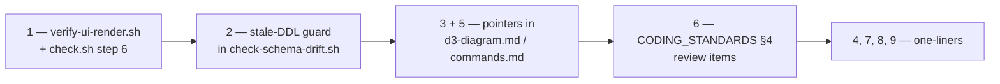

# 🔍 D3 Hover-Reveal (+ CRC Rename) — Retrospective (2026-10-31)

> Produced with the `retro` skill (`.clinerules/skills/retro.md`) — it looks back over a session and
> proposes improvements to the **environment**, never to the code.
> **Status: nothing applied.** Pick the candidate(s) you want and they get implemented then.

## Session summary

Two tasks in one session:

1. **CRC-guide alignment** — rename `ActionCdd`→`ResponsibilityCdd`, `AssociationCdd`→`CollaboratorCdd`,
   `PropertyCdd`→`AttributeCdd`, `ParameterCdd`→`ResponsibilityParameter`; split `domox.dom.crc` into
   `model`/`repository`/`service`/`diagram`; `rqm`→`requirements`; utils→`domox.util`.
   Long but mostly smooth — driven by compile errors.
   Full write-up: `docs/scratch_pad/CRC_VOCABULARY_RENAME_SUMMARY.md`.
2. **D3 graph hover-reveal in list views** — four iterations, **two of them delivered broken**.

The struggles are all in (2):

| Iteration | Symptom | Root cause | Cost |
|---|---|---|---|
| 1 | CSS added, declared done | `min-height: 0` was in the plan but dropped from the final CSS → `D3Panel.css`'s `min-height: 400px` kept the row ~800 px tall | 1 round-trip |
| 2 | User: *"doesnt seem to work"* | same as above; only provable from the user's pasted DOM dump | 1 round-trip |
| 3 | `min-height` fixed, still "rows too high" | `viewBox="0 0 3 800"` — the canvas measured **3 px**, so the force layout was computed in a 3 px window; `left:0` would also have opened the popup off-screen | 1 round-trip |
| 4 | *"old application.css still referenced"* | the browser served a **cached copy** of `/css/application.css`; `mvn clean install` + app restart cannot clear a browser cache | 2 round-trips |
| 5 | Diagnosis | built a headless-Chromium harness → hard numbers `panelH=32 minH=0px rowH=41`, hover `absolute 700×602`; root cause confirmed as browser cache | ~6 tool calls, 3 failed attempts |

---

## Candidates for improvement (in descending priority)

### 🚨 1. Nothing verifies a *rendered* UI change (this shipped two broken fixes)

**The moment:** the teaser CSS was verified by *reading the file* and `curl`-ing the bytes, then declared
done. It was wrong twice. Only a real browser render produced the truth:

```
normal:  panelH=32  minH=0px  canvasW=700  rowH=41     (was ~800)
hover:   position=absolute  panelW=702  panelH=602  svgH=600  rowH=39
```

**Category:** a mistake a tool could have caught → **automated check** (mechanical, not prose).
"CSS looks right" and "CSS is right" are indistinguishable by reading — exactly what failed here.

**Recommendation:** add `scripts/verify-ui-render.sh` and wire it into `scripts/check.sh` as a new step
(precedent: the existing *"2/5 JavaScript syntax check"* step already guards a hand-edited static asset).

```
scripts/verify-ui-render.sh   ← renders a fixture, asserts computed styles
  fixture = static/css/domox.css (the real one)
          + the extension's D3Panel.css   (unzip -p from
                causeway-extensions-d3-wicket-integration-*.jar)
          + Bootstrap 5.3.8               (unzip -p from the webjar)
          + the real cell markup:  <td class="causeway-domox-<Type>-d3Graph">
                                     <div><div class="d3GraphPanel">
                                       <div class="d3GraphCanvas"><svg height="800" …>
  asserts (normal): .d3GraphPanel height ≤ 3rem · min-height == 0px · row height < 100px
  asserts (hover) : position == absolute · 700×600 · row height unchanged
scripts/check.sh              ← add as step "6/6  UI render check"
.github/workflows/ci.yml      ← same step in the unit-test job (chromium is preinstalled on runners)
```

**Non-obvious harness recipe** (took 3 attempts — keep it in the script header so it is never re-derived):

```bash
# 1. /snap/bin/chromium CANNOT read /tmp (snap private tmp) → keep fixtures under the repo,
#    e.g. domox-webapp/target/d3verify/   (removed by `mvn clean`)
# 2. read computed styles: write them into a data-* attribute, then --dump-dom | grep it
/snap/bin/chromium --headless=new --no-sandbox --disable-gpu \
  --user-data-dir=$PWD/prof --virtual-time-budget=4000 --dump-dom file://$PWD/t.html \
  | grep -o 'data-result="[^"]*"'
# 3. simulate :hover (a plain reload cannot): launch with --remote-debugging-port=9222 and send
#    CDP Input.dispatchMouseEvent {type:'mouseMoved'} over the cell using node's built-in WebSocket,
#    then Runtime.evaluate the computed geometry.
```

### 🚨 2. `check-schema-drift.sh` can pass *vacuously* (quiet, expensive near-miss)

**The moment:** the drift check was run **before** booting the app and printed `OK`. After the boot the
same check reported **five real drifts** introduced by the rename (`responsibilitycdd_id`,
`attributecdd_id`, `collaboratorcdd_id`, `responsibilityparameter_id`, `actioncdd_id`). That regression
would have surfaced in production as `column "responsibilitycdd_id" does not exist`; it was only caught
by booting the app afterwards.

**Category:** **automated check** — *strengthen the existing one*, do not add a new one.

**Recommendation:** the script trusts `domox-webapp/create-tables.sql`, which is only regenerated when
the app boots. Make staleness a hard failure:

```bash
# in scripts/check-schema-drift.sh, right after the [ -f "$DDL" ] test
newest_src=$(find domox-domain/src/main/java -name '*.java' -newer "$DDL" -print -quit)
[ -z "$newest_src" ] || {
  echo "ERROR: $DDL is STALE (newer entity source: $newest_src)."
  echo "       Boot the app once (or run scripts/regenerate-ddl.sh) before trusting this check."
  exit 2
}
```

Plus (optional, but handy) `scripts/regenerate-ddl.sh` — the throwaway-DB + free-port recipe that
worked twice this session:

```bash
docker run -d --name domox-db-verify -p 5433:5432 \
  -e POSTGRES_USER=postgres -e POSTGRES_PASSWORD=postgres -e POSTGRES_DB=postgres postgres:18-alpine
mvn -pl domox-webapp spring-boot:run \
  -Dspring-boot.run.workingDirectory="$PWD" \
  -Dspring-boot.run.arguments="--server.port=8082 --spring.datasource.url=jdbc:postgresql://localhost:5433/postgres"
# …wait for "Started Application", then: kill the pid on :8082 ; docker rm -f domox-db-verify
```

> ⚠️ By blast radius this is arguably candidate 1 — the skill warns that a *quiet, expensive* mistake
> gets under-ranked. Reorder if you agree.

---

### ⚠️ 3. `@D3Graph` + `@PropertyLayout(cssClass=…)` is a silent no-op

**The moment:** the user's own message proposed the `cssClass` route; the agent only proved it was a
no-op after digging into `D3PanelComponentFactory` and `AttributePanel` inside the jars. That cost a
full iteration and invalidated an approach the user had already started.

**Category:** **navigation pointer** in a file the agent already reads for D3 work.

**Recommendation** — extend `.clinerules/d3-diagram.md` (its line 14 already covers the `.mjs` resource):

> A `@D3Graph` property is rendered by **`D3Panel`**, which replaces `AttributePanel` for the
> `ATTRIBUTE_NAME_AND_VALUE` component type — and `AttributePanel` is the *only* place that applies
> `@PropertyLayout(cssClass=…)`. So that annotation has **no effect** on a D3 property.
> Hook the framework-generated cell class `causeway-<objectType>-<memberId>` (or a `.table …` fallback)
> instead; `Candidate.getObjectType()` shows how the object type is derived (from the pinned `@Named`).

### ⚠️ 4. `spring-boot:run` resolves upstream modules from `~/.m2`, not the reactor

**The moment:** a boot died with `NoClassDefFoundError: domox/dom/crc/model/Candidate` because the
*installed* `domox-domain` jar predated the package move. Cost: one failed boot plus log reading.

**Category:** **navigation pointer**.

**Recommendation** — one line in `.clinerules/commands.md` ("Run the app & confirm boot") and/or
`.clinerules/memory-bank/technical/MAVEN.md`:

> After changing `domox-domain` / `domox-adapter`, run
> `mvn -pl domox-domain,domox-adapter install -DskipTests` **first** — `mvn -pl domox-webapp spring-boot:run`
> resolves those modules from the local repository, not from the reactor.

---

### ⚠️ 5. No known scriptable route to an *authenticated* page

**The moment:** three failed `curl` sign-in attempts (the Wicket sign-in is an Ajax form — not
scriptable). Meanwhile `curl -u sven:pass …/restful/objects/domox.DomainModel/653/properties/diagram`
**worked first try** and produced exactly the evidence needed (the emitted `objectType` values).

**Category:** **widen access** → navigation pointer.

**Recommendation** — `.clinerules/commands.md`:

> Wicket pages need a session; the sign-in is an Ajax form and cannot be driven with curl.
> For scriptable access use **RestfulObjects + basic auth** (users/roles in `shiro.ini`,
> e.g. `sven:pass`): `GET /restful/objects/<objectType>/<id>/properties/<property>`.

---

### ⚠️ 6. Reviewer has no judgement rule for UI / static-asset changes

**Category:** **judgement call** → `CODING_STANDARDS.md` §4 (the reviewer's checklist — *not* an
always-loaded rule file).

**Recommendation** — two checklist items:

- *"A UI / static-asset change is verified by **rendering**, not by reading the CSS."*
  → points at the check from candidate 1.
- *"A new or renamed static resource is **cache-safe**: either its URL changes, or
  `spring.web.resources.cache.cachecontrol.no-cache` is configured."*

### ℹ️ 7. Stale `target/classes` resources are indistinguishable from fresh ones

**The moment:** `target/classes` was refreshed and `curl`-verified as containing the new bytes — while the
browser kept an old copy of the same URL, making "fixed" and "not fixed" look identical from the server side.

**Category:** navigation pointer (extend the existing `.clinerules/d3-diagram.md:14` note).

**Recommendation:** add that `static/css/*.css` is served from `target/classes` too, that the **browser
caches a static resource by URL with no version key**, and that `Cache-Control: no-cache` is now
configured (hard-refresh as the fallback). Largely superseded by the durable config, but the diagnostic
("a stale copy is byte-identical to a fresh one from the server's point of view") is worth one line.

---

### ℹ️ 8. A moved file is untracked → `git diff <new path>` prints nothing

**The moment:** after the package move, `git diff domox-domain/.../crc/model/Candidate.java` printed
nothing, which briefly read as "my edit didn't land".

**Category:** navigation pointer.

**Recommendation** — one line in `.clinerules/commands.md`:

> After a package move the new path is untracked, so `git diff` shows nothing for it.
> Use `git status --short`, or `git add -N <path>` / `git diff --no-index` to diff it.

---

### ℹ️ 9. IDE MCP tools need an explicit `projectPath`

**The moment:** the first `jetbrains-idea__list_directory_tree` call failed with
*"Unable to determine the target project"*.

**Category:** navigation pointer.

**Recommendation** — one line in `.clinerules/commands.md`:

> Always pass `projectPath=/home/jrade/projects/domox` to the JetBrains/IDE MCP tools.

---

## Considered and rejected

| Candidate | Why rejected |
|---|---|
| Put the D3 `cssClass` gotcha into an **always-loaded** top-level `.clinerules/*.md` | The skill's rule: standards belong to the reviewer; always-loaded files get no-op bloat. It goes in the D3-specific file instead (candidate 3). |
| Create/append an `AGENTS.md` / `CLAUDE.md` | The repo has none, and this is where the skill pushes back hardest — such a line loads into every session's context. |
| A CSS lint flagging duplicate selectors (the stale `.d3GraphPanel { min-height }` found in `page.css`) | Overkill for one dead rule — and `page.css` turned out never to load on Wicket pages (only the static welcome page + error template), so it was never a factor. Deleted instead. |
| A prose rule "don't trust `@PropertyLayout(cssClass)`" | It is a mechanical/known fact → a **pointer** (candidate 3), not a standard. |

---

## Guardrail status

Guardrails **do** exist — no "no guardrail at all" finding:

| Guardrail | Where |
|---|---|
| Pre-commit hook | `.git/hooks/pre-commit` (installed; installer at `scripts/install-pre-commit-hook.sh`) |
| Fast local bundle (5 steps: drift, JS syntax, unit tests, webjar check, metamodel) | `scripts/check.sh` |
| CI (JS syntax · unit tests · webapp integ tests) | `.github/workflows/ci.yml` |

The gap is the **UI / static-asset axis**: no step renders anything, and the drift step can pass
vacuously — candidates 1 and 2.

---

## Suggested sequencing



Candidates **1** and **2** are the two that would have prevented this session's actual failures;
3–9 are cheap pointer work; the rest is optional polish.

## Status

**Nothing applied.** Per the `retro` skill it only proposes — no hook installed, no rule written, no
script added. Reply with the candidate number(s) (suggested set: **1 + 2 + 3**) and they get implemented.
